# Software Requirements Specification
## LastCall

**Version:** 0.1 · **Date:** 20 November 2026 · **Status:** Draft for scope review

**Course:** CSE 3412 — System Analysis and Design Lab · Section B · Fall 2026

**University:** United International University (UIU) · **Course teacher:** Rejwan Ahmed

**Team size:** 3 students

**Team name:** SAD-APJ

| Student ID | Student name | Proposed project role |
|---|---|---|
| 0112420631 | Ahanaf Abtahi | Project Manager & Lead System Analyst |
| 0112420327 | Shawli Sharmin Prionti | UI/UX Designer & Requirements Analyst |
| 0112420340 | Shahriar Alom Joy | System Designer & Quality Assurance Lead |

### Revision history

| Version | Date | Author | Changes |
|---|---|---|---|
| 0.1 | 2026-11-20 | OpenAI Codex, drafting assistance | Initial requirements, proposed release boundary, design models and acceptance checks derived from the project brief. Student review pending. |

## 1. Introduction

### 1.1 Purpose

LastCall is a proposed web marketplace for selling eligible items before their sale or transfer window closes. This specification gives the project team a basis for estimating two end-to-end workflows, gives prospective buyers and sellers concrete rules to evaluate, and gives the course evaluator observable acceptance criteria. It describes a design under review. It records no implementation, stakeholder sign-off or test results.

### 1.2 Scope

A business seller offers a discounted food lot for collection; an individual or business seller offers a transferable event ticket. A buyer sees the price, deadline and fulfilment conditions before making a reservation. The academic release uses fictional event entitlements and a payment simulator. It never moves money, issues a travel document or certifies food safety.

| Priority | Proposed release boundary |
|---|---|
| Must Have | Business food listings; review of fictional event-ticket transfer evidence; discovery, exclusive reservation, simulated checkout, collection or handover, and expiry controls. These are the proposed baseline commitments, subject to team approval. |
| Should Have | Category filtering, buyer order-status notices, reporting and administrator withdrawal of unsafe or misleading listings. |
| Could Have | Draft-only category forms for bus, train, coupons, vouchers and digital passes; verified-order feedback. Optional work follows the two core journeys. |
| Won't Have for this release | Public sale of travel tickets or merchant entitlements, real payments/refunds, identity-document collection, issuer account access, live redemption checks, delivery logistics or automatic verification of ownership. |

Proposed evaluation objectives: (G1) demonstrate collection of one discounted food lot within its pickup window; (G2) demonstrate one permitted fictional ticket handover while denying publication of every prohibited or unknown-policy case in the acceptance set; (G3) let at least three of four first-time participants locate an eligible offer and reserve it unaided within three minutes. A future impact study could measure collected lots and the difference between original and sale prices. No waste reduction, savings or adoption rate has been measured.

### 1.3 Definitions, acronyms and abbreviations

| Term | Meaning |
|---|---|
| SRS / FR / NFR | Software requirements specification / functional requirement / non-functional requirement. |
| UC / RTM | Use case / requirements traceability matrix. |
| MoSCoW | Must, Should, Could and Won't for the current release. |
| DFD / ERD | Data flow diagram / entity relationship diagram. |
| BDT | Bangladesh taka, the proposed display currency. |
| Hold | Temporary exclusive claim on one listing by one buyer. |
| Cutoff | First instant at which reservation or payment is refused. |
| STRIDE | Spoofing, tampering, repudiation, information disclosure, denial of service and elevation of privilege. |

### 1.4 References

- **Brief:** LastCall SRS task supplied by the project coordinator, sections 1–5. Source for the categories, roles, transfer restrictions, academic scale and absence of assumed integrations.
- **Faculty:** UIU CSE 3412 Section B course resources, `templates/SRS-template.md`, HealthBridge BD sample SRS, `course/rubrics.md` (P2–P7), and Weeks 4–8, 10 and 11 assignments. The sample informs format; the weekly assignments specify the diagram and validation deliverables.
- **Design:** Proposed rules derived in this draft, identified by UC in Appendix A. Durations, thresholds, fixtures and technical choices need team review. No interviews, survey results, benchmark findings, issuer permissions or approved feasibility decision were supplied as sources.

### 1.5 Overview

Section 2 sets the release boundary and operating assumptions. Section 3 describes the interfaces. Sections 4–6 define observable behaviour, quality targets and operating rules. Appendix A models the two journeys; Appendix B maps requirements to proposed acceptance checks. Appendix C defines domain terms and records drafting assistance.

## 2. Overall description

### 2.1 Product perspective

LastCall is an independent marketplace. It records an agreement between a seller and a buyer; only the seller supplies food, and only an issuer can authorize transfer of an entitlement. A seller declaration is evidence for review, never proof of external validity. In the demonstration, a fictional issuer policy explicitly permits a defined handover method. No external issuer participates. Appendix A.1 shows the system boundary.

### 2.2 Product functions

- **Major — surplus food:** publish one fixed lot, reserve it once, simulate payment and confirm collection at the stated place and time.
- **Major — event ticket:** submit an event listing with evidence, review its transfer conditions, then reserve, simulate payment and record the permitted handover of one fictional ticket.
- **Minor:** filter available offers, inspect order notices, report a listing and record a moderation decision. Authentication and authorization underpin both major journeys.
- **Extension:** capture category-specific details behind a draft-only gate; enable a new category for trading only in a later, separately approved release.

### 2.3 User classes and characteristics

| User class | Description | Technical skill | Frequency of use |
|---|---|---|---|
| Buyer | Compares offers by price and remaining time; reserves one lot or ticket. | Basic mobile-browser skills assumed. | Per purchase. |
| Individual seller | Submits a personally held entitlement and its transfer evidence. | Basic form entry assumed. | Occasional listing. |
| Business seller | Posts food lots and pickup windows; may also submit eligible event tickets. | Repeated listing and order handling. | Per lot and collection. |
| Administrator | Reviews restricted listings and resolves reports using private evidence. | Trained in the review rules. | Per submission or report. |

Frequency and skill describe design personas pending stakeholder validation. A buyer may also hold seller permissions. Business and administrator privileges are assigned to designated demo accounts, never selected through public registration.

### 2.4 Operating environment

A responsive browser-based system is specified. A single server-side application with a relational database is proposed for a student-maintained deployment. One feasible configuration is Django with PostgreSQL, a browser client and HTTPS termination on the lab host; framework, versions and hosting remain open. Demo access needs only the lab network. System time is authoritative; deadlines are stored as instants and shown in Dhaka local time.

### 2.5 Design and implementation constraints

Three students must be able to run the release without a paid service. Each listing represents one indivisible lot or ticket; multiple portions may constitute one lot. Prices use BDT at two decimal places. Proposed interface language is English with Unicode support for Bangla names and locations. A full Bangla translation is deferred. Business status and issuer review can be exercised with synthetic accounts and evidence. Originals, passenger IDs, live ticket barcodes and redeemable voucher codes are outside the demo data set.

### 2.6 Assumptions and dependencies

The team supplies a reliable server clock, test accounts, fixtures with allowed/denied/unknown policies, and simulated payment outcomes. The team must confirm actual pickup practices, entitlement restrictions, retention periods, hosting capacity and accessibility targets before accepting the design. When authority or ownership cannot be established the item cannot enter the event sale workflow. A production release would require independent issuer and legal review for each enabled category.

## 3. External interface requirements

### 3.1 User interfaces

| Screen | Information and user action |
|---|---|
| Account and sign-in | Register or sign in; expose actions allowed by the account role. |
| Catalogue and listing detail | Show category, seller, original and discounted BDT prices, availability cutoff, local time, and collection or handover terms. Expired deep links show an unavailable state. |
| Seller listing editor | Choose category; enter its mandatory fields. Highlight invalid fields without discarding the remaining input. Indicate draft, pending or published state. |
| Review desk | Show restricted evidence, decision reason and method of permitted handover to the administrator. |
| Reservation and checkout | Show hold deadline, price snapshot and clearly labelled simulated payment; distinguish declined, expired and confirmed outcomes. |
| Order detail and reports | Show buyer or seller the current order state and applicable collection or handover action. Accept reports about a listing. |

Keyboard access, visible focus, field labels and text status messages apply to the primary journeys. No approved Figma link was supplied.

### 3.2 Hardware interfaces

The browser needs a display and keyboard or touch input. The host needs persistent storage for listings, orders and backups. No scanner, printer, payment terminal or GPS device is required.

### 3.3 Software interfaces

The proposed browser/server interface carries listing identifiers, guarded actions and structured validation errors. A transactional database stores accounts, listings, decisions and orders. An internal payment simulator consumes an order identifier and a fixture outcome and returns success or decline with a stable reference. Replaying a result cannot create another confirmation. No live payment, transport, merchant, messaging or identity service is assumed. API contracts for future issuers remain unresolved.

### 3.4 Communication interfaces

Use HTTPS between the browser and a shared demo server, same-origin authenticated sessions, and server-side authorization for every protected request. In-app notices are retrieved through the application. A timeout leaves the order queryable by ID so the buyer can retrieve its authoritative status. No email, SMS or push channel is required.

## 4. Functional requirements

**Listing contract.** All publishable records have a seller, category, title, original and sale price in BDT, and a future cutoff. Store money as fixed-point decimals. Food requires a description of the lot and quantity/unit, pickup location, pickup start, pickup end and seller-declared last suitable collection time. Start < end ≤ last suitable time; reservation cutoff ≤ pickup end. One order claims the whole lot. For event tickets require event name, venue, start, issuer, seat or general-admission designation, original price, transfer method and deadline, private ownership evidence reference and policy reference. Reservation cutoff ≤ transfer deadline ≤ event start. Deadlines are exclusive; pickup start is inclusive.

**Eligibility checklist.** An administrator must find a fictional issuer policy for the exact fixture, explicit permission for the named method, ownership evidence matching the seller and a still-valid transfer interval. Prohibited, identity-bound without an authorized change, used, mismatched and unknown cases fail closed. Each approved event fixture has a unique issuer/item reference; a second active listing for that reference is refused. Review is a simulation of the decision, not an issuer certification.

**Hold and order contract.** Server time decides the outcome even when no background cleanup has run. A hold belongs to its buyer; the seller cannot change the item or price while held. Acquisition and confirmation are transactional. A successful order consumes the listing permanently. Decline or unpaid expiry releases it only while still eligible. An upheld report withdraws an unsold listing and voids its unpaid hold atomically. For a sold listing moderation records the report for follow-up; it cannot reverse a completed transaction. A missed pickup or transfer is recorded without resale or a financial refund.

**Transport contract.** Drafts capture operator/issuer, route endpoints, service number, departure date/time, seat or class, original and asking prices, booking cutoff, passenger-name restrictions, expiry and source of the transfer rule. If a seat is unassigned, record that explicitly. Unknown eligibility remains unknown. Draft entry never opens a booking.

**Merchant contract.** Drafts capture issuer, entitlement type, value or benefit, expiry, restrictions, minimum spend where applicable, use limit, seller-declared remaining uses/balance, transfer evidence and redemption status (unused, used or unknown). Use fictional reference tokens only. A repeated issuer/token pair is flagged for review; without an authorized merchant service the platform cannot establish external non-redemption. Actual coupon redemption and live double-use prevention are deferred.

### 4.1 Account access and roles

**Description and priority.** Minor foundation for both journeys. Priorities below are for the proposed release.

**Stimulus/response sequence.** A visitor registers, signs in and receives a session with the permissions assigned to the account.

| ID | Requirement | Priority | Source (use case / interview) |
|---|---|---|---|
| FR-AUTH-01 | The system shall create a buyer account for a previously unused email address. | Must | Design; UC-01 |
| FR-AUTH-02 | The system shall reject a sign-in attempt with an incorrect password. | Must | Design; UC-01 |
| FR-AUTH-03 | The system shall issue an authenticated session for a registered account with valid credentials. | Must | Design; UC-01 |
| FR-USER-01 | The system shall deny public requests to grant business-seller or administrator privileges. | Must | Design; UC-01 |
| FR-USER-02 | The system shall permit a registered buyer to activate individual-seller access on their own account. | Must | Design; UC-01 |

### 4.2 Food listings

**Description and priority.** Major. Priorities below are for the proposed release.

**Stimulus/response sequence.** A business seller enters one lot; field validation either identifies the missing information or makes the lot available.

| ID | Requirement | Priority | Source (use case / interview) |
|---|---|---|---|
| FR-FOOD-01 | The system shall restrict food publication to business-seller accounts. | Must | Brief §2; Design; UC-02 |
| FR-FOOD-02 | The system shall reject food publication if any required food field in the listing contract below is absent. | Must | Brief §2; Design; UC-02 |
| FR-FOOD-03 | The system shall publish a valid food lot submitted by a business seller. | Must | Brief §2; Design; UC-02 |

### 4.3 Event tickets and eligibility

**Description and priority.** Major. Priorities below are for the proposed release.

**Stimulus/response sequence.** A seller submits a ticket, an administrator checks the record, and an explicit decision controls publication.

| ID | Requirement | Priority | Source (use case / interview) |
|---|---|---|---|
| FR-EVENT-01 | The system shall place a complete fictional event-ticket submission in Pending review. | Must | Brief §2; Design; UC-03 |
| FR-VERIFY-01 | The system shall refuse event approval unless the eligibility checklist below passes in full. | Must | Brief §2; Design; UC-03 |
| FR-VERIFY-02 | The system shall publish a pending event listing upon an authorized approval that passes the eligibility checklist. | Must | Brief §2; Design; UC-03 |
| FR-VERIFY-03 | The system shall record each eligibility decision with reviewer, time, outcome and reason. | Must | Brief §2; Design; UC-03 |
| FR-EVENT-03 | The system shall reject a second active event listing with the same issuer and fixture reference. | Must | Brief §2; Design; UC-03 |

### 4.4 Listing controls and discovery

**Description and priority.** Major with minor filtering. Priorities below are for the proposed release.

**Stimulus/response sequence.** A buyer opens the catalogue or a saved link; availability is evaluated against server time.

| ID | Requirement | Priority | Source (use case / interview) |
|---|---|---|---|
| FR-LIST-01 | The system shall reject publication unless the sale price is greater than zero and below the stated original price. | Must | Brief §§2–3; Design; UC-04 |
| FR-LIST-02 | The system shall refuse reservations at or after the listing cutoff. | Must | Brief §§2–3; Design; UC-04 |
| FR-SEARCH-01 | The system shall return only currently reservable listings in the public catalogue. | Must | Brief §§2–3; Design; UC-04 |
| FR-SEARCH-02 | The system shall restrict catalogue results to the category selected by the buyer. | Should | Brief §§2–3; Design; UC-04 |

### 4.5 Reservation and simulated payment

**Description and priority.** Major. Priorities below are for the proposed release.

**Stimulus/response sequence.** A buyer selects a listing, receives a short hold and tries simulated checkout. Concurrent buyers compete for the same unit.

| ID | Requirement | Priority | Source (use case / interview) |
|---|---|---|---|
| FR-ORDER-01 | The system shall grant at most one active hold on the same listing at any instant. | Must | Brief §§2, 4; Design; UC-05 |
| FR-ORDER-02 | The system shall set the hold deadline to the earlier of five minutes after acquisition and the listing cutoff. | Must | Brief §§2, 4; Design; UC-05 |
| FR-ORDER-03 | The system shall restore eligibility for reservation after an unpaid hold lapses while its listing remains otherwise reservable. | Must | Brief §§2, 4; Design; UC-05 |
| FR-ORDER-04 | The system shall bind the order price to the listing sale price at reservation time. | Must | Brief §§2, 4; Design; UC-05 |
| FR-ORDER-05 | The system shall reject an attempt by a seller to reserve their own listing. | Must | Brief §§2, 4; Design; UC-05 |
| FR-PAY-01 | The system shall confirm a held order on a successful simulated payment received before its hold deadline. | Must | Brief §§2, 4; Design; UC-05 |
| FR-PAY-02 | The system shall close a held order as Declined on a simulated decline received before its deadline. | Must | Brief §§2, 4; Design; UC-05 |
| FR-PAY-03 | The system shall reject simulated payment for an expired hold. | Must | Brief §§2, 4; Design; UC-05 |
| FR-PAY-04 | The system shall return the original outcome for a replay of a processed simulation reference. | Must | Brief §§2, 4; Design; UC-05 |

### 4.6 Collection and handover

**Description and priority.** Major. Priorities below are for the proposed release.

**Stimulus/response sequence.** The listing seller opens a confirmed order and records the category-specific fulfilment event.

| ID | Requirement | Priority | Source (use case / interview) |
|---|---|---|---|
| FR-ORDER-06 | The system shall accept collection of a confirmed food order only within its stated pickup window. | Must | Brief §2; Design; UC-06 |
| FR-EVENT-02 | The system shall accept handover of a confirmed fictional ticket only by the method recorded at approval before the transfer deadline. | Must | Brief §2; Design; UC-06 |
| FR-ORDER-07 | The system shall restrict fulfilment confirmation to the seller of the ordered listing. | Must | Brief §2; Design; UC-06 |
| FR-ORDER-08 | The system shall mark a confirmed unfulfilled order Missed at the end of its fulfilment window. | Must | Brief §2; Design; UC-06 |

### 4.7 Buyer notices and moderation

**Description and priority.** Minor. Priorities below are for the proposed release.

**Stimulus/response sequence.** A participant reports a listing; an administrator reviews its status. Buyers can inspect order changes.

| ID | Requirement | Priority | Source (use case / interview) |
|---|---|---|---|
| FR-NOTIFY-01 | The system shall display an in-app notice to the buyer when an order is confirmed. | Should | Brief §3; Design; UC-07 |
| FR-ADMIN-01 | The system shall record a signed-in user's report against the selected listing. | Should | Brief §3; Design; UC-07 |
| FR-ADMIN-02 | The system shall withdraw a reported unsold listing from sale when an administrator upholds its report. | Should | Brief §3; Design; UC-07 |
| FR-REVIEW-01 | The system shall accept at most one buyer rating for each fulfilled order from its purchasing account. | Could | Brief §3; Design; UC-07 |

### 4.8 Transport and merchant entitlements

**Description and priority.** Optional category design. Priorities below are for the proposed release.

**Stimulus/response sequence.** A seller chooses a future category and saves structured details; the sale gate stays closed.

| ID | Requirement | Priority | Source (use case / interview) |
|---|---|---|---|
| FR-TRANS-01 | The system shall save a draft bus-ticket listing with the fields in the transport contract below. | Could | Brief §§2, 4; Design; UC-08 |
| FR-TRANS-02 | The system shall save a draft train-ticket listing with the fields in the transport contract below. | Could | Brief §§2, 4; Design; UC-08 |
| FR-COUPON-01 | The system shall save a draft coupon with the fields in the merchant contract below. | Could | Brief §§2, 4; Design; UC-08 |
| FR-VOUCHER-01 | The system shall save a draft gift voucher or digital pass with the fields in the merchant contract below. | Could | Brief §§2, 4; Design; UC-08 |
| FR-LIST-03 | The system shall deny publication for any category outside the release allowlist of food and fictional event tickets. | Must | Brief §§2, 4; Design; UC-08 |
| FR-COUPON-02 | The system shall flag duplicate issuer and fixture-token pairs among merchant entitlement drafts. | Could | Brief §§2, 4; Design; UC-08 |

## 5. Non-functional requirements

These are proposed acceptance targets for the lab prototype. No benchmark, security assessment or user study has been performed for this specification.

| ID | Category | Requirement |
|---|---|---|
| NFR-PERF-01 | Performance | The system shall return the catalogue within 2 seconds at the 95th percentile over 500 requests with 20 concurrent clients and 1,000 fixture listings on the chosen lab host. |
| NFR-SEC-01 | Security | The system shall store each account password only as a salted adaptive password hash. |
| NFR-SEC-02 | Security | The system shall deny every protected action outside the caller’s role and object permissions. |
| NFR-SEC-03 | Security | The system shall refuse further password attempts on an account for five minutes after five consecutive failures within five minutes. |
| NFR-PRIV-01 | Privacy | The system shall omit all private evidence fields from every public listing response. |
| NFR-REL-01 | Reliability | The system shall leave no partial payment confirmation when a simulated failure interrupts the confirmation transaction before commit. |
| NFR-AVL-01 | Availability | The system shall serve at least 99 percent of once-per-minute catalogue probes over a scheduled two-hour lab session. |
| NFR-USE-01 | Usability | The system shall allow at least three of four first-time participants to find and reserve a specified eligible offer unaided within three minutes each. |
| NFR-ACC-01 | Accessibility | The system shall allow completion of the reservation flow using only a keyboard with a visible focus indicator at each step. |
| NFR-MNT-01 | Maintainability | The system shall support changing the default hold duration through one configuration setting without editing transaction logic. |
| NFR-COMP-01 | Compatibility | The system shall support the food reservation journey at 360 and 1280 CSS pixels in the stable Chrome and Firefox versions recorded at test time. |
| NFR-INT-01 | Data integrity | The system shall preserve at most one confirmed or fulfilled purchase per listing across concurrent checkout attempts. |
| NFR-REC-01 | Backup and recovery | The system shall restore a consistent lab dataset no more than 24 hours old within 60 minutes of declaring a recovery drill. |
| NFR-AUD-01 | Accountability | The system shall retain an attributable timestamped state-change record for every order transition. |

### 5.1 Security and privacy (STRIDE-lite)

| Use case | Threat (S/T/R/I/D/E) | Mitigation | Requirement ID |
|---|---|---|---|
| UC-01 sign-in | S — impersonating a seller | Salted password hashes and limited attempts. | NFR-SEC-01, NFR-SEC-03 |
| UC-05 checkout | T — changed price submitted by browser | Use the stored reservation price. | FR-ORDER-04 |
| UC-06 handover | R — seller denies recording handover | Record actor, time, order and transition. | NFR-AUD-01 |
| UC-03 review | I — public detail reveals evidence | Separate restricted evidence from public projection. | NFR-PRIV-01 |
| UC-01 sign-in | D — repeated attempts disrupt account access | Bound credential attempts; test cooldown and review remaining lockout risk. | NFR-SEC-03 |
| UC-07 moderation | E — seller exercises administrator actions | Enforce role and object permissions on the server. | NFR-SEC-02 |

## 6. Other requirements

### 6.1 Data retention

Proposed lab policy: use fictional listings and pseudonymous accounts. Store evidence as restricted synthetic references; exclude passport, passenger ID, payment credentials and usable ticket codes. Purge the demo database and its backups within 30 days after the final assessment unless an approved course retention instruction requires otherwise. Keep real usability consent and observation records outside the demo database with restricted access. Agree a consent and deletion procedure before recruitment.

### 6.2 Backup and recovery

Take a daily database snapshot during active development and retain seven daily copies with access limited to the designated operator. Rehearse recovery on an isolated database. Check row relationships, stock exclusivity and one recorded order history before reopening. Recovery targets are specified by NFR-REC-01.

### 6.3 Legal and issuer restrictions

Activation of a real ticket or merchant category requires documented permission for the particular issuer, product and transfer method and review of applicable restrictions. The project has no verified operator agreement. Food times and suitability are seller declarations, not inspection results. No real transaction or consumer entitlement is created by the demo.

### 6.4 Data migration and dependencies

The proposed release starts with a fresh schema and synthetic fixtures. No customer-data migration is planned. Version schema changes together with the fixture definitions; verify a fresh install against the same accept/deny/unknown scenarios. Hosting, database version and backup operator remain undecided.

### 6.5 Training requirements

For evaluation, provide a short buyer exercise covering hold expiry and collection, a seller exercise covering the pickup cutoff, and an administrator exercise distinguishing permitted, prohibited and unknown cases. The participant should be able to explain why an expired lot or an unapproved ticket is unavailable. No training or usability session has yet been evidenced.

## Appendix A — Analysis and design models

These editable models describe the proposed baseline. Optional draft fields are shown so reviewers can assess the extension without opening sales. Diagram arrows in A.1 carry data; arrows in A.3 show control flow.

### A.1 Context diagram and level 1 DFD

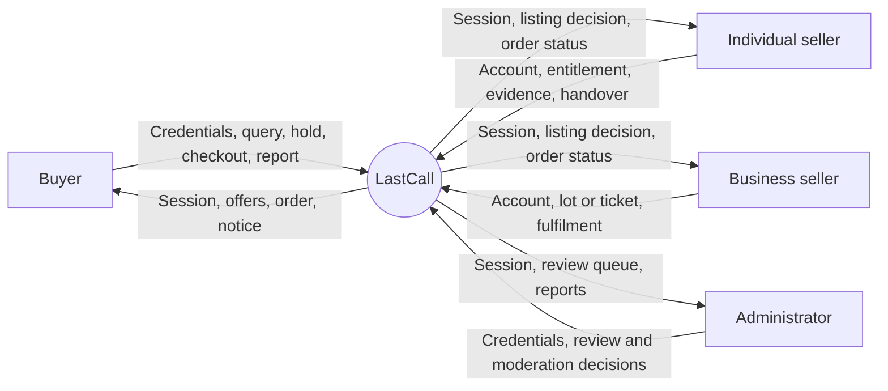

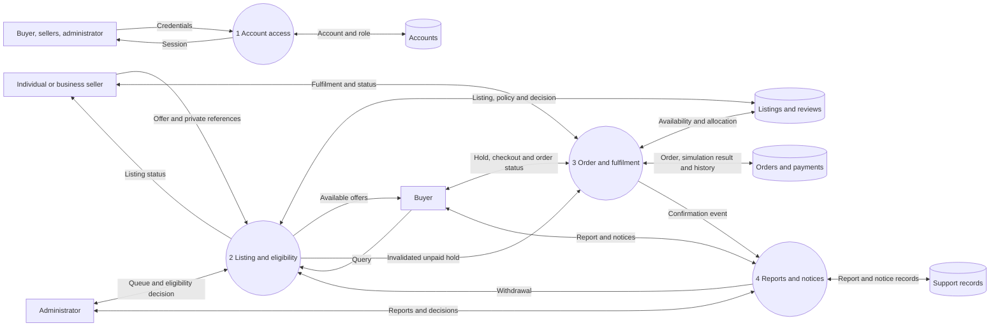

### A.2 Use case diagram and descriptions

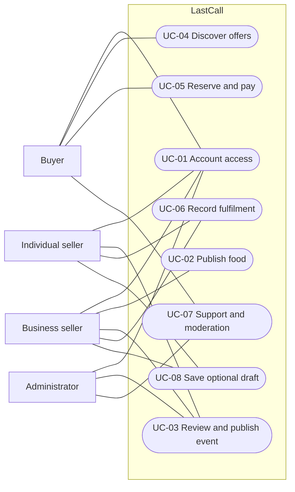

| ID | Use case / actors | Precondition | Main scenario | Exception and postcondition |
|---|---|---|---|---|
| UC-01 | Access account · all roles | Public registration or designated account exists | Register buyer → sign in → open permitted functions. A buyer may activate individual selling. | Duplicate address, invalid password or unauthorized role change yields no new access. |
| UC-02 | Publish food · business seller | Business privilege; future collection window | Enter quantity, price, cutoff and location → validate → publish. | Incomplete or invalid lot stays unpublished. |
| UC-03 | Publish event · seller and administrator | Fictional policy and ownership reference | Submit details → pending queue → administrator checks rule, ownership, method and time → approve → offer becomes visible. | Reject or leave unresolved if evidence fails; decision is attributable. |
| UC-04 | Discover offers · buyer | Catalogue available | Browse → optionally filter by category → open price and fulfilment terms. | An empty result shows no offers; expired saved link has no reservation action. |
| UC-05 | Reserve and simulate payment · buyer | Signed in; another seller owns an available unit | Select → acquire hold → see locked amount and deadline → simulate success → see confirmation. | Conflict returns unavailable; decline or timeout closes hold. A retry cannot duplicate a purchase. |
| UC-06 | Fulfil order · listing seller | Confirmed order; applicable window open | Locate order → record collection or approved event handover → order becomes fulfilled. | Wrong seller or method denied; unfulfilled order becomes Missed at deadline. |
| UC-07 | Report, moderate and inspect status · buyer, administrator | Signed in; listing or own order exists | Buyer reports an offer → administrator assesses report → uphold and withdraw unsold offer or dismiss; buyer can view own confirmation notice. | Existing completed sale remains in history. Optional rating requires the buyer’s fulfilled order. |
| UC-08 | Save optional category draft · sellers | Signed in; optional form enabled | Select category → enter travel or merchant fields → save → retrieve draft. | Missing terms remain unknown; attempts to publish are denied. |

### A.3 Activity diagrams

**Food lot from publication to collection (UC-02, UC-05, UC-06).**

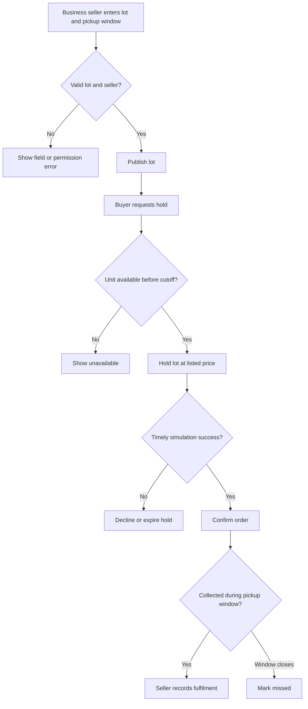

**Event review and handover (UC-03, UC-05, UC-06).**

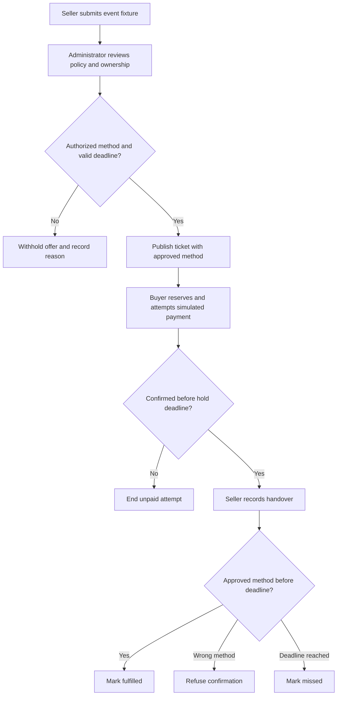

### A.4 Class diagram (design)

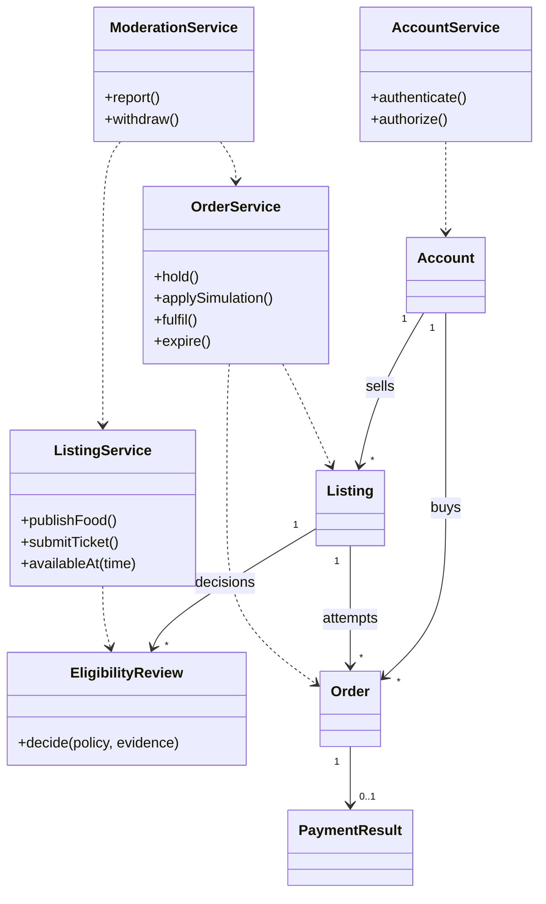

The single application hosts these services. The simulator supplies outcomes to OrderService. Withdrawing a listing and voiding an unpaid hold share a transaction. Historical orders remain queryable through their original identifiers.

### A.5 Sequence diagrams

**Review a proposed event ticket.**

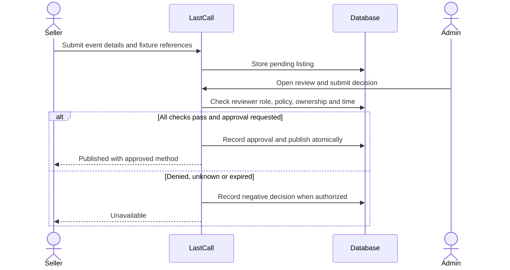

**Reserve a unit and resolve simulated payment.**

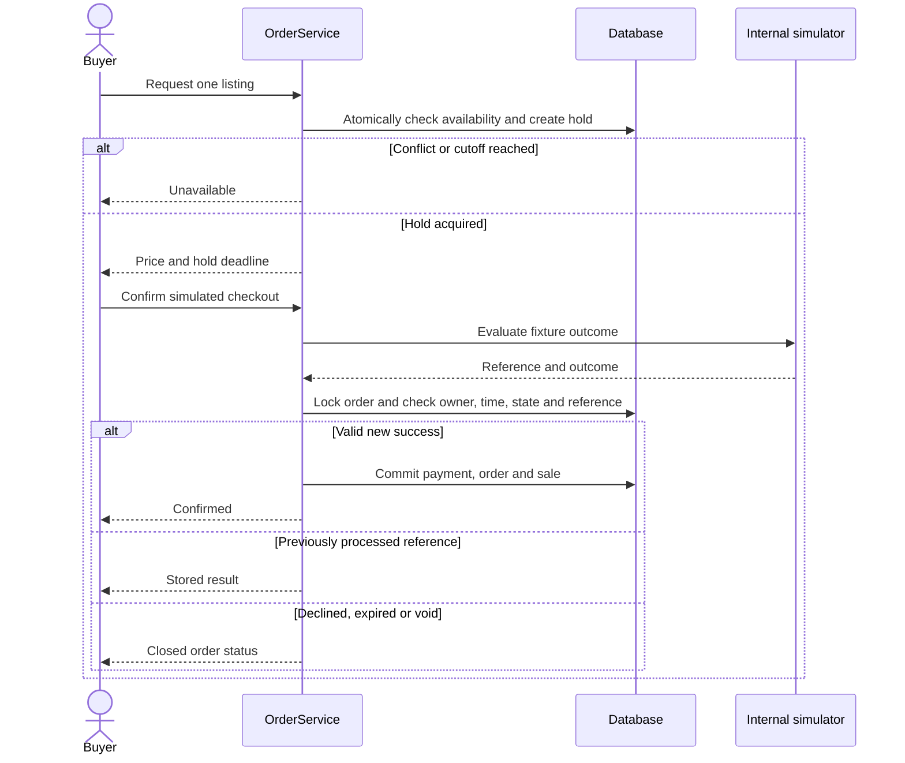

### A.6 State machine diagrams

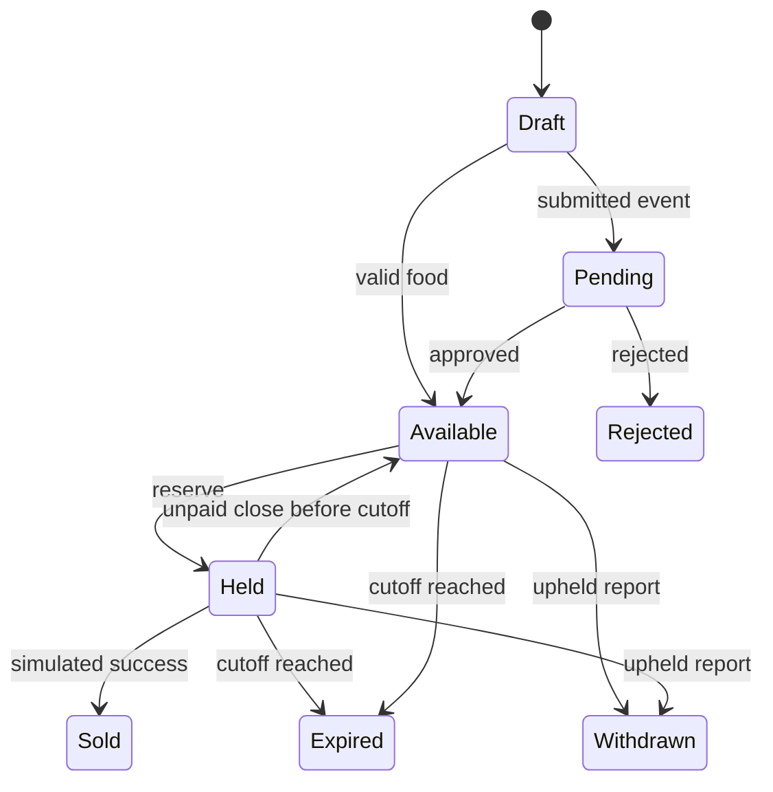

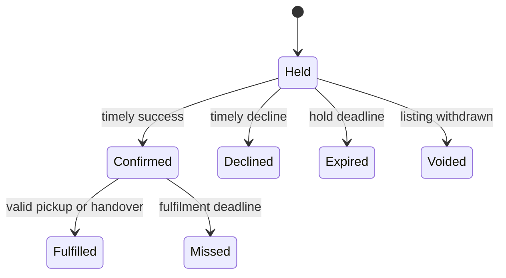

A past-cutoff pending event is never approved. Draft-only categories have no publication transition. Sale consumes the listing even when a confirmed order later becomes Missed.

### A.7 Database schema (ERD)

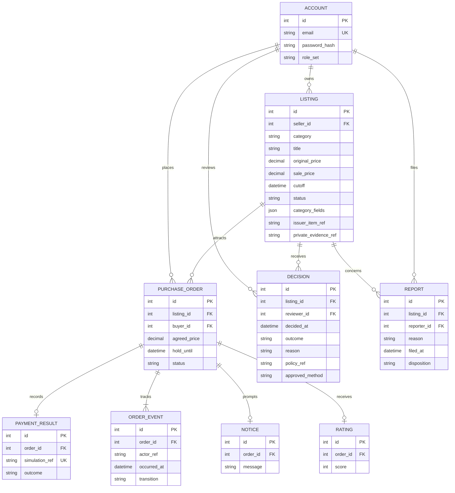

Category fields use the contracts in section 4. Restricted references are never included in the public projection. Order uniqueness, price precision and exclusive allocation are enforced at the database transaction boundary. Each payment, notice and optional rating belongs to one order; their order foreign keys are individually unique.

**Proposed deployment view.** A browser connects to one lab web host over HTTPS. The simulator runs inside the application. An access-restricted snapshot is stored separately for recovery.

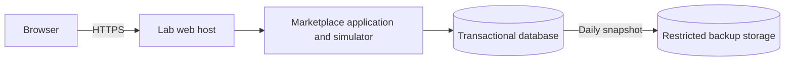

## Appendix B — Requirements traceability matrix

Each TC identifier describes a proposed acceptance check, not an executed test. A dash means that no Jira link was supplied. Status describes the proposal; implementation and test outcomes are unverified.

| Requirement | Use case | Jira story | Design element | Test case | Status |
|---|---|---|---|---|---|
| FR-AUTH-01 | UC-01 | — | AccountService | TC-01 — Submit a new address; verify a buyer account exists. | Proposed |
| FR-AUTH-02 | UC-01 | — | AccountService | TC-02 — Enter a wrong password; verify no session is issued. | Proposed |
| FR-AUTH-03 | UC-01 | — | AccountService | TC-03 — Sign in and open the account view. | Proposed |
| FR-USER-01 | UC-01 | — | AccountService | TC-04 — Request each privileged role through self-service; verify denial. | Proposed |
| FR-USER-02 | UC-01 | — | AccountService | TC-05 — Activate the seller profile and open the ticket submission form. | Proposed |
| FR-FOOD-01 | UC-02 | — | ListingService | TC-06 — Try identical submissions with business and individual accounts. | Proposed |
| FR-FOOD-02 | UC-02 | — | ListingService | TC-07 — Omit each required field in turn; expect rejection. | Proposed |
| FR-FOOD-03 | UC-02 | — | ListingService | TC-08 — Submit a complete discounted lot with future pickup; find it in the catalogue. | Proposed |
| FR-EVENT-01 | UC-03 | — | EligibilityReview | TC-09 — Submit a valid fixture; verify it remains absent from the catalogue. | Proposed |
| FR-VERIFY-01 | UC-03 | — | EligibilityReview | TC-10 — Use unknown, prohibited, identity-bound and missing-evidence fixtures; each stays unavailable. | Proposed |
| FR-VERIFY-02 | UC-03 | — | EligibilityReview | TC-11 — Approve an eligible fixture; verify public listing and transfer method. | Proposed |
| FR-VERIFY-03 | UC-03 | — | EligibilityReview | TC-12 — Reject a submission; inspect the decision record. | Proposed |
| FR-EVENT-03 | UC-03 | — | EligibilityReview | TC-13 — Submit duplicate references from two seller accounts. | Proposed |
| FR-LIST-01 | UC-04 | — | ListingService | TC-14 — Try zero, equal, higher and discounted prices. | Proposed |
| FR-LIST-02 | UC-04 | — | ListingService | TC-15 — Submit at the cutoff and one instant later. | Proposed |
| FR-SEARCH-01 | UC-04 | — | ListingService | TC-16 — Mix draft, pending, held, expired, withdrawn, sold and open listings; only open eligible stock appears. | Proposed |
| FR-SEARCH-02 | UC-04 | — | ListingService | TC-17 — Filter mixed stock by food and then by event. | Proposed |
| FR-ORDER-01 | UC-05 | — | OrderService | TC-18 — Race two distinct buyers for one listing; count active holds. | Proposed |
| FR-ORDER-02 | UC-05 | — | OrderService | TC-19 — Acquire a hold ten minutes and then two minutes before cutoff. | Proposed |
| FR-ORDER-03 | UC-05 | — | OrderService | TC-20 — Allow a hold to lapse before cutoff and reserve as a second buyer. | Proposed |
| FR-ORDER-04 | UC-05 | — | OrderService | TC-21 — Compare the recorded order amount with the exact displayed BDT price at acquisition. | Proposed |
| FR-ORDER-05 | UC-05 | — | OrderService | TC-22 — Try self-reservation from a seller session. | Proposed |
| FR-PAY-01 | UC-05 | — | OrderService | TC-23 — Apply success to a live hold; read Confirmed. | Proposed |
| FR-PAY-02 | UC-05 | — | OrderService | TC-24 — Apply decline; verify Declined and availability of the eligible listing. | Proposed |
| FR-PAY-03 | UC-05 | — | OrderService | TC-25 — Apply success exactly at expiry; verify no confirmation. | Proposed |
| FR-PAY-04 | UC-05 | — | OrderService | TC-26 — Replay the successful result; count one confirmation. | Proposed |
| FR-ORDER-06 | UC-06 | — | OrderService | TC-27 — As listing seller try before start, at start and at end using separate confirmed orders. | Proposed |
| FR-EVENT-02 | UC-06 | — | OrderService | TC-28 — Try an unapproved method, an expired handover and an allowed timely handover. | Proposed |
| FR-ORDER-07 | UC-06 | — | OrderService | TC-29 — Attempt fulfilment as the buyer and as another seller. | Proposed |
| FR-ORDER-08 | UC-06 | — | OrderService | TC-30 — Read an unfulfilled confirmed food or ticket order at its deadline. | Proposed |
| FR-NOTIFY-01 | UC-07 | — | ModerationService | TC-31 — Confirm a demo payment and check that buyer’s notices. | Proposed |
| FR-ADMIN-01 | UC-07 | — | ModerationService | TC-32 — File a report; verify listing, reporter, reason and time. | Proposed |
| FR-ADMIN-02 | UC-07 | — | ModerationService | TC-33 — Uphold a report during a hold; verify no subsequent checkout succeeds. | Proposed |
| FR-REVIEW-01 | UC-07 | — | ModerationService | TC-34 — Try rating before fulfilment, from another user and twice after fulfilment. | Optional proposal |
| FR-TRANS-01 | UC-08 | — | ListingService | TC-35 — Round-trip a populated bus draft including operator and seat. | Optional proposal |
| FR-TRANS-02 | UC-08 | — | ListingService | TC-36 — Round-trip a train draft with class and passenger restrictions. | Optional proposal |
| FR-COUPON-01 | UC-08 | — | ListingService | TC-37 — Round-trip a coupon draft with discount, minimum spend and redemption status. | Optional proposal |
| FR-VOUCHER-01 | UC-08 | — | ListingService | TC-38 — Round-trip a balance-based voucher and an admission pass. | Optional proposal |
| FR-LIST-03 | UC-08 | — | ListingService | TC-39 — Submit bus, train, coupon, voucher, pass and unknown categories to publication directly. | Proposed |
| FR-COUPON-02 | UC-08 | — | ListingService | TC-40 — Save two drafts bearing the same issuer and token. | Optional proposal |
| NFR-PERF-01 | UC-04 | — | ListingService | TC-41 — Measure server response times on the documented demo host. | Proposed |
| NFR-SEC-01 | UC-01 | — | AccountService | TC-42 — Inspect stored credentials for two test accounts with the same password. | Proposed |
| NFR-SEC-02 | UC-07 | — | AccountService | TC-43 — Exercise the buyer, two sellers and administrator against order, evidence and moderation actions. | Proposed |
| NFR-SEC-03 | UC-01 | — | AccountService | TC-44 — Use a test clock to check the fifth failure and cooldown boundary. | Proposed |
| NFR-PRIV-01 | UC-03 | — | EligibilityReview | TC-45 — Inspect catalogue and direct listing responses for fixture evidence markers. | Proposed |
| NFR-REL-01 | UC-05 | — | OrderService | TC-46 — Interrupt the demo transaction and inspect order, listing and payment records. | Proposed |
| NFR-AVL-01 | UC-04 | — | Web host | TC-47 — Run 120 probes during the proposed session and record successes. | Proposed |
| NFR-USE-01 | UC-05 | — | Catalogue and checkout | TC-48 — Time four separately consented task attempts; count unaided completions. | Proposed |
| NFR-ACC-01 | UC-05 | — | Catalogue and checkout | TC-49 — Tab through discovery, hold and checkout; inspect focus and completion. | Proposed |
| NFR-MNT-01 | UC-05 | — | OrderService | TC-50 — Change five to two minutes and repeat a hold well before cutoff. | Proposed |
| NFR-COMP-01 | UC-05 | — | Catalogue and checkout | TC-51 — Complete the journey on each of four browser/width combinations. | Proposed |
| NFR-INT-01 | UC-05 | — | OrderService | TC-52 — Submit competing confirmations and count distinct successful purchases. | Proposed |
| NFR-REC-01 | UC-05 | — | Database backup | TC-53 — Restore a dated snapshot to a clean database; check age, elapsed time and order relationships. | Proposed |
| NFR-AUD-01 | UC-06 | — | OrderService | TC-54 — Reconstruct a hold, confirmation and fulfilment from the history using actor or system identity. | Proposed |

## Appendix C — Glossary · AI-use disclosure

| Term | Meaning in LastCall |
|---|---|
| Business seller | Account designated to represent a food business in the demonstration. |
| Entitlement | A right to travel, attend, redeem a discount or receive another benefit under an issuer’s conditions. |
| Fixture | Fictional item, account, policy or payment outcome supplied for a repeatable demonstration. |
| Fulfilment | Collection of a paid food lot or recorded handover by the approved method for an event ticket. |
| Issuer | Organization that sets the conditions for a ticket, pass, voucher or coupon. |
| Lot | The full quantity offered by one food listing and reserved as one unit. |
| Private evidence reference | Restricted identifier for a synthetic record reviewed in the demonstration. |
| Simulator | Internal component that provides a repeatable payment decision without transferring money. |

**AI-use disclosure.** OpenAI Codex used the coordinator’s brief and the faculty reference materials to draft the release proposal, requirements, diagrams and traceability matrix. The model generated the proposed acceptance cases. Student authorship, review, stakeholder validation and execution of tests are not recorded. The thresholds, role privileges, issuer assumptions and module split require human review before adoption.

**Open review decisions.** Confirm the two major journeys and expected minor modules with the team; validate food cutoff and collection rules with business users; review entitlement evidence and handover rules for each candidate category; select the lab stack, retention policy and acceptance targets. Jira issue links, Figma designs, individual contributions, stakeholder findings and measured outcomes can be added once evidence exists.
