# Software Requirements Specification
## LastCall

**Version:** 0.2 · **Date:** 20 November 2026 · **Status:** Draft for scope and attribution review

**Course:** CSE 3412 — System Analysis and Design Lab · Section B · Fall 2026

**University:** United International University (UIU) · **Course teacher:** Rejwan Ahmed

**Team size:** 3 students

**Team name:** SAD-APJ

| Student ID | Student name | Proposed project role |
|---|---|---|
| 0112420631 | Ahanaf Abtahi | Project Manager & Lead System Analyst |
| 0112420327 | Shawli Sharmin Prionti | UI/UX Designer & Requirements Analyst |
| 0112420340 | Shahriar Alom Joy | System Designer & Quality Assurance Lead |

### Revision history

| Version | Date | Author | Changes |
|---|---|---|---|
| 0.1 | 2026-11-20 | Pending confirmation. Proposed coordinator: Ahanaf Abtahi. | Initial draft, prototype scope, models and proposed acceptance checks. |
| 0.2 | 2026-11-20 | Pending student confirmation | Revised full-system scope, category workflows, payment lifecycle, quality targets, models and traceability. |

## 1. Introduction

### 1.1 Purpose

This specification defines the behaviour, interfaces and acceptance criteria for LastCall. The project team and course evaluator can use it to review the intended marketplace and select a feasible demonstration. Appendix A shows the proposed design, and Appendix B links each requirement to a proposed acceptance check.

### 1.2 Scope

**A. Complete proposed system.** LastCall is a unified online marketplace for unused, time-sensitive products and entitlements. It supports surplus food, event tickets, unused bus and train tickets, discount coupons, gift vouchers, eligible digital passes and other transferable opportunities with category-specific rules. Buyers discover eligible offers, reserve available stock, pay and collect or receive the item through a permitted method. Sellers manage listings and fulfilment. Administrators review eligibility, fraud reports and disputes. Payment providers and issuers participate where approved.

**B. Academic prototype.** The proposed baseline uses synthetic accounts, item records and issuer policies. Food collection and event-ticket handover are the two major journeys. The minor scope adds filtering, notices and moderation. A simulated payment provider supplies repeatable success, decline, expiry and replay cases. Each sample listing contains one sellable unit. The team has yet to approve this split.

| MoSCoW | Academic prototype scope |
|---|---|
| Must Have | Account access, category and eligibility gates, food publication and event-ticket review, catalogue, exclusive hold per unit, simulated checkout, pickup or permitted fixture handover, and expiry. |
| Should Have | Category filtering, in-app confirmation notices, fraud reporting and withdrawal of unfulfilled stock. |
| Could Have | One synthetic end-to-end transport or merchant-entitlement journey using the same eligibility and transfer rules, and ratings for fulfilled orders. |
| Won't Have in this prototype | Real funds or refunds, real identity or entitlement documents, live issuer or payment APIs, and public sale of actual tickets or merchant entitlements. Full-system requirements in this group remain part of the product specification. |

**C. Future enhancements.** Cross-border currency support, native apps, physical delivery and automatic onboarding of new issuers can be evaluated after the complete system's core workflows are feasible. Actual availability of a lawful transfer or redemption channel is a dependency of the complete system. It does not make the corresponding marketplace category an optional form.

Prototype goals are to demonstrate one completed food pickup and one permitted ticket handover, deny every prohibited or unknown-policy fixture in the acceptance set, and evaluate the discovery-to-reservation task using NFR-USE-01. Marketplace impact measures could include collected food quantities, completed transfers and buyer savings. No impact measurements are available.

| Priority | Proposed release boundary |
|---|---|
| Must Have | Business food listings; review of fictional event-ticket transfer evidence; discovery, exclusive reservation, simulated checkout, collection or handover, and expiry controls. These are the proposed baseline commitments, subject to team approval. |
| Should Have | Category filtering, buyer order-status notices, reporting and administrator withdrawal of unsafe or misleading listings. |
| Could Have | Draft-only category forms for bus, train, coupons, vouchers and digital passes; verified-order feedback. Optional work follows the two core journeys. |
| Won't Have for this release | Public sale of travel tickets or merchant entitlements, real payments/refunds, identity-document collection, issuer account access, live redemption checks, delivery logistics or automatic verification of ownership. |

Proposed evaluation objectives: (G1) demonstrate collection of one discounted food lot within its pickup window; (G2) demonstrate one permitted fictional ticket handover while denying publication of every prohibited or unknown-policy case in the acceptance set; (G3) let at least three of four first-time participants locate an eligible offer and reserve it unaided within three minutes. A future impact study could measure collected lots and the difference between original and sale prices. No waste reduction, savings or adoption rate has been measured.

### 1.3 Definitions, acronyms and abbreviations

| Term | Meaning |
|---|---|
| SRS / FR / NFR | Software requirements specification / functional requirement / non-functional requirement. |
| UC / RTM | Use case / requirements traceability matrix. |
| MoSCoW | Must, Should, Could and Won't for the current release. |
| DFD / ERD | Data flow diagram / entity relationship diagram. |
| BDT | Bangladesh taka, the proposed display currency. |
| Hold | Temporary exclusive claim by one buyer on a sellable unit. |
| Cutoff | First instant at which new reservations cease. The cutoff caps the payment hold window. |
| STRIDE | Spoofing, tampering, repudiation, information disclosure, denial of service and elevation of privilege. |

### 1.4 References

- **Brief:** LastCall SRS revision request, particularly §§3–10 for scope, eligibility, payments and quality requirements. The original project brief supplies the marketplace objectives and academic team constraints.
- **Faculty:** UIU CSE 3412 Section B `templates/SRS-template.md`, HealthBridge BD sample SRS, `course/rubrics.md` (P2–P7), and Weeks 4–8, 10 and 11 assignments. These govern structure, models and traceability.
- **Design:** Rationale derived from the proposed use cases in Appendix A. Stakeholder interviews, survey results, actual issuer permissions, an approved feasibility decision, Figma and Jira links are pending evidence.

- **Faculty:** UIU CSE 3412 Section B course resources, `templates/SRS-template.md`, HealthBridge BD sample SRS, `course/rubrics.md` (P2–P7), and Weeks 4–8, 10 and 11 assignments. The sample informs format; the weekly assignments specify the diagram and validation deliverables.
- **Design:** Proposed rules derived in this draft, identified by UC in Appendix A. Durations, thresholds, fixtures and technical choices need team review. No interviews, survey results, benchmark findings, issuer permissions or approved feasibility decision were supplied as sources.

### 1.5 Overview

Sections 2–3 describe the marketplace participants and interfaces. Sections 4–6 specify behaviour, quality and operating requirements. Appendices A–C contain the models, traceability matrix, glossary and AI-use disclosure.

## 2. Overall description

### 2.1 Product perspective

LastCall mediates sales by business and individual sellers. Food moves through collection, while a ticket or entitlement moves through an issuer-permitted transfer. The platform records the evidence and fulfilment outcome. Issuers remain the authority for transfer, passenger identity and redemption. An approved payment provider is the authority for real payment outcomes. Appendix A.1 defines these boundaries, including the prototype substitutes.

### 2.2 Product functions

- **Listing:** Sellers submit time-sensitive offers. A business seller can publish a valid food lot. An entitlement enters review before publication.
- **Purchase:** Buyers find reservable offers, hold available units, accept the quoted price, pay and track collection or transfer.
- **Verification and support:** Reviewers check eligibility, record expiry or invalidation, handle reports and disputes and review refunds against policy.
- **Academic major/minor split:** Major workflows are food purchase and event-ticket purchase through fulfilment. Minor workflows are catalogue filtering, order notices and moderation. An optional transport or merchant fixture exercises an additional end-to-end path.

- **Major — event ticket:** submit an event listing with evidence, review its transfer conditions, then reserve, simulate payment and record the permitted handover of one fictional ticket.
- **Minor:** filter available offers, inspect order notices, report a listing and record a moderation decision. Authentication and authorization underpin both major journeys.
- **Extension:** capture category-specific details behind a draft-only gate; enable a new category for trading only in a later, separately approved release.

### 2.3 User classes and characteristics

| User class | Description | Technical skill | Frequency of use |
|---|---|---|---|
| Buyer | Compares price and remaining time, reserves and pays, accepts the permitted collection or transfer. | Basic browser skills assumed. | Per purchase. |
| Individual seller | Lists entitlements held in their name, supplies evidence and carries out permitted handover. | Basic form entry assumed. | Per available item. |
| Business seller | Lists food lots, manages pickup and may submit eligible entitlements. | Repeated form and order handling. | Per lot or order. |
| Administrator | Reviews evidence, eligibility, reports, refund requests and disputes. | Trained in category and provider policies. | Per submission or case. |

A buyer may also hold seller permissions. Issuers and payment providers are external actors. Usage patterns are design assumptions pending stakeholder validation.

|---|---|---|---|
| Buyer | Compares offers by price and remaining time; reserves one lot or ticket. | Basic mobile-browser skills assumed. | Per purchase. |
| Individual seller | Submits a personally held entitlement and its transfer evidence. | Basic form entry assumed. | Occasional listing. |
| Business seller | Posts food lots and pickup windows; may also submit eligible event tickets. | Repeated listing and order handling. | Per lot and collection. |
| Administrator | Reviews restricted listings and resolves reports using private evidence. | Trained in the review rules. | Per submission or report. |

Frequency and skill describe design personas pending stakeholder validation. A buyer may also hold seller permissions. Business and administrator privileges are assigned to designated demo accounts, never selected through public registration.

### 2.4 Operating environment

LastCall is a responsive web application for mobile and desktop browsers. The prototype can use one application and a transactional data store. Framework, database product, hosting and supported browser versions require a feasibility decision. Server time governs cutoffs. Display local collection and departure times with their time zones.

### 2.5 Design and implementation constraints

The three-member team can demonstrate the prototype without a paid integration. Prices are recorded to minor-unit precision with their currency. BDT and an English interface with Unicode support for Bangla names and locations are proposed for the first deployment. Physical lots may have multiple separately sellable units. An entitlement may be divided only when the issuer defines each independently transferable unit. The prototype uses one unit per listing to make concurrent reservation tests repeatable.

### 2.6 Assumptions and dependencies

Full-system activation depends on approved category policies, accepted payment and refund terms, an available verification route and documented privacy controls. Automated issuer calls require an approved interface. A manual route is acceptable only where the issuer authorizes it and reviewers can record reliable evidence of status and permission. Unknown status prevents publication or transfer when the governing rule requires verification. The prototype uses deterministic outcomes and synthetic evidence while these dependencies remain open.

## 3. External interface requirements

### 3.1 User interfaces

| Screen | Information and user action |
|---|---|
| Account and sign-in | Register, sign in and access authorized buyer or seller actions. |
| Catalogue and listing detail | Filter by category and show price, time zone, remaining availability and pickup, transfer or redemption terms. An expired link shows an unavailable state. |
| Seller listing editor | Enter the relevant category contract and submit required evidence privately. See review status and correction reasons. |
| Review desk | Check source, validity, permitted transfer, private evidence, status and reports. Record a decision with a reason. |
| Reservation and checkout | Show the price snapshot, hold deadline, payment status and actions for an eligible order. Clearly identify simulation in the prototype. |
| Order detail and support | Show order, payment and fulfilment status to authorized participants. Accept cancellation, invalidation and dispute reports where applicable. |

Primary journeys require keyboard access, visible focus, field labels and text status messages. The Figma link is pending.

|---|---|
| Account and sign-in | Register or sign in; expose actions allowed by the account role. |
| Catalogue and listing detail | Show category, seller, original and discounted BDT prices, availability cutoff, local time, and collection or handover terms. Expired deep links show an unavailable state. |
| Seller listing editor | Choose category; enter its mandatory fields. Highlight invalid fields without discarding the remaining input. Indicate draft, pending or published state. |
| Review desk | Show restricted evidence, decision reason and method of permitted handover to the administrator. |
| Reservation and checkout | Show hold deadline, price snapshot and clearly labelled simulated payment; distinguish declined, expired and confirmed outcomes. |
| Order detail and reports | Show buyer or seller the current order state and applicable collection or handover action. Accept reports about a listing. |

Keyboard access, visible focus, field labels and text status messages apply to the primary journeys. No approved Figma link was supplied.

### 3.2 Hardware interfaces

The browser needs a display and keyboard or touch input. The host needs persistent storage for listings, orders and backups. No scanner, printer, payment terminal or GPS device is required.

### 3.3 Software interfaces

| Interface | Required exchange and dependency |
|---|---|
| Browser and application | Structured listing, reservation, payment, order and review data with validation feedback. |
| Persistent store | Transactional allocation, orders, payment attempts, refunds, eligibility decisions and audit events. |
| Payment provider | Initiate payment for a frozen amount and currency. Use an approved provider entry point for payment credentials. Authenticate outcomes against the order and attempt. Reconcile unresolved transfers and submit approved refunds. Provider and interface contract are pending. The prototype supplies these outcomes through a simulator. |
| Issuer or operator | Validate ownership, validity and policy where supported. Record authorized transfer, invalidation or redemption evidence. The sanctioned alternative is a documented manual check against issuer evidence. API and policy availability are unresolved. |

### 3.4 Communication interfaces

Shared deployments require HTTPS for browser and approved external traffic. Provider result messages require authentication, correlation to the stored attempt and replay handling. In-app notifications and order lookup provide an authoritative status after a network timeout. Additional delivery channels depend on consent and service availability.

## 4. Functional requirements

**Applicability.** Every row describes the complete proposed system unless marked prototype-only. Priority is the academic prototype MoSCoW priority. Won't identifies behaviour specified for the complete system that is outside the prototype. Should and Could behaviours become prototype acceptance criteria only if adopted.

**Listing and stock.** A listing records seller, category, title, original and sale prices in the same currency, stock, and a future sales cutoff. Food records a description, units or portions, pickup location and window, and a seller-declared suitability limit. Pickup start is inclusive. Pickup end, transfer deadline, sales cutoff and hold deadline are exclusive. A sale cutoff cannot exceed the end of the usable handover window. Each sale unit represents a separately purchasable lot, ticket or transferable entitlement. Stock and checkout operate on that unit. Payment success consumes it once; refund, missed collection and invalidation do not automatically restock it.

**Entitlement fields.** Events record issuer, event, venue, start time, seat or admission type and permitted handover. Bus and train records include operator or issuing authority, service number, origin, destination, departure timestamp and time zone, seat or class, applicable passenger restrictions and booking reference. Coupons record issuer, benefit type and value, minimum spend where applicable, usage and eligibility conditions, expiry and evidence of remaining uses. Gift vouchers add denomination and evidenced remaining balance or uses. Digital passes record included rights and validity windows. Other opportunities require an approved category contract before any listing is eligible.

**Decision evidence.** Every non-food listing identifies its issuer, canonical opaque item reference, proof of seller authority, validity interval, specific resale permission, supported handover, and applicable identity and redemption rules. Authorization may rely on an approved issuer interface or a documented issuer-accepted manual route. The reviewer records the source and observed status. Seller claims alone leave the status unknown. Refuse publication when an applicable rule is unknown, prohibited, expired, used up, mismatched or otherwise unsatisfied. A permitted passenger reassignment follows the issuer's own process. An expired approval or adverse status prevents further sale.

**Payment and fulfilment.** Reserve at the price shown when the hold is acquired. The configured hold duration and cutoff cap the hold. Record each provider attempt separately. A result affects an order only after authenticating the source and matching attempt, amount and currency. Apply a timely successful result atomically to the order and its unit. An already successful order cannot be confirmed twice. A distinct verified payment received too late or after another attempt confirmed the order goes to refund review without changing allocation. A decline or expiry closes the attempt, and a terminal unpaid order releases an otherwise eligible unit. Fulfilment uses the channel recorded at approval. Collect food within its window. Transfer only with current eligibility and confirmation from the authorized party. Any posted redemption balance or use count retains its issuer evidence. This platform cannot infer usage outside its own records.

**Moderation and exceptions.** A confirmed invalidation withdraws the affected unit and voids its unpaid hold. It opens exception review for a paid unresolved order. A report alone does not cancel a valid sale. Approved refunds are processed against the original payment, with a separate recorded outcome. A prior fulfilment remains in the audit history if later disputed.

### 4.1 Account access and roles

**Description.** Account access protects both buyer and seller activities.

**Stimulus/response sequence.** A visitor registers or signs in. The server applies the permissions assigned to the account.

| ID | Requirement | Priority | Source (use case / interview) |
|---|---|---|---|
| FR-AUTH-01 | The system shall create a buyer account for a previously unused email address. | Must | Design, UC-01 |
| FR-AUTH-02 | The system shall reject a sign-in attempt with an incorrect password. | Must | Design, UC-01 |
| FR-AUTH-03 | The system shall issue an authenticated session for a registered account with valid credentials. | Must | Design, UC-01 |
| FR-USER-01 | The system shall deny public requests to grant business-seller or administrator privileges. | Must | Design, UC-01 |
| FR-USER-02 | The system shall permit a registered buyer to activate individual-seller access on their own account. | Must | Design, UC-01 |

### 4.2 Surplus food

**Description.** Business sellers offer food lots before the end of a declared pickup window.

**Stimulus/response sequence.** The seller enters the food contract. A valid submission publishes available stock; validation failures leave the offer unpublished.

| ID | Requirement | Priority | Source (use case / interview) |
|---|---|---|---|
| FR-FOOD-01 | The system shall restrict food publication to business-seller accounts. | Must | Brief §3, UC-02 |
| FR-FOOD-02 | The system shall reject food publication if any field in the food listing contract is missing or invalid. | Must | Brief §3, UC-02 |
| FR-FOOD-03 | The system shall publish a valid food lot submitted by a business seller. | Must | Brief §3, UC-02 |

### 4.3 Event tickets and eligibility

**Description.** An eligibility decision controls access to the catalogue for every entitlement category.

**Stimulus/response sequence.** The seller submits evidence. A reviewer checks the applicable issuer rule before making the listing available.

| ID | Requirement | Priority | Source (use case / interview) |
|---|---|---|---|
| FR-EVENT-01 | The system shall place a complete event-ticket submission in Pending review. | Must | Brief §§3, 5–6, UC-03 |
| FR-VERIFY-01 | The system shall refuse entitlement approval when the decision evidence fails the applicable category checklist. | Must | Brief §§3, 5–6, UC-03 |
| FR-VERIFY-02 | The system shall publish a pending entitlement after a current authorized approval for an enabled category. | Must | Brief §§3, 5–6, UC-03 |
| FR-VERIFY-03 | The system shall record each eligibility decision with reviewer, time, outcome and reason. | Must | Brief §§3, 5–6, UC-03 |
| FR-EVENT-03 | The system shall reject an entitlement publication when its canonical issuer-item reference already has an open listing or a previously transferred right without fresh authorization. | Must | Brief §§3, 5–6, UC-03 |

### 4.4 Listing controls and discovery

**Description.** Buyers see only stock that is eligible and currently reservable.

**Stimulus/response sequence.** The catalogue applies the category and availability rules using server time.

| ID | Requirement | Priority | Source (use case / interview) |
|---|---|---|---|
| FR-LIST-01 | The system shall reject publication unless the sale price is greater than zero and below the stated original price. | Must | Brief §§3–4, UC-04 |
| FR-LIST-02 | The system shall refuse reservations at or after the listing cutoff. | Must | Brief §§3–4, UC-04 |
| FR-SEARCH-01 | The system shall return only currently reservable listings in the public catalogue. | Must | Brief §§3–4, UC-04 |
| FR-SEARCH-02 | The system shall restrict catalogue results to the category selected by the buyer. | Should | Brief §§3–4, UC-04 |
| FR-LIST-04 | The system shall remove any unit from reservable stock when its recorded eligibility expires. | Won't | Brief §§3–4, UC-04 |

### 4.5 Reservation and payment

**Description.** Allocation stays exclusive per unit while an authenticated payment outcome is recorded.

**Stimulus/response sequence.** The buyer selects one unit and pays the reserved amount. The system checks the result against the active hold before confirming the order.

| ID | Requirement | Priority | Source (use case / interview) |
|---|---|---|---|
| FR-ORDER-01 | The system shall grant at most one active hold on the same sale unit at any instant. | Must | Brief §7, UC-05 |
| FR-ORDER-02 | The system shall set the hold deadline to the earlier of the configured hold interval after acquisition and the unit's sales cutoff. | Must | Brief §7, UC-05 |
| FR-ORDER-03 | The system shall release the unit of an expired unpaid hold when that unit remains otherwise eligible for reservation. | Must | Brief §7, UC-05 |
| FR-ORDER-04 | The system shall bind the order price to the listing sale price at reservation time. | Must | Brief §7, UC-05 |
| FR-ORDER-05 | The system shall reject an attempt by a seller to reserve their own listing. | Must | Brief §7, UC-05 |
| FR-PAY-01 | The system shall confirm an order upon verified payment success received before the hold deadline if the eligible unit remains allocated to that hold. | Must | Brief §7, UC-05 |
| FR-PAY-02 | The system shall close an active unpaid order as Declined when its current attempt returns a verified decline. | Must | Brief §7, UC-05 |
| FR-PAY-03 | The system shall refuse a new payment attempt after its order's hold deadline. | Must | Brief §7, UC-05 |
| FR-PAY-04 | The system shall return the previously recorded disposition for a replay of the same verified provider outcome. | Must | Brief §7, UC-05 |
| FR-PAY-05 | The system shall initiate at most one provider payment attempt for the same checkout request key. | Must | Brief §7, UC-05 |
| FR-PAY-06 | The system shall reject an incoming payment outcome that fails source authentication or does not match the stored attempt, amount and currency. | Must | Brief §7, UC-05 |
| FR-PAY-07 | The system shall record the status of each payment attempt against its order. | Must | Brief §7, UC-05 |
| FR-PAY-08 | The system shall send an unapplied verified successful payment to refund review if the order cannot be confirmed. | Won't | Brief §7, UC-11 |
| FR-ORDER-09 | The system shall release the unit of a declined unpaid order when that unit remains eligible for reservation. | Must | Brief §7, UC-05 |
| FR-ORDER-11 | The system shall grant a reservation to an eligible signed-in buyer when the chosen unit is available before cutoff. | Must | Brief §7, UC-05 |

### 4.6 Collection and handover

**Description.** A confirmed buyer receives the food or entitlement through the permitted channel.

**Stimulus/response sequence.** An authorized party records pickup or handover within the permitted window. Expired windows close unfulfilled orders.

| ID | Requirement | Priority | Source (use case / interview) |
|---|---|---|---|
| FR-ORDER-06 | The system shall accept collection of a confirmed food order only within its stated pickup window. | Must | Brief §§3, 5–6, UC-06 |
| FR-EVENT-02 | The system shall accept fulfilment of a confirmed event order only by the approved method while issuer eligibility remains current and the transfer window is open. | Must | Brief §§3, 5–6, UC-06 |
| FR-ORDER-07 | The system shall restrict fulfilment confirmation to the authorized actor for the approved channel. | Must | Brief §§3, 5–6, UC-06 |
| FR-ORDER-08 | The system shall mark a confirmed unfulfilled order Missed at the end of its fulfilment window. | Must | Brief §§3, 5–6, UC-06 |
| FR-ORDER-12 | The system shall record a confirmed order as Fulfilled upon accepted collection or authorized handover. | Must | Brief §§3, 5–6, UC-06 |

### 4.7 Notices, fraud reports and ratings

**Description.** Participants can see order outcomes and flag questionable listings.

**Stimulus/response sequence.** The buyer sees confirmation and can report the offer; the administrator reviews the report and may withdraw affected unsold stock.

| ID | Requirement | Priority | Source (use case / interview) |
|---|---|---|---|
| FR-NOTIFY-01 | The system shall display an in-app notice to the buyer when an order is confirmed. | Should | Brief §§6–7, UC-07 |
| FR-ADMIN-01 | The system shall record a signed-in user's report against the selected listing. | Should | Brief §§6–7, UC-07 |
| FR-ADMIN-02 | The system shall withdraw affected unsold units when an administrator upholds a listing fraud report. | Should | Brief §§6–7, UC-07 |
| FR-ADMIN-03 | The system shall void the unpaid hold of a withdrawn unit. | Should | Brief §§6–7, UC-07 |
| FR-REVIEW-01 | The system shall accept at most one buyer rating for each fulfilled order from its purchasing account. | Could | Brief §§6–7, UC-07 |

### 4.8 Bus and train tickets

**Description.** Travel listings depend on the operator or issuing authority permitting transfer of the specific booking.

**Stimulus/response sequence.** The seller enters the route and booking evidence. A reviewer checks ownership, identity rules, validity and permitted handover before approval.

| ID | Requirement | Priority | Source (use case / interview) |
|---|---|---|---|
| FR-TRANS-01 | The system shall save a bus listing draft with the transport fields for the selected bus service. | Could | Brief §5, UC-08 |
| FR-TRANS-02 | The system shall save a train listing draft with the transport fields for the selected train service. | Could | Brief §5, UC-08 |
| FR-BUS-01 | The system shall accept a bus-ticket listing for review only when all required bus fields are present. | Could | Brief §5, UC-08 |
| FR-TRAIN-01 | The system shall accept a train-ticket listing for review only when all required train fields are present. | Could | Brief §5, UC-08 |
| FR-TRANS-03 | The system shall reject travel approval when the issuer does not permit the proposed passenger transfer for the supplied booking. | Could | Brief §5, UC-08 |
| FR-TRANS-04 | The system shall record issuer-accepted travel cancellation or invalidation against the affected unit. | Won't | Brief §5, UC-10 |
| FR-NOTIFY-02 | The system shall notify the buyer when their travel order receives an authoritative transfer, cancellation or expiry outcome. | Could | Brief §5, UC-10 |

### 4.9 Coupons, vouchers and other entitlements

**Description.** Merchant entitlements can be listed, searched, reserved, paid for and transferred under issuer restrictions.

**Stimulus/response sequence.** A seller enters benefit and usage terms. Review checks remaining rights, then the regular catalogue and order workflows handle the eligible item.

| ID | Requirement | Priority | Source (use case / interview) |
|---|---|---|---|
| FR-COUPON-01 | The system shall save a coupon listing draft with the required benefit, eligibility, expiry, minimum-spend and usage fields. | Could | Brief §§3, 6, UC-09 |
| FR-COUPON-02 | The system shall flag a duplicate issuer and canonical reference among active merchant listing submissions. | Could | Brief §§3, 6, UC-09 |
| FR-COUPON-03 | The system shall accept a coupon for review only when its single-use or multiple-use terms are recorded. | Could | Brief §§3, 6, UC-09 |
| FR-VOUCHER-01 | The system shall save a gift voucher draft with the denomination, expiry and applicable balance or use limit. | Could | Brief §§3, 6, UC-09 |
| FR-VOUCHER-02 | The system shall refuse voucher approval when required issuer-backed remaining balance or permitted uses are unknown or exhausted. | Could | Brief §§3, 6, UC-09 |
| FR-PASS-01 | The system shall accept a pass listing for review only when its issuer, included rights and validity windows are recorded. | Won't | Brief §§3, 6, UC-09 |
| FR-LIST-05 | The system shall deny publication of other opportunities until an approved category contract is enabled. | Won't | Brief §§3, 6, UC-09 |
| FR-LIST-03 | The system shall deny publication in the academic profile for categories outside its configured demonstration allowlist. | Must | Brief §§3, 6, UC-09 |
| FR-COUPON-04 | The system shall display the verified restrictions and remaining rights on the detail page of a reservable merchant entitlement. | Could | Brief §§3, 6, UC-04 |

### 4.10 External transfer, invalidation and redemption

**Description.** An entitlement changes hands through its approved issuer channel.

**Stimulus/response sequence.** After payment the authorized party carries out the transfer. The system records the issuer-supported outcome and updates future eligibility.

| ID | Requirement | Priority | Source (use case / interview) |
|---|---|---|---|
| FR-TRANSFER-01 | The system shall block completion when the issuer's approved transfer channel cannot establish current eligibility. | Could | Brief §§5–6, UC-10 |
| FR-TRANSFER-02 | The system shall record confirmed travel or merchant delivery only for the approved method with evidence associated with that paid order. | Could | Brief §§5–6, UC-10 |
| FR-TRANSFER-03 | The system shall withdraw an affected unsold unit when authoritative cancellation or invalidation makes it ineligible. | Won't | Brief §§5–6, UC-10 |
| FR-TRANSFER-04 | The system shall open an exception case when authoritative invalidation affects a confirmed unfulfilled order. | Won't | Brief §§5–6, UC-10 |
| FR-COUPON-05 | The system shall record a redemption status change only from approved issuer evidence linked to the entitlement. | Won't | Brief §§5–6, UC-10 |
| FR-VOUCHER-03 | The system shall apply the same issuer redemption event at most once to the recorded balance or use count. | Won't | Brief §§5–6, UC-10 |
| FR-NOTIFY-03 | The system shall notify the buyer when authorized delivery of a merchant entitlement completes. | Could | Brief §§5–6, UC-10 |
| FR-TRANSFER-05 | The system shall void an unpaid hold when authoritative invalidation makes its unit ineligible. | Won't | Brief §§5–6, UC-10 |

### 4.11 Disputes, refunds and reconciliation

**Description.** The full system resolves payment and fulfilment exceptions under documented policy.

**Stimulus/response sequence.** A participant opens a dispute or records an unmatched payment. An authorized decision determines whether to seek a refund through the provider.

| ID | Requirement | Priority | Source (use case / interview) |
|---|---|---|---|
| FR-ADMIN-04 | The system shall record an order dispute from an authorized participant with the source reason and order reference. | Won't | Brief §7, UC-11 |
| FR-PAY-09 | The system shall initiate an approved refund against its original payment up to the verified unrefunded amount. | Won't | Brief §7, UC-11 |
| FR-PAY-10 | The system shall record the verified provider outcome for an existing refund without creating another refund on replay. | Won't | Brief §7, UC-11 |
| FR-ORDER-10 | The system shall mark an unfulfilled order Cancelled after an authorized cancellation decision. | Won't | Brief §7, UC-11 |
| FR-NOTIFY-04 | The system shall notify the buyer when an approved refund reaches a verified terminal outcome. | Won't | Brief §7, UC-11 |
| FR-PAY-11 | The system shall reserve the unrefunded amount against concurrent pending refund requests. | Won't | Brief §7, UC-11 |

## 5. Non-functional requirements

The numeric profiles below are proposals for acceptance planning. The team will approve workloads, test environment and thresholds before treating them as release criteria. No measurements are available.

| Profile | Proposed acceptance conditions |
|---|---|
| Catalogue baseline and growth | 95th percentile at or below 2 seconds over 500 requests from 20 concurrent clients with 1,000 listings. Repeat with 5,000 listings for NFR-SCALE-01. Record environment and dataset. |
| Availability | At least 99 percent successful responses to one catalogue probe per minute in a scheduled two-hour demonstration. A production service window and target require separate agreement. |
| Sign-in throttling and holds | Evaluate throttling after five failures in five minutes. Select the observation window and rate-limit policy with attention to account lockout risk. Set the hold interval during feasibility review and always cap it at the sales cutoff. |
| Usability and browser coverage | At least three of four first-time participants complete reservation within three minutes. Test stable Chrome and Firefox at 360 and 1280 CSS pixels. |
| Recovery | Restore records no more than 24 hours old within 60 minutes of declaring the drill. Backup frequency and retention depend on the approved policy. |

| ID | Category | Requirement |
|---|---|---|
| NFR-PERF-01 | Performance | The system shall return catalogue responses within the approved 95th-percentile latency budget under the documented test load. |
| NFR-SEC-01 | Security | The system shall store each account password only as a salted adaptive password hash. |
| NFR-SEC-02 | Security | The system shall deny every protected action outside the caller’s role and object permissions. |
| NFR-SEC-03 | Security | The system shall apply a configured rate limit to repeated failed sign-ins within the approved observation window. |
| NFR-PRIV-01 | Privacy | The system shall omit private evidence, identity data and redemption credentials from every unauthenticated or unauthorized listing response. |
| NFR-REL-01 | Reliability | The system shall leave no partial order confirmation when a failure interrupts application of a verified payment before transaction commit. |
| NFR-AVL-01 | Availability | The system shall serve successful catalogue responses at the approved availability target over the documented service window. |
| NFR-USE-01 | Usability | The system shall allow at least three of four first-time participants to find and reserve a specified eligible offer unaided within three minutes each. |
| NFR-ACC-01 | Accessibility | The system shall allow completion of the reservation flow using only a keyboard with a visible focus indicator at each step. |
| NFR-MNT-01 | Maintainability | The system shall support changing the default hold duration through one configuration setting without editing transaction logic. |
| NFR-COMP-01 | Compatibility | The system shall support the discovery-to-checkout flow on each browser and viewport in the approved compatibility matrix. |
| NFR-INT-01 | Data integrity | The system shall preserve at most one confirmed purchase per sale unit across concurrent checkout attempts. |
| NFR-REC-01 | Backup and recovery | The system shall restore a consistent dataset within the approved recovery time and recovery point objectives in a recovery drill. |
| NFR-AUD-01 | Accountability | The system shall retain an attributable timestamped state-change record for every order transition. |
| NFR-SCALE-01 | Scalability | The system shall meet the catalogue latency budget without losing category filtering correctness at the approved larger catalogue size. |

### 5.1 Security and privacy (STRIDE-lite)

| Use case | Threat (S/T/R/I/D/E) | Mitigation | Requirement ID |
|---|---|---|---|
| UC-01 account access | S — impersonating a seller | Store adaptive password hashes and limit failed attempts. | NFR-SEC-01, NFR-SEC-03 |
| UC-08 review and UC-10 handover | T — unauthorized passenger reassignment or method change | Verify issuer permission and require the approved channel and current eligibility. | FR-TRANS-03, FR-TRANSFER-01, FR-TRANSFER-02 |
| UC-09 entitlement listing | T — fraudulent listing or invalid coupon | Check issuer authority and benefit terms. Flag canonical duplicates. | FR-VERIFY-01, FR-COUPON-02, FR-COUPON-03, FR-ADMIN-01 |
| UC-10 redemption | T — repeated or fabricated voucher redemption | Require evidence and apply each issuer event once. Off-platform duplicate redemption requires issuer controls. | FR-COUPON-05, FR-VOUCHER-03 |
| UC-05 checkout | T — price or payment outcome manipulation | Freeze the order amount and validate provider evidence against it. | FR-ORDER-04, FR-PAY-06, FR-PAY-04 |
| UC-06 fulfilment | R — participant disputes a recorded handover | Record an attributable order transition and preserve fulfilment evidence. | NFR-AUD-01, FR-TRANSFER-02 |
| UC-03 evidence review | I — unrelated account accesses private evidence | Restrict protected records by actor and object. Exclude them from unauthorized views. | NFR-SEC-02, NFR-PRIV-01 |
| UC-01 account access | D — repeated sign-ins consume resources | Throttle repeated attempts with configurable limits. Review denial-of-service risks when choosing the control. | NFR-SEC-03 |
| UC-07 moderation and UC-11 refunds | E — seller gains reviewer or refund authority | Deny self-granting of privileged roles and enforce server-side authority on actions. | FR-USER-01, NFR-SEC-02 |

## 6. Other requirements

### 6.1 Data retention

The complete system needs an approved retention schedule for order records, payment references, eligibility evidence, disputes and deletion requests. Limit evidence to the fields required to verify the transaction. Keep it separate from public content with restricted access. The prototype uses synthetic evidence and excludes usable barcodes, real passenger IDs and payment credentials. Retention of prototype records and consent materials needs faculty or team confirmation.

### 6.2 Backup and recovery

Backups cover transactional records and the private references required to reconstruct decisions. Access to backups is limited to the designated operator. Recovery is exercised on an isolated data store and checked for allocation and payment consistency. The schedule, retention duration and recovery objectives are pending feasibility review. Section 5 provides proposed recovery-drill values.

### 6.3 Legal and issuer restrictions

Activation requires review of applicable law and documented issuer permission for the specific product, sale and handover method. An issuer's refusal or inability to support transfer keeps the ticket or entitlement ineligible. Food collection follows the seller-declared window and applicable business obligations. A category can enter real operation only once lawful verification, custody, payment and refund processes are available. No particular operator, merchant or payment provider has been confirmed.

### 6.4 Data migration and dependencies

The prototype starts with fresh synthetic data. The full system has no confirmed migration source. A future import would need authorized records, field mapping, expiry checks and reconciliation of imported orders. Framework, storage engine, hosting, integrations and recovery operator are open design decisions.

### 6.5 Training requirements

The prototype orientation covers hold expiry and collection for buyers, cutoff and handover for sellers, and allowed, prohibited and unknown evidence for administrators. Full-system training adds issuer verification, redemption restrictions, payment exceptions and refund decisions. Evaluation can use a supervised acceptance exercise for each role.

## Appendix A — Analysis and design models

The models specify the complete proposed system. For the academic prototype, an approved test payment adapter and synthetic issuer policy can stand in for external services. The demonstrated listing can have a single sale unit.

### A.1 Context diagram and level 1 DFD

The context diagram shows LastCall as a single process. The level 1 DFD decomposes it into numbered processes. Rectangles represent external entities, circles represent processes, and cylinders represent data stores. Labels describe data that crosses each boundary. Issuer data may come through an approved interface or a documented authorized manual channel.

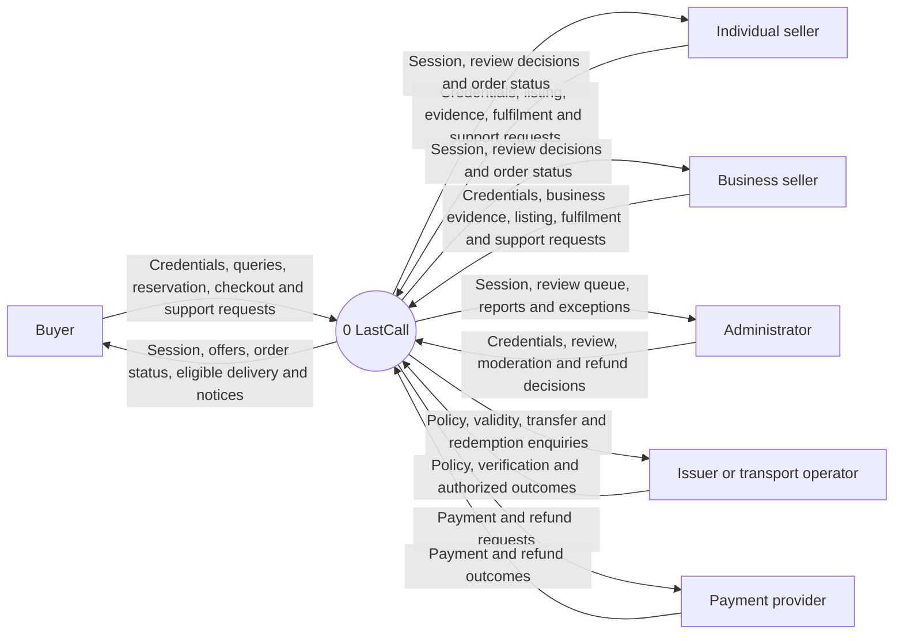

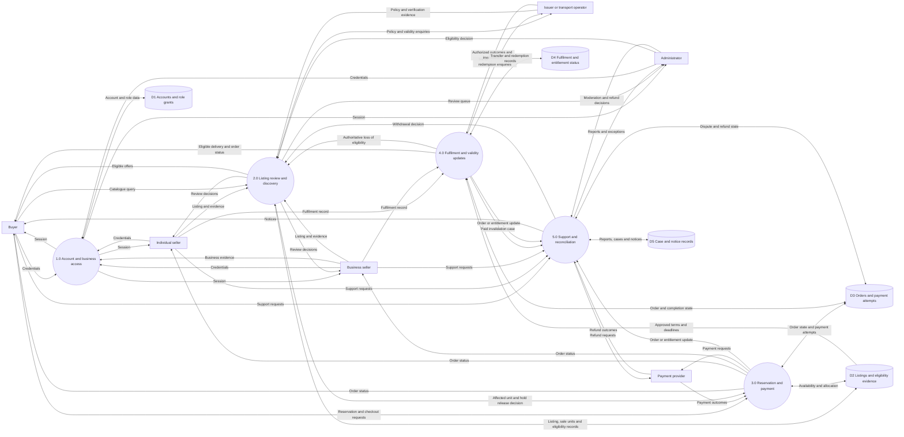

### A.2 Use case diagram and descriptions

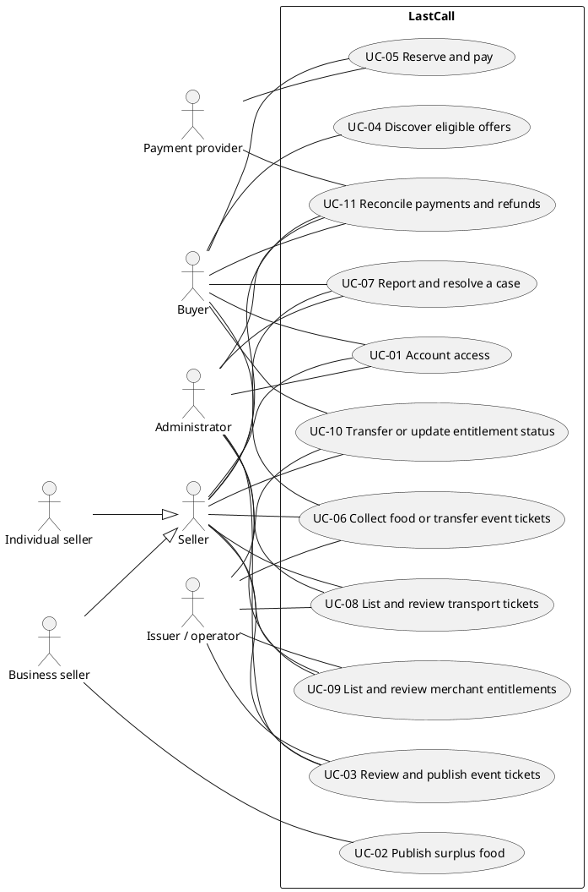

| ID | Use case / actors | Precondition | Main scenario | Exception and postcondition |
|---|---|---|---|---|
| UC-01 | Account access · buyer, sellers, administrator | Public registration or designated account exists | Register or sign in. An eligible user activates individual selling. The business role requires authorization. | Invalid credentials or unauthorized role change grants no access. |
| UC-02 | Publish surplus food · business seller | Business privilege and suitable pickup window | Submit lot, quantity, price, cutoff and location. Publish when valid. | Incomplete, expired or invalid lot stays unavailable. |
| UC-03 | Review and publish event tickets · seller, administrator, issuer | Policy and ownership evidence available | Submit event details. Review validity, ownership, permitted transfer method and deadline. Publish approved ticket. | Prohibited, unknown or unsupported transfer stays unavailable. Record decision. |
| UC-04 | Discover eligible offers · buyer | Catalogue available | Browse and filter eligible offers. Inspect price, category terms and deadlines. | Empty results display no offers. Unavailable links expose no reservation action. |
| UC-05 | Reserve and pay · buyer, payment provider | Signed-in buyer and eligible unit belonging to another seller | Reserve unit at the agreed price. Initiate payment and apply a verified timely success once. | Conflict, decline or expiry prevents confirmation. Unapplied funds go to UC-11. |
| UC-06 | Collect food or transfer event tickets · buyer, seller, issuer | Confirmed order and valid collection or transfer window | Record food pickup or authorized event-ticket handover. | Wrong actor, wrong method, loss of validity or expiry blocks fulfilment. |
| UC-07 | Report and resolve a case · buyer, seller, administrator | A relevant listing or order exists | Record a listing report. Investigate and record the decision. Withdraw affected stock where justified. The buyer can inspect confirmation notices or rate a fulfilled order when enabled. | Open reservations cannot complete after withdrawal. Order disputes follow UC-11. |
| UC-08 | List and review transport tickets · seller, administrator, operator | Ticket and route details, ownership evidence and identifiable issuer | Submit bus or train details. Check unused status, passenger restrictions, policy and supported handover. Publish the eligible item. | Keep unavailable on denial, missing evidence or absent official transfer path. |
| UC-09 | List and review merchant entitlements · seller, administrator, issuer | Merchant or other issuer identifiable | Submit coupon, voucher, pass or eligible opportunity with restrictions and use or balance terms. Assess transfer, validity, redemption evidence and duplicates before publication. | Flag duplicate references. Unknown or unverified redemption does not establish eligibility. |
| UC-10 | Transfer or update entitlement status · buyer, seller, issuer | Confirmed order for an entitlement or authoritative status update | Recheck restrictions, record the authorized transfer and notify the buyer. Record issuer-supported cancellation, invalidation or redemption updates. | Block invalid delivery. Record unknown redemption separately from confirmed unused status. |
| UC-11 | Reconcile payments and refunds · buyer, seller, administrator, payment provider | Disputed purchase, verified unapplied funds or eligible refund request | Match payment to order, record review decision, request approved refund and record verified result. Notify buyer of the outcome. | Pending or failed refund remains identifiable. Late funds never reopen a released allocation. |

### A.3 Activity diagrams

**Food listing, purchase and pickup (UC-02, UC-05, UC-06).**

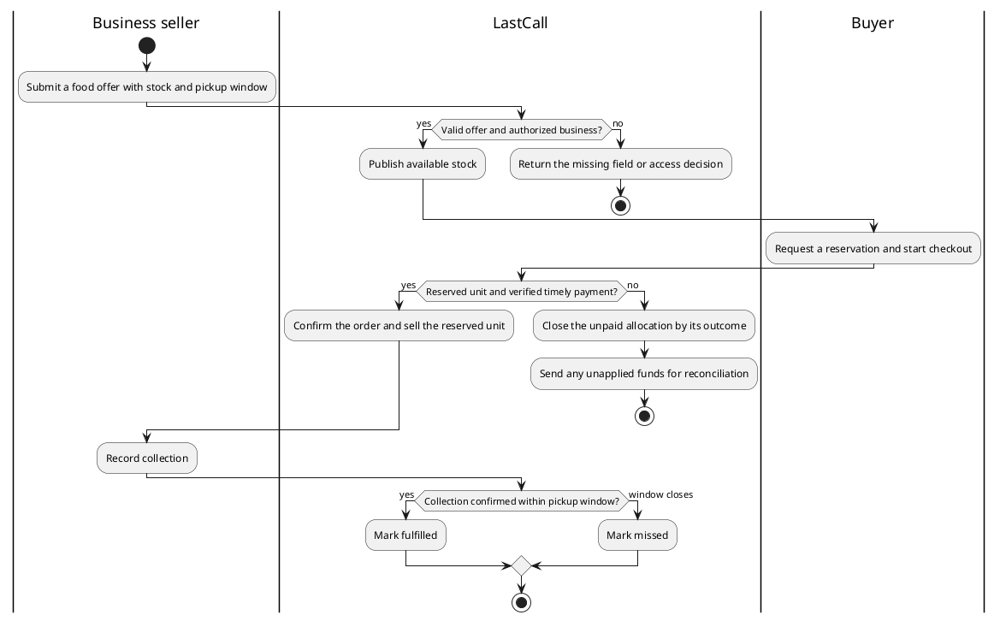

**Eligibility review and authorized handover (UC-03, UC-08–UC-10).**

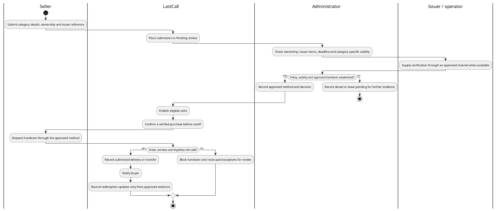

### A.4 Class diagram (design)

The domain classes describe responsibilities and relationships rather than framework components. An eligible offer has category-specific terms and one or more independent sale units. Eligibility decisions, payment attempts and fulfilment records preserve the evidence of changes over time.

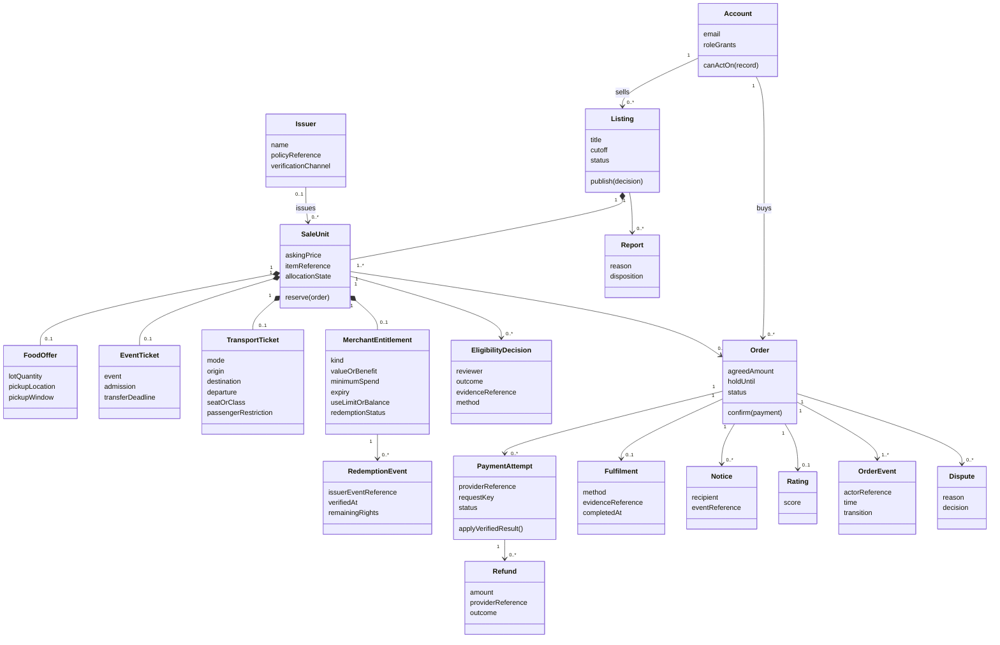

Each sale unit has exactly one matching category detail. Transport modes carry shared route and schedule data and mode-specific seat, class and identity conditions. Merchant entitlement kinds carry offer terms appropriate to a coupon, voucher, digital pass or other eligible issuer-backed opportunity. Only offers with an issuer require an issuer reference.

### A.5 Sequence diagrams

**Verify eligibility and publish an entitlement (UC-03, UC-08, UC-09).**

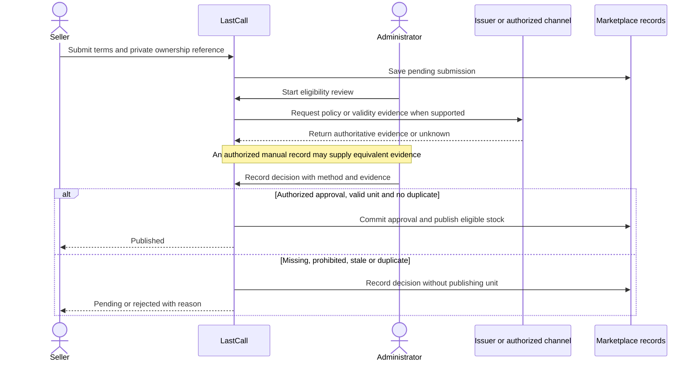

**Reserve, pay and reconcile (UC-05, UC-11).**

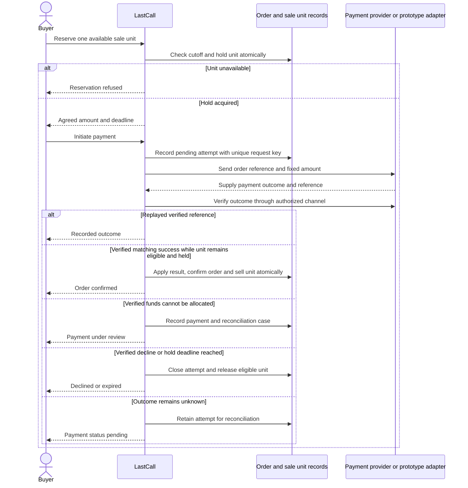

**Confirm authorized transfer and update redemption status (UC-10).**

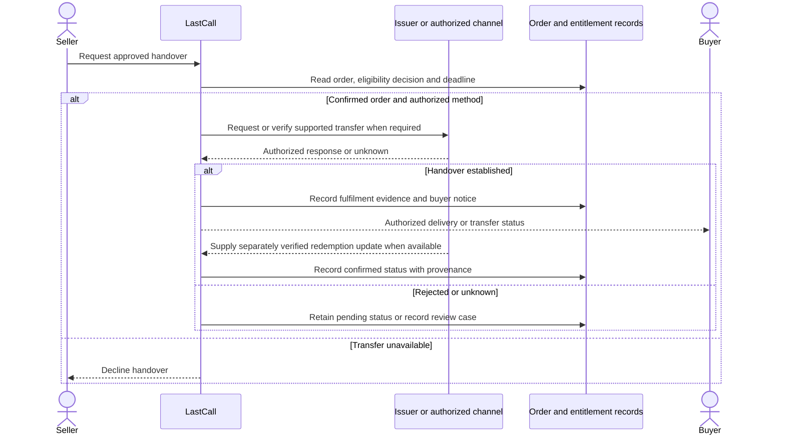

### A.6 State machine diagrams

**Listing eligibility and sale unit availability.** Publication controls visibility of the offer. Each unit is allocated independently. A published offer stays discoverable only while at least one unit is available before cutoff.

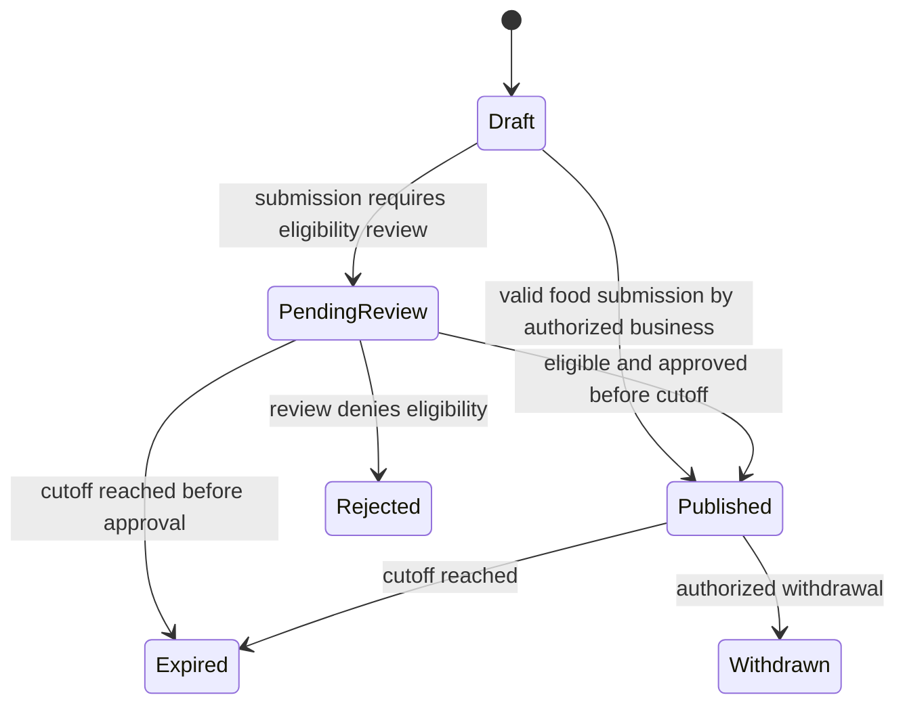

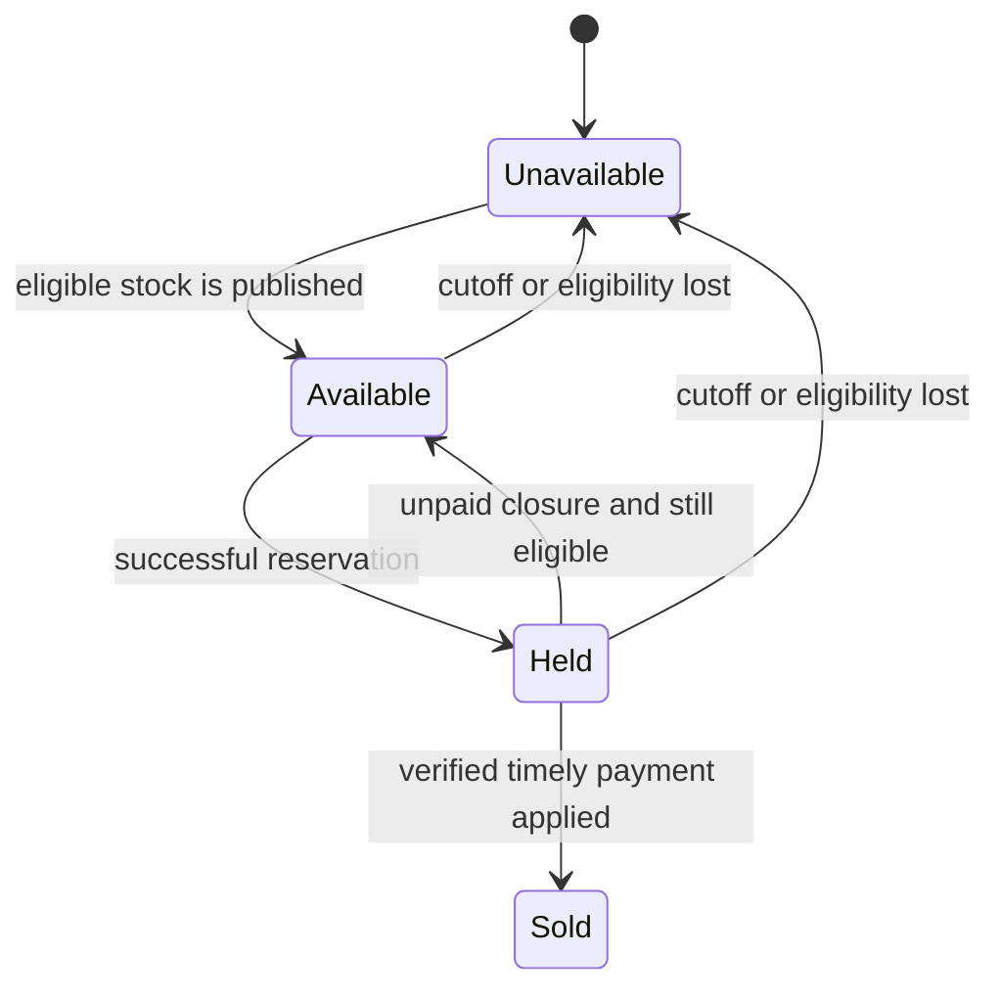

A sold unit has no return path to available stock. A withdrawal or invalidation closes an affected unpaid reservation. A paid order follows the relevant fulfilment, dispute or refund rules.

**Order and payment.** Payment arrival can lag reservation expiry. Record late verified funds and reconcile them without reacquiring inventory or confirming the original order.

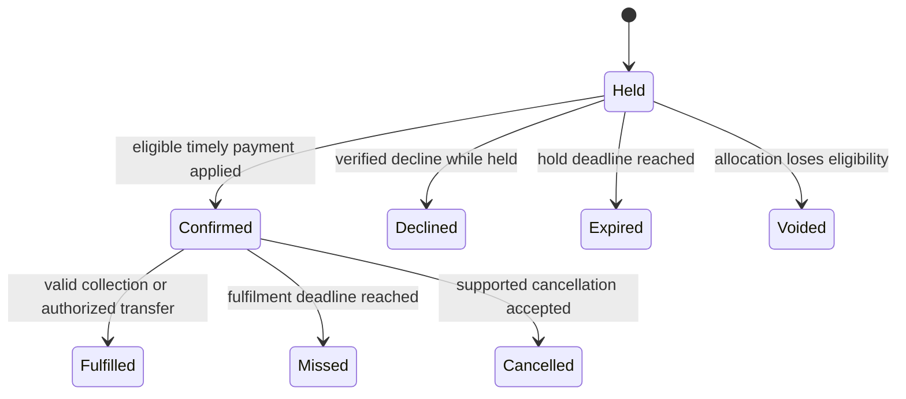

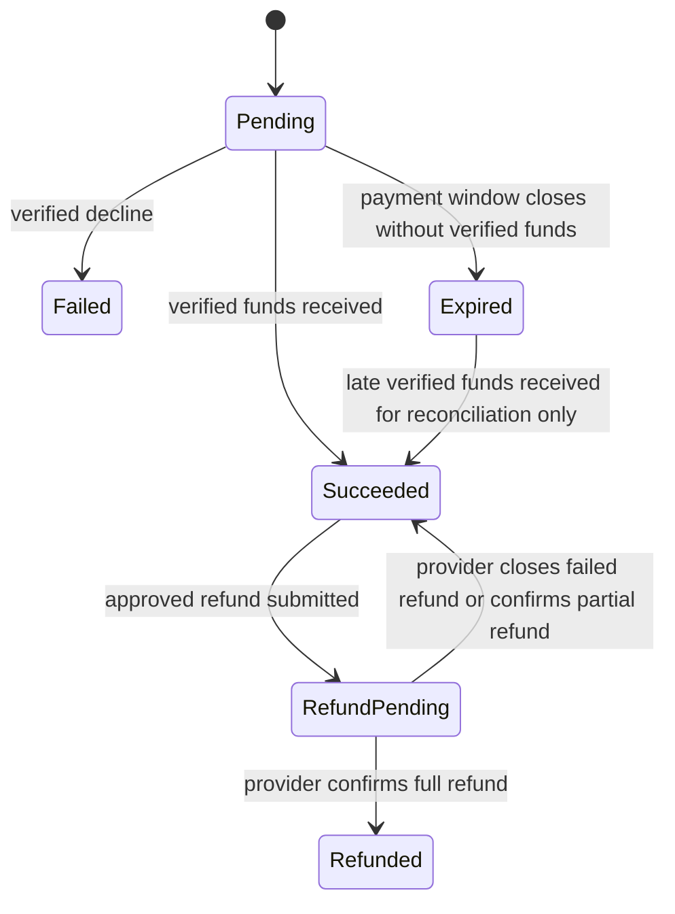

State labels in the models omit spaces where Mermaid requires a single identifier. Individual refund amounts and outcomes remain on refund records. A partial refund leaves a remaining paid amount. Duplicate results do not create either a new allocation or a second refund.

### A.7 Database schema (ERD)

This is a proposed logical model. The detail tables share the sale unit key and supply distinct validation fields. Event, transport and merchant records reference an issuer through their sale unit. A merchant record keeps proof of ownership or issuance separate from authority-sourced redemption evidence.

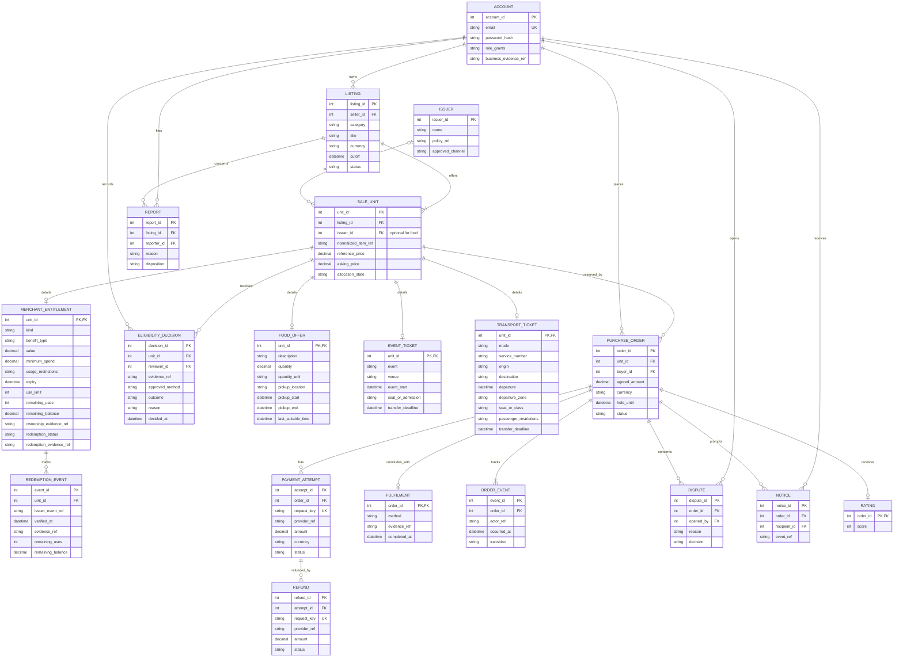

- A sale unit has exactly one detail row and its type must match the listing category. Transport mode distinguishes bus from train. A quantity within a food unit describes the lot collected together. Multiple independently sold lots use separate unit keys.
- A canonical issuer and item reference cannot identify simultaneous competing active listings or a relisted sold unit. The normalized reference is private. Review evidence remains access-controlled, separate from the public listing.
- A sale unit can have many historical orders, at most one live hold, and at most one allocation to a confirmed purchase. Apply the successful payment and sell the unit in one transaction. A payment that cannot be applied is retained for reconciliation.
- Payment and refund request keys are unique. When known, a provider transaction reference is unique within that provider and transaction kind. Verified refunds cannot exceed the collected amount.
- Redemption events are unique by unit and issuer event reference. Evidence is distinct from ownership or issuance evidence. Unknown redemption stays unknown when evidence is unavailable. Orders, status events and fulfilment records retain references even after catalogue withdrawal.

**Deployment and recovery concept.** A browser connects through HTTPS to a web host. The application keeps private records in a persistent store and accesses payment and issuer channels through authorized interfaces where available. The backup boundary includes the database and required private evidence references. Hosting, frameworks and backup service are design decisions.

## Appendix B — Requirements traceability matrix

Acceptance checks are proposed and execution is pending. The Jira column is blank where no issue reference is available. Status refers to the specification or candidate prototype scope. Implementation status has not been verified.

| Requirement | Use case | Jira story | Design element | Test case | Status |
|---|---|---|---|---|---|
| FR-AUTH-01 | UC-01 |  | Account | TC-01 — Submit a new address; verify a buyer account exists. | Proposed |
| FR-AUTH-02 | UC-01 |  | Account | TC-02 — Enter a wrong password; verify no session is issued. | Proposed |
| FR-AUTH-03 | UC-01 |  | Account | TC-03 — Sign in and open the account view. | Proposed |
| FR-USER-01 | UC-01 |  | Account | TC-04 — Request each privileged role through self-service; verify denial. | Proposed |
| FR-USER-02 | UC-01 |  | Account | TC-05 — Activate the seller profile and open the ticket submission form. | Proposed |
| FR-FOOD-01 | UC-02 |  | FoodOffer | TC-06 — Try identical submissions with business and individual accounts. | Proposed |
| FR-FOOD-02 | UC-02 |  | FoodOffer | TC-07 — Omit a required field and supply a pickup window that exceeds the suitability limit; expect rejection. | Proposed |
| FR-FOOD-03 | UC-02 |  | FoodOffer | TC-08 — Submit a complete discounted lot with future pickup; find it in the catalogue. | Proposed |
| FR-EVENT-01 | UC-03 |  | EligibilityDecision | TC-09 — Submit complete event details and verify the offer remains private in Pending review. | Proposed |
| FR-VERIFY-01 | UC-03 |  | EligibilityDecision | TC-10 — Submit prohibited, unknown, expired and mismatched cases for each entitlement category; verify refusal. | Proposed |
| FR-VERIFY-02 | UC-03 |  | EligibilityDecision | TC-11 — Approve eligible items in each enabled category; verify each becomes reservable. | Proposed |
| FR-VERIFY-03 | UC-03 |  | EligibilityDecision | TC-12 — Reject a submission; inspect the decision record. | Proposed |
| FR-EVENT-03 | UC-03 |  | SaleUnit | TC-13 — Submit a duplicate across seller accounts, then resubmit after transfer with no new permission; expect refusal. | Proposed |
| FR-LIST-01 | UC-04 |  | Listing | TC-14 — Try zero, equal, higher and discounted prices. | Proposed |
| FR-LIST-02 | UC-04 |  | Listing | TC-15 — Submit at the cutoff and one instant later. | Proposed |
| FR-SEARCH-01 | UC-04 |  | Listing | TC-16 — Mix draft, pending, held, expired, withdrawn, sold and open listings; only open eligible stock appears. | Proposed |
| FR-SEARCH-02 | UC-04 |  | Listing | TC-17 — Filter mixed stock by food and then by event. | Proposed |
| FR-LIST-04 | UC-04 |  | Listing | TC-55 — Expire one approved ticket with another unit still valid; verify only the valid unit remains reservable. | Proposed for complete system |
| FR-ORDER-01 | UC-05 |  | SaleUnit | TC-18 — Race two buyers for one unit; verify one hold. Hold another available unit of the same listing independently. | Proposed |
| FR-ORDER-02 | UC-05 |  | Order | TC-19 — Hold one offer far from cutoff and another near cutoff; compare deadlines with the configured interval. | Proposed |
| FR-ORDER-03 | UC-05 |  | Order | TC-20 — Expire an unpaid hold before the cutoff; verify another buyer can reserve the unit. | Proposed |
| FR-ORDER-04 | UC-05 |  | Order | TC-21 — Compare the recorded order amount with the exact displayed BDT price at acquisition. | Proposed |
| FR-ORDER-05 | UC-05 |  | Order | TC-22 — Try self-reservation from a seller session. | Proposed |
| FR-PAY-01 | UC-05 |  | PaymentAttempt | TC-23 — Compare timely verified success with an amount mismatch, void hold and expired eligibility. Only the first confirms. | Proposed |
| FR-PAY-02 | UC-05 |  | PaymentAttempt | TC-24 — Submit a decline for the active attempt and verify the order becomes Declined. | Proposed |
| FR-PAY-03 | UC-05 |  | PaymentAttempt | TC-25 — Attempt initiation exactly at expiry; verify no provider request. | Proposed |
| FR-PAY-04 | UC-05 |  | PaymentAttempt | TC-26 — Replay one success before and after expiry; count one applied confirmation. | Proposed |
| FR-PAY-05 | UC-05 |  | PaymentAttempt | TC-56 — Retry one checkout request before its response returns; count one provider attempt. | Proposed |
| FR-PAY-06 | UC-05 |  | PaymentAttempt | TC-57 — Send an unauthenticated message and vary each matched field; verify none change the payment or order. | Proposed |
| FR-PAY-07 | UC-05 |  | PaymentAttempt | TC-58 — Exercise pending, verified decline, expiry and success; inspect each attempt rather than inferring status from the order. | Proposed |
| FR-PAY-08 | UC-11 |  | Refund | TC-59 — Deliver a distinct success after hold expiry, invalidation or another attempt has confirmed; verify refund review and no allocation change. | Proposed for complete system |
| FR-ORDER-09 | UC-05 |  | SaleUnit | TC-60 — Decline an active payment before cutoff; reserve the released unit as a different buyer. | Proposed |
| FR-ORDER-11 | UC-05 |  | Order | TC-61 — Reserve an open unit as a different buyer and verify the hold belongs to that account. | Proposed |
| FR-ORDER-06 | UC-06 |  | Fulfilment | TC-27 — As listing seller try before start, at start and at end using separate confirmed orders. | Proposed |
| FR-EVENT-02 | UC-06 |  | Fulfilment | TC-28 — Attempt wrong-method, revoked and late handovers; accept a timely approved handover. | Proposed |
| FR-ORDER-07 | UC-06 |  | Fulfilment | TC-29 — Verify an unrelated seller is denied and the listing seller for pickup or named transfer authority is accepted. | Proposed |
| FR-ORDER-08 | UC-06 |  | Fulfilment | TC-30 — Read an unfulfilled confirmed food or ticket order at its deadline. | Proposed |
| FR-ORDER-12 | UC-06 |  | Fulfilment | TC-62 — Record timely collection and eligible handover for separate confirmed orders, then inspect the resulting order states. | Proposed |
| FR-NOTIFY-01 | UC-07 |  | Notice | TC-31 — Confirm a demo payment and check that buyer’s notices. | Proposed |
| FR-ADMIN-01 | UC-07 |  | Report | TC-32 — File a report; verify listing, reporter, reason and time. | Proposed |
| FR-ADMIN-02 | UC-07 |  | Report | TC-33 — Uphold a report during a hold; verify the affected unit cannot be sold. | Proposed |
| FR-ADMIN-03 | UC-07 |  | Order | TC-63 — Withdraw during checkout and verify the hold moves to Voided. | Proposed |
| FR-REVIEW-01 | UC-07 |  | Rating | TC-34 — Try rating before fulfilment, from another user and twice after fulfilment. | Optional prototype scope |
| FR-TRANS-01 | UC-08 |  | TransportTicket | TC-35 — Save and reopen a bus record with route, operator, departure, seat, price and booking references. | Optional prototype scope |
| FR-TRANS-02 | UC-08 |  | TransportTicket | TC-36 — Save and reopen a train record with class, passenger restrictions and validity evidence. | Optional prototype scope |
| FR-BUS-01 | UC-08 |  | TransportTicket | TC-64 — Submit an otherwise valid bus offer without its operator, then with complete evidence fields. | Optional prototype scope |
| FR-TRAIN-01 | UC-08 |  | TransportTicket | TC-65 — Submit an otherwise valid train offer without its class or applicable passenger restriction, then complete it. | Optional prototype scope |
| FR-TRANS-03 | UC-08 |  | EligibilityDecision | TC-66 — Use permitted and prohibited bookings including an identity-linked ticket without issuer-approved reassignment. | Optional prototype scope |
| FR-TRANS-04 | UC-10 |  | TransportTicket | TC-67 — Record a cancellation from the approved route and inspect the linked status. | Proposed for complete system |
| FR-NOTIFY-02 | UC-10 |  | Notice | TC-68 — Drive each outcome for a linked order and verify one corresponding in-app notice. | Optional prototype scope |
| FR-COUPON-01 | UC-09 |  | MerchantEntitlement | TC-37 — Save both a fixed-value and percentage benefit; inspect their separate terms. | Optional prototype scope |
| FR-COUPON-02 | UC-09 |  | MerchantEntitlement | TC-40 — Submit two active listings with the same issuer and reference; inspect the flag. | Optional prototype scope |
| FR-COUPON-03 | UC-09 |  | MerchantEntitlement | TC-69 — Attempt to submit a coupon without use terms, then supply the supported terms. | Optional prototype scope |
| FR-VOUCHER-01 | UC-09 |  | MerchantEntitlement | TC-38 — Save a voucher with a partial balance and verify the denomination is unchanged. | Optional prototype scope |
| FR-VOUCHER-02 | UC-09 |  | EligibilityDecision | TC-70 — Submit fixtures with positive, unknown and zero issuer-backed values; only the first may pass. | Optional prototype scope |
| FR-PASS-01 | UC-09 |  | MerchantEntitlement | TC-71 — Omit validity or included rights from a pass; verify rejection. | Proposed for complete system |
| FR-LIST-05 | UC-09 |  | Listing | TC-72 — Submit an unsupported category that has generic listing fields; verify it remains unpublished. | Proposed for complete system |
| FR-LIST-03 | UC-09 |  | Listing | TC-39 — Exercise baseline food and event, outside-profile travel, and an explicitly enabled synthetic extension against the profile gate. | Proposed |
| FR-COUPON-04 | UC-04 |  | Listing | TC-73 — Open an approved merchant offer and verify expiry, benefit, minimum spend, redemption terms and the evidenced count or balance. | Optional prototype scope |
| FR-TRANSFER-01 | UC-10 |  | Fulfilment | TC-74 — Try an expired, revoked and unknown record; verify that no handover completes. | Optional prototype scope |
| FR-TRANSFER-02 | UC-10 |  | Fulfilment | TC-75 — Try an unrelated order and wrong method, then a supported handover with matching evidence. | Optional prototype scope |
| FR-TRANSFER-03 | UC-10 |  | SaleUnit | TC-76 — Invalidate a held unit and verify it leaves available stock. | Proposed for complete system |
| FR-TRANSFER-04 | UC-10 |  | Dispute | TC-77 — Invalidate a paid ticket and verify a case is open and no fulfilment is accepted. | Proposed for complete system |
| FR-COUPON-05 | UC-10 |  | RedemptionEvent | TC-78 — Compare a seller screenshot with issuer-confirmed usage; only the latter changes recorded status. | Proposed for complete system |
| FR-VOUCHER-03 | UC-10 |  | RedemptionEvent | TC-79 — Replay a partial redemption event and verify only one decrement; an unknown external use stays unknown. | Proposed for complete system |
| FR-NOTIFY-03 | UC-10 |  | Notice | TC-80 — Complete an approved coupon or voucher handover and verify the buyer's notice. | Optional prototype scope |
| FR-TRANSFER-05 | UC-10 |  | Order | TC-81 — Invalidate held transport and merchant units and verify each unpaid order becomes Voided. | Proposed for complete system |
| FR-ADMIN-04 | UC-11 |  | Dispute | TC-82 — Open a transfer dispute as its buyer, then as an unrelated account; verify only the authorized case is created. | Proposed for complete system |
| FR-PAY-09 | UC-11 |  | Refund | TC-83 — Approve a partial refund and try another above the remaining amount; verify the excess is refused. | Proposed for complete system |
| FR-PAY-10 | UC-11 |  | Refund | TC-84 — Deliver a verified refund confirmation twice and inspect the single refund. | Proposed for complete system |
| FR-ORDER-10 | UC-11 |  | Order | TC-85 — Approve cancellation on one pending handover and attempt it on a fulfilled order; only the first becomes Cancelled. | Proposed for complete system |
| FR-NOTIFY-04 | UC-11 |  | Notice | TC-86 — Confirm and fail separate approved refunds and verify the corresponding buyer notices. | Proposed for complete system |
| FR-PAY-11 | UC-11 |  | Refund | TC-87 — Submit two concurrent refund requests that together exceed the original payment and verify the provider receives only an allowed amount. | Proposed for complete system |
| NFR-PERF-01 | UC-04 |  | Listing | TC-41 — Run the proposed profile of 500 requests, 20 concurrent clients and 1,000 records; compare p95 with the proposed 2 s budget. | Proposed |
| NFR-SEC-01 | UC-01 |  | Account | TC-42 — Inspect stored credentials for two test accounts with the same password. | Proposed |
| NFR-SEC-02 | UC-07 |  | Account | TC-43 — Exercise the buyer, two sellers and administrator against order, evidence and moderation actions. | Proposed |
| NFR-SEC-03 | UC-01 |  | Account | TC-44 — Use the proposed limit of five failures per five minutes and verify the next attempt is throttled without creating a session. | Proposed |
| NFR-PRIV-01 | UC-03 |  | EligibilityDecision | TC-45 — Inspect anonymous, buyer and unrelated seller list and detail responses for private markers. | Proposed |
| NFR-REL-01 | UC-05 |  | PaymentAttempt | TC-46 — Inject a failure before commit, then replay the result and verify one coherent payment, order and unit outcome. | Proposed |
| NFR-AVL-01 | UC-04 |  | Web host | TC-47 — Use the proposed demo profile of 120 once-per-minute probes and 99 percent successful responses; record downtime and errors. | Proposed |
| NFR-USE-01 | UC-05 |  | Listing and Order | TC-48 — Time four separately consented task attempts; count unaided completions. | Proposed |
| NFR-ACC-01 | UC-05 |  | Listing and Order | TC-49 — Tab through discovery, hold and checkout; inspect focus and completion. | Proposed |
| NFR-MNT-01 | UC-05 |  | Order | TC-50 — Change the configured hold interval without editing order logic and check the new cutoff. | Proposed |
| NFR-COMP-01 | UC-05 |  | Listing and Order | TC-51 — Run the proposed Chrome and Firefox matrix at 360 and 1280 CSS pixels and record the browser versions. | Proposed |
| NFR-INT-01 | UC-05 |  | SaleUnit | TC-52 — Race timed success messages and count applied purchases per unit, including orders later fulfilled, missed or cancelled. | Proposed |
| NFR-REC-01 | UC-05 |  | Restricted backup storage | TC-53 — Restore a snapshot within the proposed 60-minute recovery time and 24-hour recovery point; verify order and stock records. | Proposed |
| NFR-AUD-01 | UC-06 |  | OrderEvent | TC-54 — Reconstruct a hold, confirmation and fulfilment from the history using actor or system identity. | Proposed |
| NFR-SCALE-01 | UC-04 |  | Listing | TC-88 — Repeat TC-41 against the proposed 5,000-listing profile; compare latency and category results with the baseline. | Proposed |

## Appendix C — Glossary · AI-use disclosure

| Term | Meaning in LastCall |
|---|---|
| Entitlement | An issuer-defined right to travel, attend, redeem a benefit or receive another service. |
| Canonical reference | Private normalized identifier for an issuer's item, used to check for duplicates. |
| Sale unit | One separately reservable and purchasable lot, ticket or entitlement. |
| Eligibility decision | Attributable decision linking evidence, review outcome and approved handover method. |
| Fixture | Synthetic account, listing, policy or payment response used to exercise the prototype. |
| Fulfilment | Recorded completion of food collection or authorized delivery of an entitlement. |
| Reconciliation | Matching verified provider funds with the applicable payment, order or refund. |
| Redemption evidence | Issuer-backed information establishing the use, balance or usage status of an entitlement. |

### AI-use disclosure

OpenAI Codex assisted with drafting and reviewing requirements, editing the full-system and prototype scope, generating editable models, and mapping proposed acceptance checks. The draft uses the supplied project briefs and faculty references. Responsible student attribution is pending, and this revision records no student review, stakeholder validation or test execution.
