# Software Requirements Specification
## LastCall

**Version:** 0.1 · **Date:** 20 November 2026 · **Status:** Draft for scope and policy review

**Course:** CSE 3412 — System Analysis and Design Lab · Section B · Fall 2026

**University:** United International University (UIU) · **Course teacher:** Rejwan Ahmed

**Team size:** 3 students

**Team name:** SAD-APJ

**Confirmed project coordinator:** Ahanaf Abtahi. Other roles below remain proposals; module ownership and individual contributions have not been verified.

| Student ID | Student name | Responsibility / proposed role |
|---|---|---|
| 0112420631 | Ahanaf Abtahi | Confirmed coordinator; proposed Project Manager & Lead System Analyst |
| 0112420327 | Shawli Sharmin Prionti | UI/UX Designer & Requirements Analyst |
| 0112420340 | Shahriar Alom Joy | System Designer & Quality Assurance Lead |

### Revision history

| Version | Date | Author | Changes |
|---|---|---|---|
| 0.1 | 2026-11-20 | Ahanaf Abtahi. | Initial draft, Revised full-system scope, category workflows, payment lifecycle, quality targets, models and traceability. |

## 1. Introduction

### 1.1 Purpose

This specification defines the behaviour, interfaces and acceptance criteria for LastCall. The project team and course evaluator can use it to review the intended marketplace and select a feasible demonstration. Appendix A shows the proposed design, and Appendix B links each requirement to a proposed acceptance check.

### 1.2 Scope

**A. Complete proposed system.** LastCall is a unified online marketplace for unused, time-sensitive products and entitlements. It supports surplus food, event tickets, unused bus and train tickets, discount coupons, gift vouchers, eligible digital passes and other transferable opportunities with category-specific rules. Buyers discover eligible offers, reserve available stock, pay and collect or receive the item through a permitted method. Sellers manage listings and fulfilment. Administrators review eligibility, fraud reports and disputes. Payment providers and issuers participate where approved.

**B. Academic prototype.** The proposed baseline uses synthetic accounts, item records and issuer policies. Food collection and event-ticket handover are the two major journeys. The minor scope adds filtering, notices and moderation. A simulated payment provider supplies repeatable success, decline, expiry and replay cases. Each sample listing contains one sellable unit. The team has yet to approve this split.

The following is the authoritative proposed release-scope table. Requirement priorities in Sections 4–5 implement this boundary. Student approval is pending under D1 in Section 2.6.

| MoSCoW | Academic prototype release scope |
|---|---|
| Must | Account access and roles; food publication; fictional event-ticket eligibility review; catalogue; one unit per listing; exclusive reservation; simulated payment including decline, expiry, replay and late-success review; pickup or permitted handover; deadline enforcement; security and allocation integrity. |
| Should | Category filtering, buyer confirmation notices, listing reports and administrator withdrawal, including review of reports against paid orders. These are planned minor features for P6. |
| Could | Draft-only bus, train, coupon and voucher forms; ratings for fulfilled orders; 5,000-listing load test; expanded browser matrix; timed backup-recovery drill. Only after Must and Should work is complete. |
| Won't | Trading transport or merchant entitlements in this release; multiple independent units per listing in the prototype; real funds or refunds; real identity or entitlement documents; live issuer/payment APIs; external redemption checks; delivery logistics. These marketplace capabilities remain in the complete proposed system. |

**C. Future enhancements.** Cross-border currency support, native apps, physical delivery and automatic onboarding of new issuers can be evaluated later. The complete marketplace retains surplus food, event tickets, eligible bus/train tickets, coupons, vouchers, digital passes and other transferable opportunities. Category activation depends on a lawful, documented transfer or redemption route.

Proposed evaluation objectives are one completed food pickup, one permitted fictional ticket handover, rejection of every prohibited or unknown-policy fixture, and the formative usability exercise in NFR-USE-01. Waste reduction, buyer savings and adoption have not been measured.

### 1.3 Definitions, acronyms and abbreviations

| Term | Meaning |
|---|---|
| SRS / FR / NFR | Software requirements specification / functional requirement / non-functional requirement. |
| UC / RTM | Use case / requirements traceability matrix. |
| MoSCoW | Must, Should, Could and Won't for the current release. |
| DFD / ERD | Data flow diagram / entity relationship diagram. |
| BDT | Bangladesh taka, the proposed display currency. |
| Hold | Temporary exclusive claim by one buyer on a sellable unit. |
| Cutoff | First instant at which new reservations cease. The cutoff caps the payment hold window. |
| STRIDE | Spoofing, tampering, repudiation, information disclosure, denial of service and elevation of privilege. |

### 1.4 References

- **Brief:** LastCall SRS revision request, particularly §§3–10 for scope, eligibility, payments and quality requirements. The existing SRS carries forward marketplace objectives from the original brief; that brief was not independently revalidated during this QA revision.
- **Faculty:** Official UIU CSE 3412 Section B resource checkout at `D:/uiu-sad-lab-student-resources`: `templates/SRS-template.md` (structure), `course/rubrics.md` (P2–P7 scope and deadlines), `templates/security-checklist.md` (security), `Week-11/assignment.md` (final submission), and `course/CSE3412_SAD_Lab_Section_B_Fall2026_Course_Outline.html` (AI disclosure). These local sources were consulted for this revision.
- **Design:** Proposed rules derived from the use cases in Appendix A. No stakeholder interviews, survey results, benchmark results, issuer permissions or approved feasibility decision are supplied as evidence. Figma and Jira references remain pending.

### 1.5 Overview

Sections 2–3 describe the marketplace participants and interfaces. Sections 4–6 specify behaviour, quality and operating requirements. Appendices A–C contain the models, traceability matrix, glossary and AI-use disclosure.

## 2. Overall description

### 2.1 Product perspective

LastCall mediates sales by business and individual sellers. Food moves through collection, while a ticket or entitlement moves through an issuer-permitted transfer. The platform records the evidence and fulfilment outcome. Issuers remain the authority for transfer, passenger identity and redemption. An approved payment provider is the authority for real payment outcomes. Appendix A.1 defines these boundaries, including the prototype substitutes.

### 2.2 Product functions

- **Listing:** Sellers submit time-sensitive offers. A business seller can publish a valid food lot. An entitlement enters review before publication.
- **Purchase:** Buyers find reservable offers, hold available units, accept the quoted price, pay and track collection or transfer.
- **Verification and support:** Reviewers check eligibility, record expiry or invalidation, handle reports and disputes and review refunds against policy.
- **Academic major/minor split:** Major workflows are food purchase and event-ticket purchase through fulfilment. Minor workflows are catalogue filtering, order notices and moderation. Optional draft forms do not enable transport or merchant trading.

### 2.3 User classes and characteristics

| User class | Description | Technical skill | Frequency of use |
|---|---|---|---|
| Buyer | Compares price and remaining time, reserves and pays, accepts the permitted collection or transfer. | Basic browser skills assumed. | Per purchase. |
| Individual seller | Lists entitlements held in their name, supplies evidence and carries out permitted handover. | Basic form entry assumed. | Per available item. |
| Business seller | Lists food lots, manages pickup and may submit eligible entitlements. | Repeated form and order handling. | Per lot or order. |
| Administrator | Reviews evidence, eligibility, reports, refund requests and disputes. | Trained in category and provider policies. | Per submission or case. |

A buyer may also hold seller permissions. Issuers and payment providers are external actors. Usage patterns are design assumptions pending stakeholder validation.

Business and administrator privileges are assigned to designated demo accounts, never selected through public registration.

### 2.4 Operating environment

LastCall is a responsive web application for mobile and desktop browsers. The prototype can use one application and a transactional data store. Framework, database product, hosting and supported browser versions require a feasibility decision. Server time governs cutoffs. Display local collection and departure times with their time zones.

### 2.5 Design and implementation constraints

The three-member team can demonstrate the prototype without a paid integration. Prices are recorded to minor-unit precision with their currency. BDT and an English interface with Unicode support for Bangla names and locations are proposed for the first deployment. In the complete system, a listing groups one or more independent sale units; each reservation purchases exactly one unit. A food unit is a lot collected together, even if it contains several portions. An entitlement is divisible only into issuer-defined independently transferable units. The prototype enforces exactly one unit per listing (FR-LIST-09).

Faculty milestones are P3 major 50% on 26 December 2026, P4 major complete on 31 December, P5 minor 50% on 2 January 2027, P6 Must and Should complete on 9 January, and P7 final SRS/PDF on 16 January at 11:00 AM (Asia/Dhaka). The three-member plan therefore keeps two core journeys and defers additional trading categories. Numeric acceptance targets remain proposals, not measured achievements.

### 2.6 Assumptions and dependencies

Full-system activation depends on approved category policies, accepted payment and refund terms, an available verification route and documented privacy controls. Automated issuer calls require an approved interface. A manual route is acceptable only where the issuer authorises it and reviewers can record reliable evidence of status and permission. Unknown status prevents publication or transfer when the governing rule requires verification. The prototype uses deterministic outcomes and synthetic evidence while these dependencies remain open.

**Pending student decisions**

| ID | Decision requiring approval | Current draft basis |
|---|---|---|
| D1 | Confirm the release boundary and feature ownership against faculty milestones. | Two major journeys; Must and Should by P6; optional category work is draft-only. No individual module allocation is asserted. |
| D2 | Confirm whether a verified decline ends the reservation or permits retry within the same hold. | Preserve the existing terminal-decline policy: close the order, release eligible stock, and require a new reservation to try again. A network replay of the same request is not a new attempt. |
| D3 | Approve refund eligibility, fees, decision authority and processing times, including missed collection and late payment. | Unapplied verified funds enter refund review; no automatic refund promise. Missed collection, cancellation and refunds never automatically restock a sold unit. Real refunds are outside the prototype. |
| D4 | Approve handover cutoffs and eligibility/review routes by category. | Proposed bounds: sales cutoff no later than fulfilment deadline; ticket handover no later than event start/departure; merchant handover no later than validity end. Confirm category exceptions before changing these bounds. Unknown permission blocks publication. |
| D5 | Approve the proposed quality targets, runtime/browser versions, retention and backup operation. | Section 5 defines testable candidate targets; production service and recovery commitments remain pending. |
| D6 | Approve handling of upheld reports against paid sales. | Open a blocking exception case for an unfulfilled paid sale without reversing payment; preserve completed fulfilment. An unresolved Confirmed order becomes Missed at its deadline; any refund needs a separate decision. |

## 3. External interface requirements

### 3.1 User interfaces

| Screen | Information and user action |
|---|---|
| Account and sign-in | Register, sign in and access authorised buyer or seller actions. |
| Catalogue and listing detail | Filter by category and show price, time zone, remaining availability and pickup, transfer or redemption terms. An expired link shows an unavailable state. |
| Seller listing editor | Enter the relevant category contract and submit required evidence privately. See review status and correction reasons. |
| Review desk | Check source, validity, permitted transfer, private evidence, status and reports. Record a decision with a reason. |
| Reservation and checkout | Show the price snapshot, hold deadline, payment status and actions for an eligible order. Clearly identify simulation in the prototype. |
| Order detail and support | Show order, payment and fulfilment status to authorised participants. Accept cancellation, invalidation and dispute reports where applicable. |

Primary journeys require keyboard access, visible focus, field labels and text status messages. The Figma link is pending.

### 3.2 Hardware interfaces

The browser needs a display and keyboard or touch input. The host needs persistent storage for listings, orders and backups. No scanner, printer, payment terminal or GPS device is required.

### 3.3 Software interfaces

| Interface | Required exchange and dependency |
|---|---|
| Browser and application | Structured listing, reservation, payment, order and review data with validation feedback. |
| Persistent store | Transactional allocation, orders, payment attempts, refunds, eligibility decisions and audit events. |
| Payment provider | Initiate payment for a frozen amount and currency. Use an approved provider entry point for payment credentials. Authenticate outcomes against the order and attempt. Reconcile unresolved transfers and submit approved refunds. Provider and interface contract are pending. The prototype supplies these outcomes through a simulator. |
| Issuer or operator | Validate ownership, validity and policy where supported. Record authorised transfer, invalidation or redemption evidence. The sanctioned alternative is a documented manual check against issuer evidence. API and policy availability are unresolved. |

### 3.4 Communication interfaces

Shared deployments require HTTPS for browser and approved external traffic. Provider result messages require authentication, correlation to the stored attempt and replay handling. In-app notifications and order lookup provide an authoritative status after a network timeout. Additional delivery channels depend on consent and service availability.

## 4. Functional requirements

**Applicability.** Every row describes the complete proposed system unless marked prototype-only. Priority is the academic prototype MoSCoW priority. Won't identifies behaviour specified for the complete system that is outside the prototype. Must and Should behaviours form the planned P6 scope. Could behaviours are optional. Shared rules apply only to enabled categories; complete-system extensions do not enable extra prototype trading. Policy details remain proposals under Section 2.6.

**Listing and stock.** A listing records seller, category, title, original and sale prices in the same currency, stock, and a future sales cutoff. Food records a description, units or portions, pickup location and window, and a seller-declared suitability limit. Pickup start is inclusive. Pickup end, transfer deadline, sales cutoff and hold deadline are exclusive. A sales cutoff cannot exceed the end of the usable handover window (FR-LIST-06). Each sale unit represents a separately purchasable lot, ticket or transferable entitlement. Stock and checkout operate on that unit. Payment success consumes it once; refund, missed collection and invalidation do not automatically restock it.

**Entitlement fields.** Every entitlement records an explicit transfer deadline no later than its usable validity limit (FR-LIST-10). Events record issuer, event, venue, start time, seat or admission type and permitted handover. Bus and train records include operator or issuing authority, service number, origin, destination, departure timestamp and time zone, seat or class, applicable passenger restrictions and booking reference. Coupons record issuer, benefit type and value, minimum spend where applicable, usage and eligibility conditions, expiry and evidence of remaining uses. Gift vouchers add denomination and evidenced remaining balance or uses. Digital passes record included rights and validity windows. Other opportunities require an approved category contract before any listing is eligible.

**Decision evidence.** Every non-food listing identifies its issuer, canonical opaque item reference, proof of seller authority, validity interval, specific resale permission, supported handover, and applicable identity and redemption rules. Authorisation may rely on an approved issuer interface or a documented issuer-accepted manual route. The reviewer records the source and observed status. Seller claims alone leave the status unknown. Refuse publication when an applicable rule is unknown, prohibited, expired, used up, mismatched or otherwise unsatisfied. A permitted passenger reassignment follows the issuer's own process. An expired approval or adverse status prevents further sale.

**Payment and fulfilment.** Reserve at the price shown when the hold is acquired. The configured hold duration and cutoff cap the hold. Record each provider attempt separately. A result affects an order only after authenticating the source and matching attempt, amount and currency. Apply a timely successful result atomically to the order and its unit. An already successful order cannot be confirmed twice. A distinct verified payment received too late or after another attempt confirmed the order goes to refund review without changing allocation. A verified decline closes the order as Declined and releases eligible stock. The buyer must acquire a new reservation before another payment attempt; the old deadline cannot be reused. Expiry releases the unit even if a provider outcome is still unknown. Allocation checks use server transaction time: a result at or after the deadline is late, regardless of a provider-reported earlier time. Late funds never reclaim a unit allocated to another buyer. Fulfilment uses the channel recorded at approval. Collect food within its window. Transfer only with current eligibility and confirmation from the authorised party. Any posted redemption balance or use count retains its issuer evidence. This platform cannot infer usage outside its own records.

**Moderation and exceptions.** A confirmed invalidation withdraws the affected unit and voids its unpaid hold. It opens exception review for a paid unresolved order. A report alone does not cancel a valid sale or imply a refund. An upheld report against a confirmed sale opens an exception case; a confirmed unfulfilled order is blocked from fulfilment while that case is open. Approved refunds are processed against the original payment, with a separate recorded outcome. A prior fulfilment remains in the audit history if later disputed.

### 4.1 Account access and roles

**Description.** Account access protects both buyer and seller activities.

**Stimulus/response sequence.** A visitor registers or signs in. The server applies the permissions assigned to the account.

| ID | Requirement | Priority | Basis / use case |
|---|---|---|---|
| FR-AUTH-01 | The system shall create a buyer account for a previously unused email address. | Must | Design, UC-01 |
| FR-AUTH-02 | The system shall reject a sign-in attempt with an incorrect password. | Must | Design, UC-01 |
| FR-AUTH-03 | The system shall issue an authenticated session for a registered account with valid credentials when sign-in is not throttled. | Must | Design, UC-01 |
| FR-USER-01 | The system shall deny public requests to grant business-seller or administrator privileges. | Must | Design, UC-01 |
| FR-USER-02 | The system shall permit a registered buyer to activate individual-seller access on their own account. | Must | Design, UC-01 |

### 4.2 Surplus food

**Description.** Business sellers offer food lots before the end of a declared pickup window.

**Stimulus/response sequence.** The seller enters the food contract. A valid submission publishes available stock; validation failures leave the offer unpublished.

| ID | Requirement | Priority | Basis / use case |
|---|---|---|---|
| FR-FOOD-01 | The system shall restrict food publication to business-seller accounts. | Must | Brief / Design, UC-02 |
| FR-FOOD-02 | The system shall reject food publication when required food fields are absent or invalid, including a pickup start not before pickup end or pickup end after the seller-declared suitability limit. | Must | Brief / Design, UC-02 |
| FR-FOOD-03 | The system shall publish a valid food lot submitted by a business seller. | Must | Brief / Design, UC-02 |

### 4.3 Event tickets and eligibility

**Description.** An eligibility decision controls access to the catalogue for every entitlement category.

**Stimulus/response sequence.** The seller submits evidence. A reviewer checks the applicable issuer rule before making the listing available.

| ID | Requirement | Priority | Basis / use case |
|---|---|---|---|
| FR-EVENT-01 | The system shall place a complete event-ticket submission in Pending review. | Must | Brief / Design, UC-03 |
| FR-VERIFY-01 | The system shall refuse entitlement approval when the decision evidence fails the applicable category checklist. | Must | Brief / Design, UC-03 |
| FR-VERIFY-02 | The system shall publish a pending entitlement after a current authorised approval for an enabled category. | Must | Brief / Design, UC-03 |
| FR-VERIFY-03 | The system shall record each eligibility decision with reviewer, time, outcome and reason. | Must | Brief / Design, UC-03 |
| FR-EVENT-03 | The system shall reject an entitlement publication when its canonical issuer-item reference already has an open listing or a previously transferred right without fresh authorisation. | Must | Brief / Design, UC-03 |

### 4.4 Listing controls and discovery

**Description.** Buyers see only stock that is eligible and currently reservable.

**Stimulus/response sequence.** The catalogue applies the category and availability rules using server time.

| ID | Requirement | Priority | Basis / use case |
|---|---|---|---|
| FR-LIST-01 | The system shall reject publication unless the sale price is greater than zero and below the stated original price. | Must | Brief / Design, UC-04 |
| FR-LIST-02 | The system shall refuse reservations at or after the listing cutoff. | Must | Brief / Design, UC-04 |
| FR-LIST-03 | The system shall deny publication in the academic profile for categories other than food and event tickets. | Must | Design, UC-04 |
| FR-SEARCH-01 | The system shall return only currently reservable listings in the public catalogue. | Must | Brief / Design, UC-04 |
| FR-SEARCH-02 | The system shall restrict catalogue results to the category selected by the buyer. | Should | Brief / Design, UC-04 |
| FR-COUPON-04 | The system shall display the verified restrictions and remaining rights on the detail page of a reservable merchant entitlement. | Won't | Brief / Design, UC-04 |
| FR-LIST-04 | The system shall exclude a unit from reservable stock at or after its recorded eligibility expiry. | Must | Brief / Design, UC-04 |
| FR-LIST-05 | The system shall deny publication of other opportunities until an approved category contract is enabled. | Won't | Brief / Design, UC-09 |
| FR-LIST-06 | The system shall reject publication unless server time is before the sales cutoff and that cutoff is no later than every included unit's fulfilment deadline. | Must | Design, UC-04 |
| FR-LIST-07 | The system shall calculate available stock as the count of eligible Available units in a Published listing before its sales cutoff. | Must | Design, UC-04 |
| FR-LIST-08 | The system shall retain the Sold allocation state of a purchased unit after missed collection, cancellation, invalidation or any refund. | Must | Design, UC-06 |
| FR-LIST-09 | The system shall reject an academic-profile listing containing other than one independent sale unit. | Must | Design, UC-02 |
| FR-LIST-10 | The system shall reject entitlement publication when its transfer deadline exceeds the event start or departure for tickets, or the validity end for merchant entitlements. | Must | Design, UC-03 |

### 4.5 Reservation and payment

**Description.** Allocation stays exclusive per unit while an authenticated payment outcome is recorded.

**Stimulus/response sequence.** The buyer selects one unit and pays the reserved amount. The system checks the result against the active hold before confirming the order.

| ID | Requirement | Priority | Basis / use case |
|---|---|---|---|
| FR-ORDER-01 | The system shall grant at most one active hold on the same sale unit at any instant. | Must | Brief / Design, UC-05 |
| FR-ORDER-02 | The system shall set the hold deadline to the earlier of acquisition time plus the configured duration (proposed default: 10 minutes) and the listing sales cutoff. | Must | Brief / Design, UC-05 |
| FR-ORDER-03 | The system shall release the unit of an expired unpaid hold when that unit remains otherwise eligible for reservation. | Must | Brief / Design, UC-05 |
| FR-ORDER-04 | The system shall bind the order price to the listing sale price at reservation time. | Must | Brief / Design, UC-05 |
| FR-ORDER-05 | The system shall reject an attempt by a seller to reserve their own listing. | Must | Brief / Design, UC-05 |
| FR-PAY-01 | The system shall atomically confirm an order and mark its unit Sold on verified payment success only while the order is Held, the unit remains eligible and allocated to that hold, and server transaction time is strictly before the hold deadline. | Must | Brief / Design, UC-05 |
| FR-PAY-02 | The system shall close an active unpaid order as Declined when its current attempt returns a verified decline. | Must | Brief / Design, UC-05 |
| FR-PAY-03 | The system shall refuse initiation of a payment attempt unless its order is Held and server time is strictly before the hold deadline. | Must | Brief / Design, UC-05 |
| FR-PAY-04 | The system shall return the previously recorded disposition for a replay of the same verified provider outcome. | Must | Brief / Design, UC-05 |
| FR-PAY-05 | The system shall initiate at most one provider payment attempt for the same checkout request key. | Must | Brief / Design, UC-05 |
| FR-PAY-06 | The system shall reject an incoming payment outcome that fails source authentication or does not match the stored attempt, amount and currency. | Must | Brief / Design, UC-05 |
| FR-PAY-07 | The system shall record the status of each payment attempt against its order. | Must | Brief / Design, UC-05 |
| FR-PAY-08 | The system shall record an unapplied verified successful payment in refund review without changing the order state or unit allocation. | Must | Brief / Design, UC-11 |
| FR-PAY-12 | The system shall require a new reservation before initiating another payment attempt following a verified decline. | Must | Design, UC-05 |
| FR-ORDER-09 | The system shall release the unit of a declined unpaid order when that unit remains eligible for reservation. | Must | Brief / Design, UC-05 |
| FR-ORDER-11 | The system shall grant a reservation to an eligible signed-in buyer when the chosen unit is available before cutoff. | Must | Brief / Design, UC-05 |
| FR-ORDER-13 | The system shall mark an unpaid Held order Expired at its hold deadline even if a payment attempt has an unknown outcome. | Must | Design, UC-05 |

### 4.6 Collection and handover

**Description.** A confirmed buyer receives the food or entitlement through the permitted channel.

**Stimulus/response sequence.** An authorised party records pickup or handover within the permitted window. Expired windows close unfulfilled orders.

| ID | Requirement | Priority | Basis / use case |
|---|---|---|---|
| FR-ORDER-06 | The system shall accept collection of a confirmed food order only within its stated pickup window. | Must | Brief / Design, UC-06 |
| FR-EVENT-02 | The system shall accept fulfilment of a confirmed event order only by the approved method while issuer eligibility remains current and the transfer window is open. | Must | Brief / Design, UC-06 |
| FR-ORDER-07 | The system shall restrict fulfilment confirmation to the authorised actor for the approved channel. | Must | Brief / Design, UC-06 |
| FR-ORDER-08 | The system shall mark a Confirmed unfulfilled order Missed at its fulfilment deadline, including when an exception case is open. | Must | Brief / Design, UC-06 |
| FR-ORDER-12 | The system shall record a confirmed order as Fulfilled upon accepted collection or authorised handover. | Must | Brief / Design, UC-06 |
| FR-ORDER-14 | The system shall reject fulfilment confirmation while an exception case blocking that order is open. | Should | Design, UC-06 |
| FR-PAY-13 | The system shall retain the recorded payment outcome when an order becomes Missed without initiating an automatic refund. | Must | Design, UC-06 |

### 4.7 Notices, fraud reports and ratings

**Description.** Participants can see order outcomes and flag questionable listings.

**Stimulus/response sequence.** The buyer sees confirmation and can report the offer; the administrator reviews the report and may withdraw affected unsold stock.

| ID | Requirement | Priority | Basis / use case |
|---|---|---|---|
| FR-NOTIFY-01 | The system shall display an in-app notice to the buyer when an order is confirmed. | Should | Brief / Design, UC-07 |
| FR-ADMIN-01 | The system shall record a signed-in user's listing report with listing reference, reporter, reason and submission time. | Should | Brief / Design, UC-07 |
| FR-ADMIN-02 | The system shall withdraw affected unsold units when an administrator upholds a listing fraud report. | Should | Brief / Design, UC-07 |
| FR-ADMIN-03 | The system shall void the unpaid hold of a withdrawn unit. | Should | Brief / Design, UC-07 |
| FR-ADMIN-05 | The system shall preserve the order and payment states of a confirmed sale when a listing report is submitted. | Should | Design, UC-07 |
| FR-ADMIN-06 | The system shall open an exception case for each previously confirmed sale affected by an upheld listing report. | Should | Design, UC-07 |
| FR-REVIEW-01 | The system shall accept at most one buyer rating for each fulfilled order from its purchasing account. | Could | Brief / Design, UC-07 |

### 4.8 Bus and train tickets

**Description.** Travel listings depend on the operator or issuing authority permitting transfer of the specific booking.

**Stimulus/response sequence.** The seller enters the route and booking evidence. A reviewer checks ownership, identity rules, validity and permitted handover before approval.

| ID | Requirement | Priority | Basis / use case |
|---|---|---|---|
| FR-TRANS-01 | The system shall save a bus listing draft with the transport fields for the selected bus service. | Could | Brief / Design, UC-08 |
| FR-TRANS-02 | The system shall save a train listing draft with the transport fields for the selected train service. | Could | Brief / Design, UC-08 |
| FR-BUS-01 | The system shall accept a bus-ticket listing for review only when all required bus fields are present. | Won't | Brief / Design, UC-08 |
| FR-TRAIN-01 | The system shall accept a train-ticket listing for review only when all required train fields are present. | Won't | Brief / Design, UC-08 |
| FR-TRANS-03 | The system shall reject travel approval when the issuer does not permit the proposed passenger transfer for the supplied booking. | Won't | Brief / Design, UC-08 |

### 4.9 Coupons, vouchers and other entitlements

**Description.** Merchant entitlements can be listed, searched, reserved, paid for and transferred under issuer restrictions.

**Stimulus/response sequence.** A seller enters benefit and usage terms. Review checks remaining rights, then the regular catalogue and order workflows handle the eligible item.

| ID | Requirement | Priority | Basis / use case |
|---|---|---|---|
| FR-COUPON-01 | The system shall save a coupon listing draft with the required benefit, eligibility, expiry, minimum-spend and usage fields. | Could | Brief / Design, UC-09 |
| FR-COUPON-02 | The system shall flag a duplicate issuer and canonical reference among active merchant listing submissions. | Won't | Brief / Design, UC-09 |
| FR-COUPON-03 | The system shall accept a coupon for review only when its single-use or multiple-use terms are recorded. | Won't | Brief / Design, UC-09 |
| FR-VOUCHER-01 | The system shall save a gift voucher draft with the denomination, expiry and applicable balance or use limit. | Could | Brief / Design, UC-09 |
| FR-VOUCHER-02 | The system shall refuse voucher approval when required issuer-backed remaining balance or permitted uses are unknown or exhausted. | Won't | Brief / Design, UC-09 |
| FR-PASS-01 | The system shall accept a pass listing for review only when its issuer, included rights and validity windows are recorded. | Won't | Brief / Design, UC-09 |

### 4.10 External transfer, invalidation and redemption

**Description.** An entitlement changes hands through its approved issuer channel.

**Stimulus/response sequence.** After payment the authorised party carries out the transfer. The system records the issuer-supported outcome and updates future eligibility.

| ID | Requirement | Priority | Basis / use case |
|---|---|---|---|
| FR-TRANSFER-01 | The system shall block completion when the issuer's approved transfer channel cannot establish current eligibility. | Won't | Brief / Design, UC-10 |
| FR-TRANSFER-02 | The system shall record confirmed travel or merchant delivery only for the approved method with evidence associated with that paid order. | Won't | Brief / Design, UC-10 |
| FR-TRANSFER-03 | The system shall withdraw an affected unsold unit when authoritative cancellation or invalidation makes it ineligible. | Won't | Brief / Design, UC-10 |
| FR-TRANSFER-04 | The system shall open an exception case when authoritative invalidation affects a confirmed unfulfilled order. | Won't | Brief / Design, UC-10 |
| FR-COUPON-05 | The system shall record a redemption status change only from approved issuer evidence linked to the entitlement. | Won't | Brief / Design, UC-10 |
| FR-VOUCHER-03 | The system shall apply the same issuer redemption event at most once to the recorded balance or use count. | Won't | Brief / Design, UC-10 |
| FR-NOTIFY-03 | The system shall notify the buyer when authorised delivery of a merchant entitlement completes. | Won't | Brief / Design, UC-10 |
| FR-TRANSFER-05 | The system shall void an unpaid hold when authoritative invalidation makes its unit ineligible. | Won't | Brief / Design, UC-10 |
| FR-TRANS-04 | The system shall record issuer-accepted travel cancellation or invalidation against the affected unit. | Won't | Brief / Design, UC-10 |
| FR-NOTIFY-02 | The system shall notify the buyer when their travel order receives an authoritative transfer, cancellation or expiry outcome. | Won't | Brief / Design, UC-10 |

### 4.11 Disputes, refunds and reconciliation

**Description.** The full system resolves payment and fulfilment exceptions under documented policy.

**Stimulus/response sequence.** A participant opens a dispute or records an unmatched payment. An authorised decision determines whether to seek a refund through the provider.

| ID | Requirement | Priority | Basis / use case |
|---|---|---|---|
| FR-ADMIN-04 | The system shall record an order dispute from an authorised participant with the source reason and order reference. | Won't | Brief / Design, UC-11 |
| FR-PAY-09 | The system shall initiate an approved refund against its original payment up to the verified unrefunded amount. | Won't | Brief / Design, UC-11 |
| FR-PAY-10 | The system shall record the verified provider outcome for an existing refund without creating another refund on replay. | Won't | Brief / Design, UC-11 |
| FR-ORDER-10 | The system shall mark a Confirmed or Missed unfulfilled order Cancelled after an authorised cancellation decision. | Won't | Brief / Design, UC-11 |
| FR-NOTIFY-04 | The system shall notify the buyer when an approved refund reaches a verified terminal outcome. | Won't | Brief / Design, UC-11 |
| FR-PAY-11 | The system shall reserve the unrefunded amount against concurrent pending refund requests. | Won't | Brief / Design, UC-11 |

## 5. Non-functional requirements

All targets below are **proposed acceptance criteria**, not achieved results. D5 records the approval still needed. Unless marked Could, these criteria apply to the prototype; they do not promise production performance. Test records must identify hardware, database, build, browser versions, dataset and measurement method. No acceptance or security tests have been executed as part of this document revision.

| Evaluation | Proposed scope and method |
|---|---|
| Catalogue performance | Measure request-to-complete-response elapsed time from the test client over 500 requests, 20 concurrent clients and 1,000 synthetic listings; nearest-rank p95 at most 2 seconds, no failed requests. Include filtered queries. The same test at 5,000 listings is Could. |
| Availability | 120 catalogue probes, one per minute during a scheduled two-hour demo; HTTP 200 with expected catalogue structure within 5 seconds counts as success. At least 119 successes are required (at least 99%). This short observation is not a production uptime estimate. |
| Usability | Four consenting first-time participants each receive the same find-and-reserve task from the catalogue; time until reservation confirmation, without assistance. Report individual times, completions as n/4, observed errors and assistance. The 3/4 target is a formative pilot criterion, not evidence of a population success rate. No observations have yet been collected. |
| Browser coverage | Baseline: the installed stable Chrome version at 360 and 1280 CSS-pixel widths. Record exact version and OS before testing. Firefox at both widths is a Could extension; other browsers/devices remain unclaimed. |
| Recovery | Basic snapshot-and-restore consistency check remains required. The timed 60-minute recovery / 24-hour recovery-point drill is Could; production objectives, backup schedule and retention await approval. |

| ID | Category | Requirement |
|---|---|---|
| NFR-PERF-01 | Performance | The system shall complete catalogue requests with nearest-rank p95 latency at most 2 seconds under the 500-request, 20-client, 1,000-listing profile above. |
| NFR-SEC-01 | Security | The system shall store each account password only as a uniquely salted adaptive bcrypt or Argon2 hash. |
| NFR-SEC-02 | Security | The system shall deny every protected action outside the caller's role and object permissions through server-side checks. |
| NFR-SEC-03 | Security | The system shall reject further sign-in attempts for an account identifier after five failed attempts in a rolling five-minute window until the oldest failure leaves that window. |
| NFR-PRIV-01 | Privacy | The system shall omit private evidence, identity data and redemption credentials from every unauthenticated or unauthorised listing response. |
| NFR-REL-01 | Reliability | The system shall leave no partial order confirmation when a failure interrupts application of a verified payment before transaction commit. |
| NFR-AVL-01 | Availability | The system shall return a successful catalogue response for at least 119 of the 120 scheduled probes defined above. |
| NFR-USE-01 | Usability | The system shall allow at least three of four first-time pilot participants to find and reserve the specified eligible offer unaided within three minutes each. |
| NFR-ACC-01 | Accessibility | The system shall allow completion of the reservation flow using only a keyboard with a visible focus indicator at each step. |
| NFR-MNT-01 | Maintainability | The system shall support changing the default hold duration through one configuration setting without editing transaction logic. |
| NFR-COMP-01 | Compatibility | The system shall support discovery, reservation and simulated checkout without clipped required controls or horizontal page scrolling in the recorded stable Chrome version at 360 and 1280 CSS-pixel widths. |
| NFR-INT-01 | Data integrity | The system shall preserve at most one confirmed purchase per sale unit across concurrent checkout attempts. |
| NFR-REC-01 | Recovery — Could | The system shall restore a consistent dataset with no more than 24 hours of data loss within 60 minutes of declaring an isolated recovery drill. |
| NFR-AUD-01 | Accountability | The system shall retain an attributable timestamped state-change record for every order transition. |
| NFR-SCALE-01 | Scalability — Could | The system shall meet NFR-PERF-01's latency target with 5,000 synthetic listings while returning the expected category-filter results. |
| NFR-SEC-04 | Security | The system shall reject server-side input that violates the endpoint's documented type, length, format or range constraints before changing stored data. |
| NFR-SEC-05 | Security | The system shall bind untrusted database values through parameterised queries or equivalent safe ORM bindings. |
| NFR-SEC-06 | Security | The system shall render untrusted text with context-appropriate output encoding so it cannot execute as browser script. |
| NFR-SEC-07 | Security | The system shall reject a cookie-authenticated state-changing request without a valid session-bound CSRF token. |
| NFR-SEC-08 | Security | The system shall reject an authenticated session at or after 15 minutes of inactivity or 8 hours from sign-in, whichever occurs first. |
| NFR-SEC-09 | Security | The system shall invalidate the current session on logout so that reuse of its credential is denied. |
| NFR-SEC-10 | Security | The system shall keep plaintext passwords, session credentials and service secrets out of versioned files, client-delivered assets, error responses and logs. |
| NFR-SEC-11 | Security | The system shall issue session cookies with Secure, HttpOnly and SameSite=Lax or stricter attributes on an HTTPS deployment. |
| NFR-REC-02 | Backup integrity | The system shall reproduce the snapshot's order, payment and unit-allocation records without orphaned references when restoring a prototype backup into an isolated store. |
| NFR-COMP-02 | Compatibility — Could | The system shall complete NFR-COMP-01's flow and layout checks in the recorded stable Firefox version at 360 and 1280 CSS-pixel widths. |

The proposed throttling rule needs review for deliberate account lockout risk; it does not justify silently relaxing authentication. CSRF protection applies to browser requests with automatically attached cookies, including logout and privileged actions. Provider callbacks use source authentication and replay checks (FR-PAY-04 and FR-PAY-06) instead of a browser CSRF token. Secrets are supplied through restricted runtime configuration, and synthetic fixtures must not contain live service credentials or real payment/entitlement secrets. Endpoint validation constraints and password-hash parameters must be documented before implementation acceptance; their implementation is not claimed here.

### 5.1 Security and privacy (STRIDE-lite)

| Use case | Threat (S/T/R/I/D/E) | Mitigation | Requirement ID |
|---|---|---|---|
| UC-01 account access | S — impersonating a seller | Store adaptive password hashes and limit failed attempts. | NFR-SEC-01, NFR-SEC-03 |
| UC-08 review and UC-10 handover | T — unauthorised passenger reassignment or method change | Verify issuer permission and require the approved channel and current eligibility. | FR-TRANS-03, FR-TRANSFER-01, FR-TRANSFER-02 |
| UC-09 entitlement listing | T — fraudulent listing or invalid coupon | Check issuer authority and benefit terms. Flag canonical duplicates. | FR-VERIFY-01, FR-COUPON-02, FR-COUPON-03, FR-ADMIN-01 |
| UC-10 redemption | T — repeated or fabricated voucher redemption | Require evidence and apply each issuer event once. Off-platform duplicate redemption requires issuer controls. | FR-COUPON-05, FR-VOUCHER-03 |
| UC-05 checkout | T — price or payment outcome manipulation | Freeze the order amount and validate provider evidence against it. | FR-ORDER-04, FR-PAY-06, FR-PAY-04 |
| UC-06 fulfilment | R — participant disputes a recorded handover | Record an attributable order transition and preserve fulfilment evidence. | NFR-AUD-01, FR-TRANSFER-02 |
| UC-03 evidence review | I — unrelated account accesses private evidence | Restrict protected records by actor and object. Exclude them from unauthorised views. | NFR-SEC-02, NFR-PRIV-01 |
| UC-01 account access | D — repeated sign-ins consume resources | Throttle repeated attempts with configurable limits. Review denial-of-service risks when choosing the control. | NFR-SEC-03 |
| UC-07 moderation and UC-11 refunds | E — seller gains reviewer or refund authority | Deny self-granting of privileged roles and enforce server-side authority on actions. | FR-USER-01, NFR-SEC-02 |
| UC-01 sessions | S — stolen or abandoned session reused | Expire sessions server-side, invalidate on logout and protect cookies. | NFR-SEC-08, NFR-SEC-09, NFR-SEC-11 |
| UC-01–UC-11 input | T/E — malicious values alter queries or execute script | Validate server-side, bind query values and encode untrusted output. | NFR-SEC-04, NFR-SEC-05, NFR-SEC-06 |
| UC-02, UC-05, UC-07 browser actions | T/E — cross-site requests act with a victim's session | Require a session-bound CSRF token for cookie-authenticated changes. | NFR-SEC-07 |
| UC-01 and UC-05 credentials | I — secrets exposed in code, responses or logs | Restricted runtime configuration and redaction; inspect assets and version history. | NFR-SEC-10 |

Security checks in Appendix B are planned; this table records threats and proposed controls, not test results.

## 6. Other requirements

### 6.1 Data retention

The complete system needs an approved retention schedule for order records, payment references, eligibility evidence, disputes and deletion requests. Limit evidence to the fields required to verify the transaction. Keep it separate from public content with restricted access. The prototype uses synthetic evidence and excludes usable barcodes, real passenger IDs and payment credentials. Retention of prototype records and consent materials needs faculty or team confirmation.

### 6.2 Backup and recovery

Backups cover transactional records and the private references required to reconstruct decisions. Access to backups is limited to the designated operator. Recovery is exercised on an isolated data store and checked for allocation and payment consistency. A basic isolated snapshot restore and consistency check is required by NFR-REC-02. The timed disaster-recovery drill in NFR-REC-01 is optional for the prototype. Backup schedule, retention and production recovery commitments await D5 approval.

### 6.3 Legal and issuer restrictions

Activation requires review of applicable law and documented issuer permission for the specific product, sale and handover method. An issuer's refusal or inability to support transfer keeps the ticket or entitlement ineligible. Food collection follows the seller-declared window and applicable business obligations. A category can enter real operation only once lawful verification, custody, payment and refund processes are available. No particular operator, merchant or payment provider has been confirmed.

### 6.4 Data migration and dependencies

The prototype starts with fresh synthetic data. The full system has no confirmed migration source. A future import would need authorised records, field mapping, expiry checks and reconciliation of imported orders. Framework, storage engine, hosting, integrations and recovery operator are open design decisions.

### 6.5 Training requirements

The prototype orientation covers hold expiry and collection for buyers, cutoff and handover for sellers, and allowed, prohibited and unknown evidence for administrators. Full-system training adds issuer verification, redemption restrictions, payment exceptions and refund decisions. Evaluation can use a supervised acceptance exercise for each role.

## Appendix A — Analysis and design models

The models specify the complete proposed system. For the academic prototype, an approved test payment adapter and synthetic issuer policy can stand in for external services. The prototype requires exactly one sale unit per listing; the full-system models allow multiple independent units.

Figures A-01–A-15 retain their editable Mermaid sources below; Figure A-02 is divided into five panels, for 19 diagram source blocks in total. GitHub renders Mermaid diagrams in Markdown; a viewer without Mermaid support may show the source instead. For the faculty PDF/source submission, render each source to SVG or high-resolution PNG, insert it with its figure caption into the final document, use landscape/full-page layouts for the DFD, class diagram and ERD, then inspect the exported PDF at readable text size. Keep these source blocks with the submission. The class diagram and ERD remain detailed: use a large landscape page or tiled detail pages if reducing to A4 would make labels smaller than 10 pt.

### A.1 Context diagram and level 1 DFD

The context diagram shows LastCall as a single process. The level 1 DFD decomposes it into numbered processes. Rectangles represent external entities, circles represent processes, and cylinders represent data stores. Labels describe data that crosses each boundary. Issuer data may come through an approved interface or a documented authorised manual channel.

**Figure A-01. Context DFD.**

**Figure A-02. Level 1 DFD, panels a–e.** Each panel shows the flows incident to one numbered process. Repeated actors, processes and D1–D5 stores denote the same entities across panels; a shared flow appears at both endpoints. This is one level 1 model divided for legibility, not five extra processing stages. Context inputs and outputs in Figure A-01 are preserved.

**Figure A-02a. Account access.**

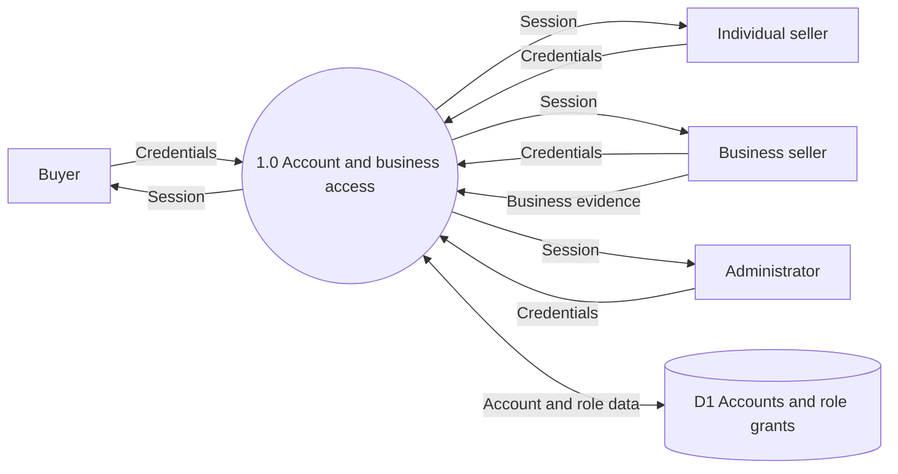

**Figure A-02b. Listing review and discovery.**

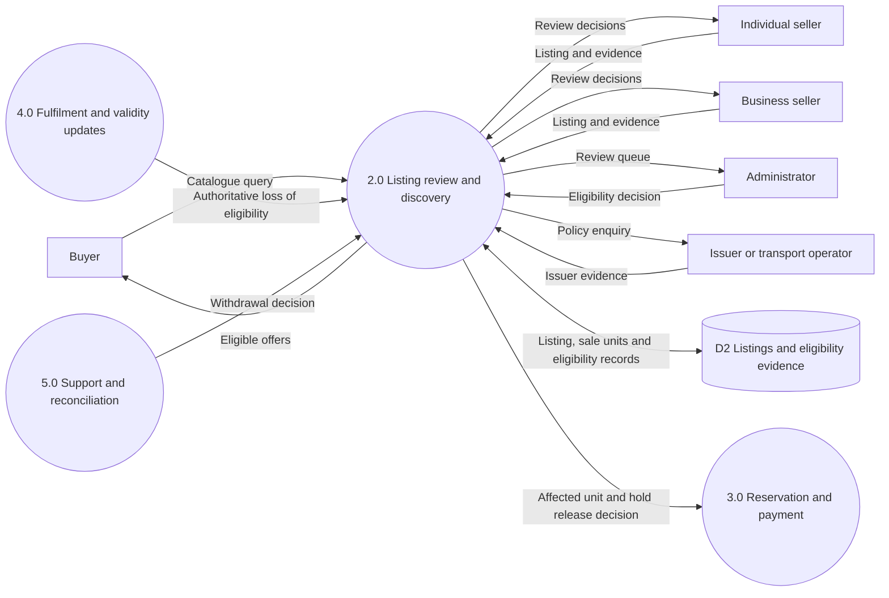

**Figure A-02c. Reservation and payment.**

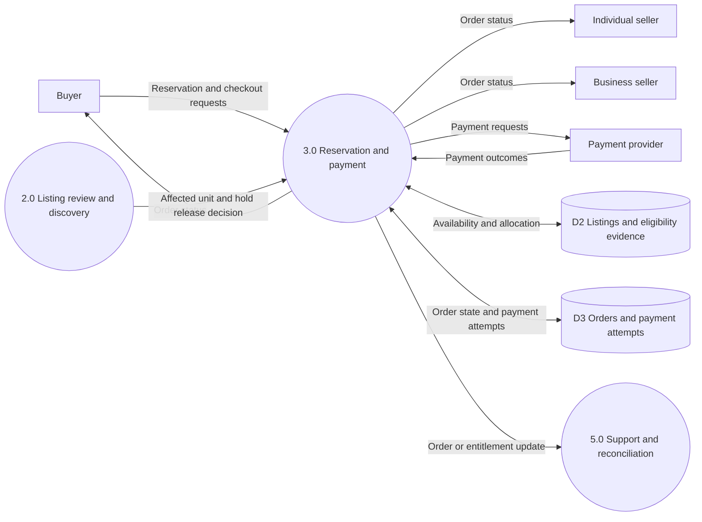

**Figure A-02d. Fulfilment and validity updates.**

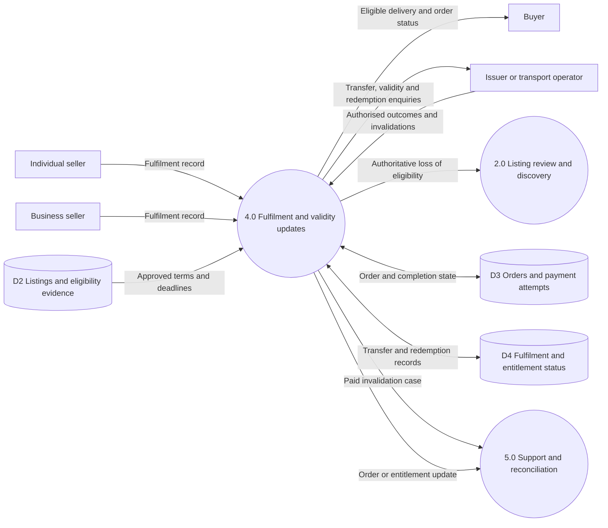

**Figure A-02e. Support and reconciliation.**

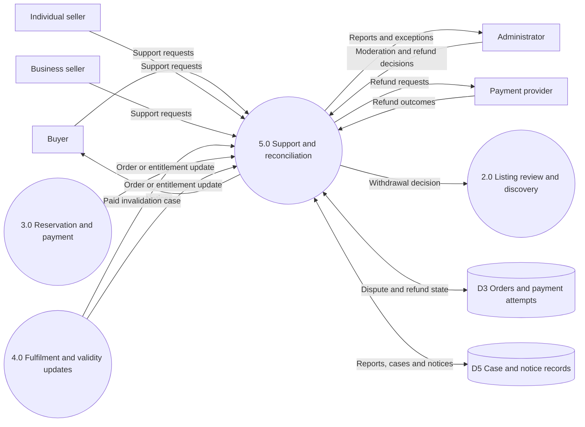

### A.2 Use case diagram and descriptions

**Figure A-03. Use case diagram.**

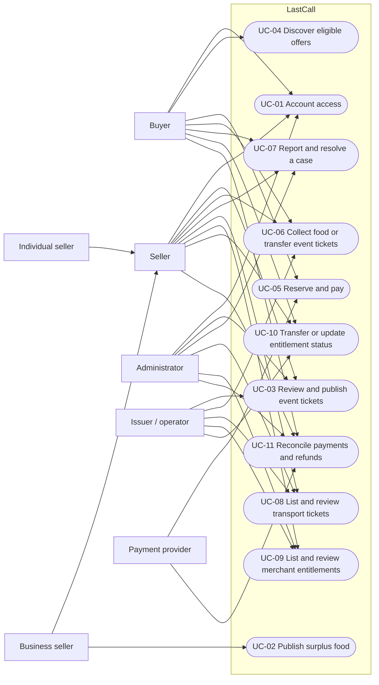

| ID | Use case / actors | Precondition | Main scenario | Exception and postcondition |
|---|---|---|---|---|
| UC-01 | Account access · buyer, sellers, administrator | Public registration or designated account exists | Register, sign in or log out. Sessions expire on inactivity or absolute age. An eligible user activates individual selling. The business role requires authorisation. | Invalid credentials or unauthorised role change grants no access. |
| UC-02 | Publish surplus food · business seller | Business privilege and suitable pickup window | Submit lot, quantity, price, cutoff and location. Publish when valid. | Incomplete, expired or invalid lot stays unavailable. |
| UC-03 | Review and publish event tickets · seller, administrator, issuer | Policy and ownership evidence available | Submit event details. Review validity, ownership, permitted transfer method and deadline. Publish approved ticket. | Prohibited, unknown or unsupported transfer stays unavailable. Record decision. |
| UC-04 | Discover eligible offers · buyer | Catalogue available | Browse and filter eligible offers. Inspect price, category terms and deadlines. | Empty results display no offers. Unavailable links expose no reservation action. |
| UC-05 | Reserve and pay · buyer, payment provider | Signed-in buyer and eligible unit belonging to another seller | Reserve unit at the agreed price. Initiate payment and apply a verified timely success once. | Conflict, decline or expiry prevents confirmation. A verified decline ends the hold; another checkout needs a new reservation. Unapplied funds go to UC-11 without changing allocation. |
| UC-06 | Collect food or transfer event tickets · buyer, seller, issuer | Confirmed order and valid collection or transfer window | Record food pickup or authorised event-ticket handover. | Wrong actor, wrong method, blocking case, loss of validity or expiry blocks fulfilment; the deadline marks an unfulfilled Confirmed order Missed without automatic refund or restocking. |
| UC-07 | Report and resolve a case · buyer, seller, administrator | A relevant listing or order exists | Record a listing report. Investigate and record the decision. Withdraw affected stock where justified. The buyer can inspect confirmation notices or rate a fulfilled order when enabled. | Open reservations cannot complete after withdrawal. Reports alone preserve paid sales; upheld reports open cases and block outstanding fulfilment. Refund decisions follow UC-11. |
| UC-08 | List and review transport tickets · seller, administrator, operator | Ticket and route details, ownership evidence and identifiable issuer | Submit bus or train details. Check unused status, passenger restrictions, policy and supported handover. Publish the eligible item. | Keep unavailable on denial, missing evidence or absent official transfer path. |
| UC-09 | List and review merchant entitlements · seller, administrator, issuer | Merchant or other issuer identifiable | Submit coupon, voucher, pass or eligible opportunity with restrictions and use or balance terms. Assess transfer, validity, redemption evidence and duplicates before publication. | Flag duplicate references. Unknown or unverified redemption does not establish eligibility. |
| UC-10 | Transfer or update entitlement status · buyer, seller, issuer | Confirmed order for an entitlement or authoritative status update | Recheck restrictions, record the authorised transfer and notify the buyer. Record issuer-supported cancellation, invalidation or redemption updates. | Block invalid delivery. Record unknown redemption separately from confirmed unused status. |
| UC-11 | Reconcile payments and refunds · buyer, seller, administrator, payment provider | Disputed purchase, verified unapplied funds or eligible refund request | Match payment to order, record review decision, request approved refund and record verified result. Notify buyer of the outcome. | Pending or failed refund remains identifiable. Late funds never reopen a released allocation. |

### A.3 Activity diagrams

**Food listing, purchase and pickup (UC-02, UC-05, UC-06).**

**Figure A-04. Food activity.**

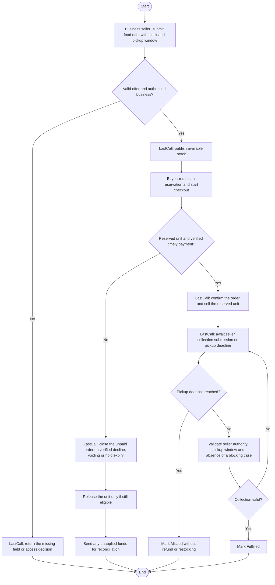

**Eligibility review and authorised handover (UC-03, UC-08–UC-10).**

**Figure A-05. Entitlement activity.**

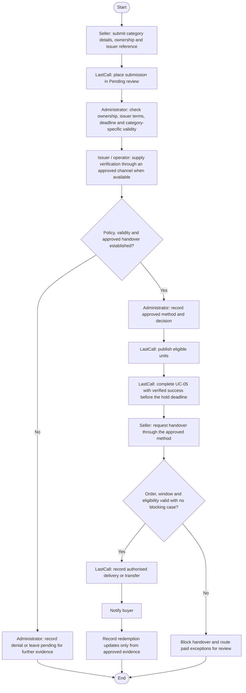

### A.4 Class diagram (design)

The domain classes describe responsibilities and relationships rather than framework components. An eligible offer has category-specific terms and one or more independent sale units. Eligibility decisions, payment attempts and fulfilment records preserve the evidence of changes over time.

**Figure A-06. Domain class diagram.**

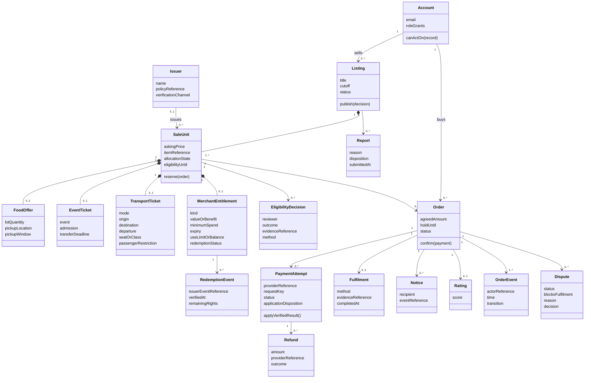

Each sale unit has exactly one matching category detail. Transport modes carry shared route and schedule data and mode-specific seat, class and identity conditions. Merchant entitlement kinds carry offer terms appropriate to a coupon, voucher, digital pass or other eligible issuer-backed opportunity. Only offers with an issuer require an issuer reference.

### A.5 Sequence diagrams

**Verify eligibility and publish an entitlement (UC-03, UC-08, UC-09).**

**Figure A-07. Eligibility sequence.**

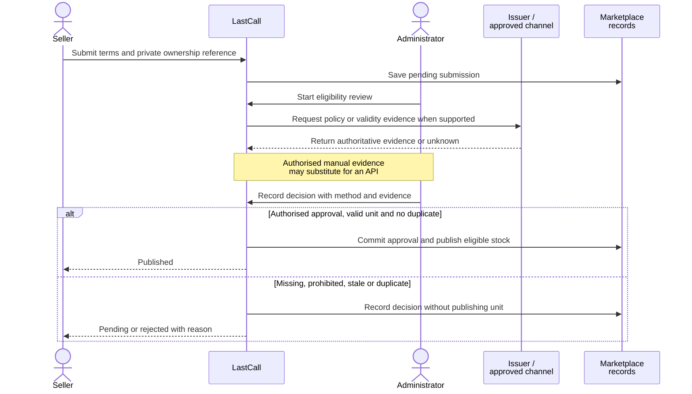

**Reserve, pay and reconcile (UC-05, UC-11).**

**Figure A-08. Reservation and payment sequence.**

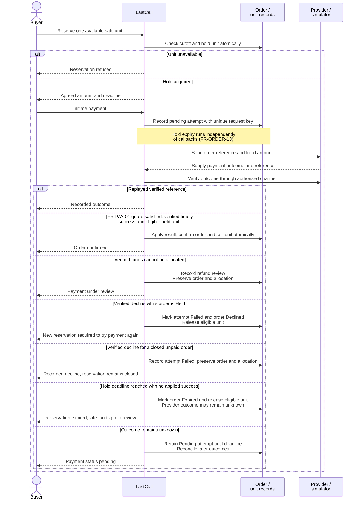

**Confirm authorised transfer and update redemption status (UC-10).**

**Figure A-09. Transfer sequence.**

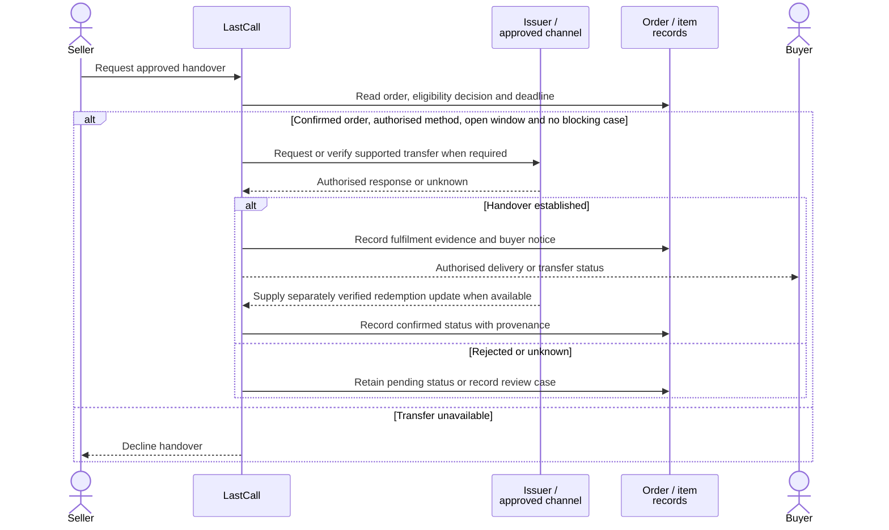

### A.6 State machine diagrams

**Listing eligibility and sale unit availability.** Publication controls visibility of the offer. Each unit is allocated independently. A Published offer stays discoverable only while at least one eligible unit is Available before cutoff (FR-LIST-02, FR-LIST-04, FR-LIST-07). Published is a listing state; Held and Sold are unit states, not listing states.

**Figure A-10. Listing states.**

**Figure A-11. Sale-unit states.**

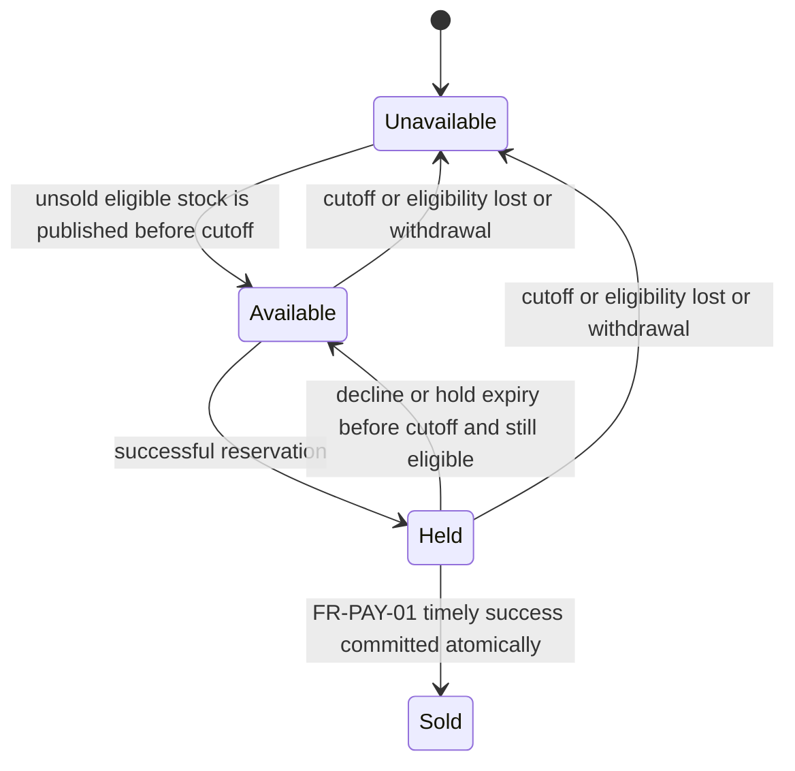

A sold unit has no return path to available stock. A withdrawal or invalidation closes an affected unpaid reservation. A paid order follows the relevant fulfilment, dispute or refund rules.

**Order and payment.** Payment arrival can lag reservation expiry. Record late verified funds and reconcile them without reacquiring inventory or confirming the original order.

**Figure A-12. Order and fulfilment states.**

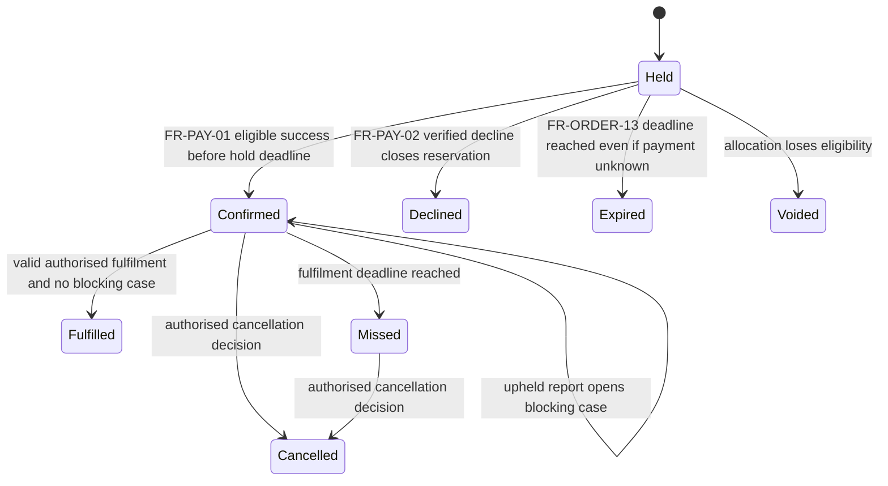

**Figure A-13. Payment and refund states.**

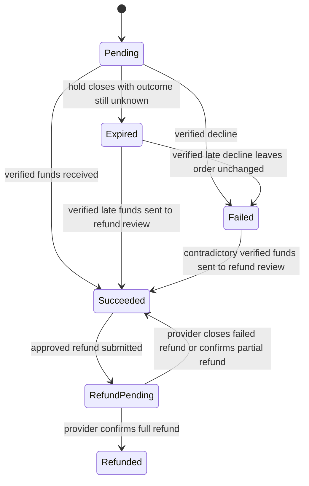

Declined, Expired and Voided orders never return to Held or Confirmed; retry requires a new order and reservation (FR-PAY-12). The unit may meanwhile be held or sold to another buyer. Payment Succeeded records verified funds, not necessarily an applied purchase: an unapplied success enters Refund review under FR-PAY-08 and never changes allocation. The payment attempt's Expired state means its local window closed with an unresolved provider outcome, not proof that no funds were collected. A still-Pending attempt moves to Expired when its unpaid hold closes; later verified funds cannot confirm the closed order. A received report does not change a confirmed sale; an upheld report blocks fulfilment through an associated case (FR-ADMIN-05–06, FR-ORDER-14). Missed does not change payment or restock the unit (FR-PAY-13, FR-LIST-08).

State labels in the models omit spaces where Mermaid requires a single identifier. Individual refund amounts and outcomes remain on refund records. A partial refund leaves a remaining paid amount. Duplicate results do not create either a new allocation or a second refund.

### A.7 Database schema (ERD)

This is a proposed logical model. The detail tables share the sale unit key and supply distinct validation fields. Event, transport and merchant records reference an issuer through their sale unit. A merchant record keeps proof of ownership or issuance separate from authority-sourced redemption evidence.

**Figure A-14. Logical ERD.**

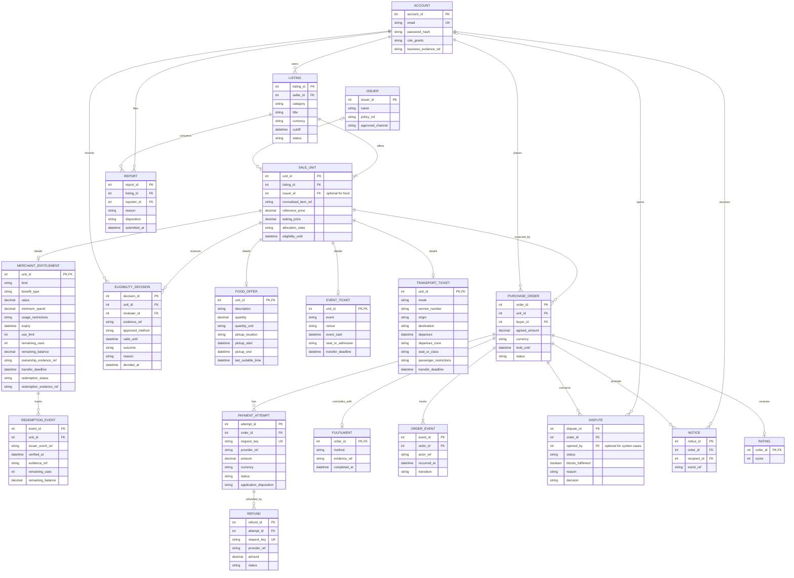

- A sale unit has exactly one detail row and its type must match the listing category. Transport mode distinguishes bus from train. A quantity within a food unit describes the lot collected together. Multiple independently sold lots use separate unit keys.
- A canonical issuer and item reference cannot identify simultaneous competing active listings or a relisted sold unit. The normalised reference is private. Review evidence remains access-controlled, separate from the public listing.
- A sale unit can have many historical orders, at most one live hold, and at most one allocation to a confirmed purchase. Apply the successful payment and sell the unit in one transaction. A payment that cannot be applied is retained for reconciliation.
- Payment and refund request keys are unique. When known, a provider transaction reference is unique within that provider and transaction kind. Verified refunds cannot exceed the collected amount.
- Redemption events are unique by unit and issuer event reference. Evidence is distinct from ownership or issuance evidence. Unknown redemption stays unknown when evidence is unavailable. Orders, status events and fulfilment records retain references even after catalogue withdrawal.

**Deployment and recovery concept.** A browser connects through HTTPS to a web host. The application keeps private records in a persistent store and accesses payment and issuer channels through authorised interfaces where available. The backup boundary includes the database and required private evidence references. Hosting, frameworks and backup service are design decisions.

**Figure A-15. Deployment and recovery concept.**

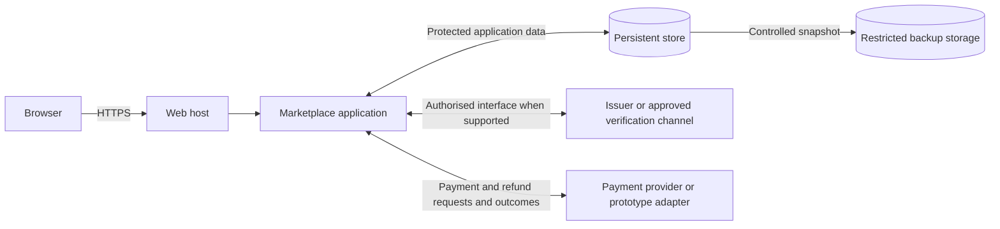

## Appendix B — Requirements traceability matrix

All checks below are **proposed, not executed**. Rows are ordered by numeric test ID; existing IDs are retained. Status identifies release scope, not implementation or test success. Must and Should are the planned prototype scope, Could is optional, and complete-system checks are deferred. Shared-category and multi-unit cases are exercised only in their applicable profile. The Jira column remains empty because no verified issue references were supplied.

| Requirement | Use case | Jira story | Design element | Test case | Status |
|---|---|---|---|---|---|
| FR-AUTH-01 | UC-01 |  | Account | TC-01 — Submit a new address; verify a buyer account exists. | Proposed — Must |
| FR-AUTH-02 | UC-01 |  | Account | TC-02 — Enter a wrong password; verify no session is issued. | Proposed — Must |
| FR-AUTH-03 | UC-01 |  | Account | TC-03 — Sign in and open the account view. | Proposed — Must |
| FR-USER-01 | UC-01 |  | Account | TC-04 — Request each privileged role through self-service; verify denial. | Proposed — Must |
| FR-USER-02 | UC-01 |  | Account | TC-05 — Activate the seller profile and open the ticket submission form. | Proposed — Must |
| FR-FOOD-01 | UC-02 |  | FoodOffer | TC-06 — Submit the same valid food lot from business and individual seller accounts; permit only the business account to publish. | Proposed — Must |
| FR-FOOD-02 | UC-02 |  | FoodOffer | TC-07 — Omit each required food field; try pickup start equal to end and pickup end after suitability limit; reject each and accept a valid window. | Proposed — Must |
| FR-FOOD-03 | UC-02 |  | FoodOffer | TC-08 — Submit a complete discounted lot with future pickup; find it in the catalogue. | Proposed — Must |
| FR-EVENT-01 | UC-03 |  | EligibilityDecision | TC-09 — Submit complete event details and verify the offer remains private in Pending review. | Proposed — Must |
| FR-VERIFY-01 | UC-03 |  | EligibilityDecision | TC-10 — Submit prohibited, unknown, expired and mismatched cases for each entitlement category; verify refusal. | Proposed — Must |
| FR-VERIFY-02 | UC-03 |  | EligibilityDecision | TC-11 — Approve eligible items in each enabled category; verify each becomes reservable. | Proposed — Must |
| FR-VERIFY-03 | UC-03 |  | EligibilityDecision | TC-12 — Reject a submission; verify the decision records the acting reviewer, server time, rejection outcome and supplied reason. | Proposed — Must |
| FR-EVENT-03 | UC-03 |  | SaleUnit | TC-13 — Submit a duplicate across seller accounts, then resubmit after transfer with no new permission; expect refusal. | Proposed — Must |
| FR-LIST-01 | UC-04 |  | Listing | TC-14 — Try zero, equal, higher and discounted positive sale prices against the same original price; only the discounted positive price may publish. | Proposed — Must |
| FR-LIST-02 | UC-04 |  | Listing | TC-15 — Request reservations just before, exactly at and after cutoff; only the first may acquire an otherwise eligible unit. | Proposed — Must |
| FR-SEARCH-01 | UC-04 |  | Listing | TC-16 — Mix Draft, Pending review, Expired and Withdrawn listings with Published listings whose units are Held, Sold or Available; return only Published offers with eligible Available stock. | Proposed — Must |
| FR-SEARCH-02 | UC-04 |  | Listing | TC-17 — Filter mixed eligible stock by food and then event; each result set contains only the selected category. | Proposed — Should |
| FR-ORDER-01 | UC-05 |  | SaleUnit | TC-18 — Race two buyers for one prototype unit; exactly one hold succeeds. Complete-system extension only: hold a second available unit of the same listing independently. | Proposed — Must |
| FR-ORDER-02 | UC-05 |  | Order | TC-19 — With the proposed 10-minute configuration, hold one offer far from cutoff and another two minutes before cutoff; expect deadlines in ten and two minutes respectively. | Proposed — Must |
| FR-ORDER-03 | UC-05 |  | Order | TC-20 — Expire an unpaid hold before the cutoff; verify another buyer can reserve the unit. | Proposed — Must |
| FR-ORDER-04 | UC-05 |  | Order | TC-21 — Acquire a reservation, then alter the displayed listing price; verify the order retains the exact original amount and currency quoted at acquisition. | Proposed — Must |
| FR-ORDER-05 | UC-05 |  | Order | TC-22 — Attempt self-reservation from the listing seller account; verify refusal and no hold creation. | Proposed — Must |
| FR-PAY-01 | UC-05 |  | PaymentAttempt | TC-23 — Compare verified success before, at and after the hold deadline, plus amount mismatch, Voided order and expired eligibility; only the timely valid case confirms atomically with Sold allocation. | Proposed — Must |
| FR-PAY-02 | UC-05 |  | PaymentAttempt | TC-24 — Submit a verified decline while Held with time remaining; verify payment Failed and order Declined. A late decline must not overwrite a Confirmed order. | Proposed — Must |
| FR-PAY-03 | UC-05 |  | PaymentAttempt | TC-25 — Try payment initiation at expiry and on Declined, Voided and Confirmed orders; verify no provider request. A valid Held order before its deadline is allowed. | Proposed — Must |
| FR-PAY-04 | UC-05 |  | PaymentAttempt | TC-26 — Replay one success before and after expiry; count one applied confirmation. | Proposed — Must |
| FR-ORDER-06 | UC-06 |  | Fulfilment | TC-27 — As listing seller, try pickup before start, at start, just before end and at end on separate Confirmed orders; accept only at start and just before end. | Proposed — Must |
| FR-EVENT-02 | UC-06 |  | Fulfilment | TC-28 — Attempt wrong-method, revoked and late handovers; accept a timely approved handover. | Proposed — Must |
| FR-ORDER-07 | UC-06 |  | Fulfilment | TC-29 — Verify an unrelated seller is denied and the listing seller for pickup or named transfer authority is accepted. | Proposed — Must |
| FR-ORDER-08 | UC-06 |  | Fulfilment | TC-30 — Read Confirmed unfulfilled food and ticket orders at their deadlines, including one with a blocking case; expect Missed, unchanged paid state and Sold allocation. | Proposed — Must |
| FR-NOTIFY-01 | UC-07 |  | Notice | TC-31 — Confirm a demo payment; verify an in-app confirmation notice is visible to that purchasing buyer. | Proposed — Should |
| FR-ADMIN-01 | UC-07 |  | Report | TC-32 — File a report as a signed-in user; verify listing reference, reporter, reason and submission time are stored. | Proposed — Should |
| FR-ADMIN-02 | UC-07 |  | Report | TC-33 — Uphold a report during a hold; verify the affected unit cannot be sold. | Proposed — Should |
| FR-REVIEW-01 | UC-07 |  | Rating | TC-34 — Attempt a rating before fulfilment, by an unrelated user and twice after fulfilment; accept only the first post-fulfilment rating by the buyer. | Proposed — Could |
| FR-TRANS-01 | UC-08 |  | TransportTicket | TC-35 — Save and reopen a bus draft with route, operator, departure, seat, price and booking reference; verify values persist and the prototype keeps it unpublished. | Proposed — Could |
| FR-TRANS-02 | UC-08 |  | TransportTicket | TC-36 — Save and reopen a train draft with class, passenger restrictions and validity evidence; verify values persist and the prototype keeps it unpublished. | Proposed — Could |
| FR-COUPON-01 | UC-09 |  | MerchantEntitlement | TC-37 — Save fixed-value and percentage coupon drafts; verify benefit types and terms persist separately and remain unpublished in the prototype. | Proposed — Could |
| FR-VOUCHER-01 | UC-09 |  | MerchantEntitlement | TC-38 — Save a voucher draft with a partial balance; verify denomination and balance persist distinctly and it remains unpublished in the prototype. | Proposed — Could |
| FR-LIST-03 | UC-04 |  | Listing | TC-39 — In the academic profile, allow valid food/event publication; deny bus, train, coupon, voucher and pass publication even when optional draft forms are present. | Proposed — Must |
| FR-COUPON-02 | UC-09 |  | MerchantEntitlement | TC-40 — Submit two active merchant listings with the same issuer and canonical reference; verify the second is flagged as a duplicate. | Proposed — complete system |
| NFR-PERF-01 | UC-04 |  | Listing | TC-41 — Run 500 catalogue requests from 20 concurrent clients over 1,000 listings; record environment, all failures and nearest-rank p95; accept at most 2 seconds with no failed requests. | Proposed — Must |
| NFR-SEC-01 | UC-01 |  | Account | TC-42 — Inspect stored credentials for two test accounts with the same password; verify distinct salted bcrypt/Argon2 hashes and no plaintext storage. | Proposed — Must |
| NFR-SEC-02 | UC-07 |  | Account | TC-43 — Exercise buyer, two seller accounts and administrator against protected order, evidence and moderation actions; deny every disallowed role/object pair, including direct API requests. | Proposed — Must |
| NFR-SEC-03 | UC-01 |  | Account | TC-44 — Fail sign-in five times for one identifier within five minutes; deny a sixth attempt even with valid credentials. After the oldest failure leaves the rolling window, permit a valid sign-in; another identifier is unaffected. | Proposed — Must |
| NFR-PRIV-01 | UC-03 |  | EligibilityDecision | TC-45 — Place synthetic private markers in evidence, identity and redemption fields; verify anonymous, buyer and unrelated seller listing responses omit every marker. | Proposed — Must |
| NFR-REL-01 | UC-05 |  | PaymentAttempt | TC-46 — Inject a failure before commit, then replay the result and verify one coherent payment, order and unit outcome. | Proposed — Must |
| NFR-AVL-01 | UC-04 |  | Web host | TC-47 — Run 120 once-per-minute probes over the scheduled two hours; require at least 119 HTTP 200 responses with expected catalogue structure within five seconds; record errors and timing. | Proposed — Must |
| NFR-USE-01 | UC-05 |  | Listing and Order | TC-48 — Time four consenting first-time participants separately from catalogue to reservation confirmation; require at least 3/4 unaided completions within three minutes. Report each time, observed errors and help; make no population-level success claim. | Proposed — Must |
| NFR-ACC-01 | UC-05 |  | Listing and Order | TC-49 — Complete discovery, reservation and checkout using only the keyboard; require visible focus on every actionable control and successful completion without a pointer. | Proposed — Must |
| NFR-MNT-01 | UC-05 |  | Order | TC-50 — Change hold duration from ten to five minutes in configuration without editing order logic; a new hold far from cutoff lasts five minutes and the listing cutoff is unchanged. | Proposed — Must |
| NFR-COMP-01 | UC-05 |  | Listing and Order | TC-51 — Record stable Chrome version and OS; complete discovery, reservation and simulated checkout at 360 and 1280 CSS-pixel widths; verify all required controls are usable without clipping or horizontal page scrolling. | Proposed — Must |
| NFR-INT-01 | UC-05 |  | SaleUnit | TC-52 — Race verified successes for the same unit; require at most one purchase ever confirmed, including orders later Fulfilled, Missed or Cancelled. | Proposed — Must |
| NFR-REC-01 | UC-05 |  | Restricted backup storage | TC-53 — Optional timed drill: restore within 60 minutes of declaration from a snapshot no older than 24 hours; verify order, payment and stock consistency and report actual elapsed time and data loss. | Proposed — Could |
| NFR-AUD-01 | UC-06 |  | OrderEvent | TC-54 — Reconstruct hold, confirmation and fulfilment from order history; verify each transition has its actor or system identity and timestamp. | Proposed — Must |
| FR-LIST-04 | UC-04 |  | Listing | TC-55 — Expire one prototype unit at its recorded eligibility boundary; verify it is not reservable. Complete-system extension: a second still-valid Available unit remains reservable. | Proposed — Must |
| FR-PAY-05 | UC-05 |  | PaymentAttempt | TC-56 — Retry one checkout request before its response returns; count one provider attempt. | Proposed — Must |
| FR-PAY-06 | UC-05 |  | PaymentAttempt | TC-57 — Send an unauthenticated message and vary each matched field; verify none change the payment or order. | Proposed — Must |
| FR-PAY-07 | UC-05 |  | PaymentAttempt | TC-58 — Exercise Pending, verified decline (Failed), local closure (Expired) and verified funds (Succeeded); a verified decline after local expiry records Failed without changing the Expired order or its released allocation. | Proposed — Must |
| FR-PAY-08 | UC-11 |  | PaymentAttempt.applicationDisposition | TC-59 — Deliver verified success at and after expiry, after voiding, after decline, and as distinct excess funds after confirmation; expect one refund-review record per distinct payment and no order/allocation change. Include a unit already resold to another buyer and replay each outcome. | Proposed — Must |
| FR-ORDER-09 | UC-05 |  | SaleUnit | TC-60 — Decline an active payment before cutoff; verify the released eligible unit can be reserved by a different buyer. | Proposed — Must |
| FR-ORDER-11 | UC-05 |  | Order | TC-61 — Reserve an open unit as a different buyer and verify the hold belongs to that account. | Proposed — Must |
| FR-ORDER-12 | UC-06 |  | Fulfilment | TC-62 — Record timely collection and eligible handover for separate Confirmed orders; verify each resulting state is Fulfilled. | Proposed — Must |
| FR-ADMIN-03 | UC-07 |  | Order | TC-63 — Withdraw during checkout and verify the hold moves to Voided. | Proposed — Should |
| FR-BUS-01 | UC-08 |  | TransportTicket | TC-64 — Submit an otherwise valid bus offer without its operator; reject it for review. Supply complete required fields and accept it into review. | Proposed — complete system |
| FR-TRAIN-01 | UC-08 |  | TransportTicket | TC-65 — Submit an otherwise valid train offer without its class or applicable passenger restriction; reject it for review, then accept the completed submission. | Proposed — complete system |
| FR-TRANS-03 | UC-08 |  | EligibilityDecision | TC-66 — Submit permitted, prohibited and identity-linked travel bookings without issuer-approved reassignment; only the permitted case may be approved in the complete system. | Proposed — complete system |
| FR-TRANS-04 | UC-10 |  | TransportTicket | TC-67 — Record an issuer-accepted travel cancellation; verify the authoritative outcome is stored against the correct unit. | Proposed — complete system |
| FR-NOTIFY-02 | UC-10 |  | Notice | TC-68 — Drive each outcome for a linked order and verify one corresponding in-app notice. | Proposed — complete system |
| FR-COUPON-03 | UC-09 |  | MerchantEntitlement | TC-69 — Submit a coupon without its use terms; reject it for review, then accept complete supported single-use and multiple-use fixtures. | Proposed — complete system |
| FR-VOUCHER-02 | UC-09 |  | EligibilityDecision | TC-70 — Submit fixtures with positive, unknown and zero issuer-backed values; only the first may pass. | Proposed — complete system |
| FR-PASS-01 | UC-09 |  | MerchantEntitlement | TC-71 — Omit validity or included rights from a pass; verify rejection. | Proposed — complete system |
| FR-LIST-05 | UC-09 |  | Listing | TC-72 — Submit an unsupported category that has generic listing fields; verify it remains unpublished. | Proposed — complete system |
| FR-COUPON-04 | UC-04 |  | Listing | TC-73 — Open an approved merchant offer and verify expiry, benefit, minimum spend, redemption terms and the evidenced count or balance. | Proposed — complete system |
| FR-TRANSFER-01 | UC-10 |  | Fulfilment | TC-74 — Try an expired, revoked and unknown record; verify that no handover completes. | Proposed — complete system |
| FR-TRANSFER-02 | UC-10 |  | Fulfilment | TC-75 — Try an unrelated order and wrong method, then a supported handover with matching evidence. | Proposed — complete system |
| FR-TRANSFER-03 | UC-10 |  | SaleUnit | TC-76 — Invalidate a held unit and verify it leaves available stock. | Proposed — complete system |
| FR-TRANSFER-04 | UC-10 |  | Dispute | TC-77 — Invalidate a paid ticket and verify a case is open and no fulfilment is accepted. | Proposed — complete system |
| FR-COUPON-05 | UC-10 |  | RedemptionEvent | TC-78 — Compare a seller screenshot with issuer-confirmed usage; only the latter changes recorded status. | Proposed — complete system |
| FR-VOUCHER-03 | UC-10 |  | RedemptionEvent | TC-79 — Replay a partial redemption event and verify only one decrement; an unknown external use stays unknown. | Proposed — complete system |
| FR-NOTIFY-03 | UC-10 |  | Notice | TC-80 — Complete an approved coupon or voucher handover and verify the buyer's notice. | Proposed — complete system |
| FR-TRANSFER-05 | UC-10 |  | Order | TC-81 — Invalidate held transport and merchant units and verify each unpaid order becomes Voided. | Proposed — complete system |
| FR-ADMIN-04 | UC-11 |  | Dispute | TC-82 — Open a transfer dispute as its buyer, then as an unrelated account; verify only the authorised case is created. | Proposed — complete system |
| FR-PAY-09 | UC-11 |  | Refund | TC-83 — Approve a partial refund; verify initiation against the original payment. Try another above the remaining refundable amount and verify refusal. | Proposed — complete system |
| FR-PAY-10 | UC-11 |  | Refund | TC-84 — Deliver a verified refund confirmation twice; verify one refund record with the verified outcome and no duplicate refund. | Proposed — complete system |
| FR-ORDER-10 | UC-11 |  | Order | TC-85 — Approve cancellation on separate Confirmed and Missed unfulfilled orders; expect Cancelled. Refuse cancellation of a Fulfilled order; retain its fulfilment history. | Proposed — complete system |
| FR-NOTIFY-04 | UC-11 |  | Notice | TC-86 — Confirm and fail separate approved refunds and verify the corresponding buyer notices. | Proposed — complete system |
| FR-PAY-11 | UC-11 |  | Refund | TC-87 — Submit two concurrent refund requests that together exceed the original payment and verify the provider receives only an allowed amount. | Proposed — complete system |
| NFR-SCALE-01 | UC-04 |  | Listing | TC-88 — Optional: repeat TC-41 with 5,000 listings; require p95 at most 2 seconds, no failed requests and correct filtered results. | Proposed — Could |
| FR-LIST-06 | UC-04 |  | Listing | TC-89 — Try cutoff in the past, at now, after a unit deadline and equal to a future deadline; reject the first three and accept the last. | Proposed — Must |
| FR-LIST-07 | UC-04 |  | SaleUnit | TC-90 — Mix Available, Held, Sold and ineligible units; verify the exact eligible count before cutoff and zero at cutoff. Prototype check uses one unit; multiple-unit check is complete-system only. | Proposed — Must |
| FR-LIST-08 | UC-06 |  | SaleUnit | TC-91 — Apply missed collection, cancellation, invalidation and partial/full refund fixtures to sold units; verify none becomes reservable. Refund/cancellation fixtures test the invariant without implementing real refunds. | Proposed — Must |
| FR-LIST-09 | UC-02 |  | Listing | TC-92 — Submit zero, one and two units in the prototype; only one unit is accepted, including a food lot containing several portions. | Proposed — Must |
| FR-PAY-12 | UC-05 |  | PaymentAttempt | TC-93 — Decline payment with time remaining; refuse retry on that order, then permit checkout after the same buyer acquires a new available reservation. | Proposed — Must |
| FR-ORDER-13 | UC-05 |  | Order | TC-94 — Leave an attempt pending until the deadline; verify order Expired and eligible stock released; later success cannot confirm it. | Proposed — Must |
| FR-ADMIN-05 | UC-07 |  | Report | TC-95 — Submit a report against a Confirmed sale; verify the report is recorded and neither the sale nor payment changes. | Proposed — Should |
| FR-ADMIN-06 | UC-07 |  | Dispute | TC-96 — Uphold reports against separate Confirmed and Fulfilled purchases; verify each affected sale is linked to a case and completed fulfilment history is retained. | Proposed — Should |
| FR-ORDER-14 | UC-06 |  | Fulfilment | TC-97 — Open a blocking case on a Confirmed order; reject an otherwise valid handover, then allow it after authorised resolution if its window and eligibility remain valid. | Proposed — Should |
| FR-PAY-13 | UC-06 |  | PaymentAttempt | TC-98 — Reach the collection deadline with a paid uncollected food order; verify Missed, unchanged payment outcome and no refund request. | Proposed — Must |
| FR-LIST-10 | UC-03 |  | Listing | TC-99 — Try event and travel deadlines after their start/departure and merchant deadlines after expiry; reject each. A deadline equal to the governing limit is allowed, with handover strictly before it. | Proposed — Must |
| NFR-SEC-04 | UC-02 |  | Validation | TC-100 — Send missing, wrong-type, oversized, malformed and out-of-range values directly to an endpoint; verify rejection before storage; valid boundary inputs remain accepted. | Proposed — Must |
| NFR-SEC-05 | UC-01 |  | Data access | TC-101 — Inspect query bindings and submit SQL metacharacters in sign-in and search inputs; verify they remain data and cannot bypass sign-in or broaden results. | Proposed — Must |
| NFR-SEC-06 | UC-04 |  | Output encoding | TC-102 — Store and reflect script/HTML payloads through listing fields; verify they display as text without script execution. | Proposed — Must |
| NFR-SEC-07 | UC-05 |  | Session / CSRF | TC-103 — Send cookie-authenticated state changes with missing, invalid and another session's token; deny each, while accepting the valid session token. Check logout and moderation too. | Proposed — Must |
| NFR-SEC-08 | UC-01 |  | Session | TC-104 — With controlled time, test just before and at 15 idle minutes; separately keep activity below that limit until 8 hours after sign-in; reject at each applicable boundary. | Proposed — Must |
| NFR-SEC-09 | UC-01 |  | Session | TC-105 — Log out, then replay the captured session credential against a protected endpoint; verify denial, including from a second tab. | Proposed — Must |
| NFR-SEC-10 | UC-01 |  | Runtime configuration | TC-106 — Inspect repository history, client bundles, error responses and logs using synthetic secret markers; verify no credentials leak and runtime secret storage is access-restricted. Do not copy discovered secrets into evidence. | Proposed — Must |
| NFR-SEC-11 | UC-01 |  | Session cookie | TC-107 — Inspect Set-Cookie on the HTTPS deployment for Secure, HttpOnly and SameSite=Lax or Strict; verify scripts cannot read the session cookie. | Proposed — Must |
| NFR-REC-02 | UC-05 |  | Restricted backup storage | TC-108 — Snapshot known Held, Confirmed and Missed orders with payment records; restore into an isolated store and compare values, references and allocation invariants. | Proposed — Must |
| NFR-COMP-02 | UC-05 |  | Listing and Order | TC-109 — Repeat TC-51 in the recorded stable Firefox version at both widths; record flow and layout results separately from baseline Chrome coverage. | Proposed — Could |

## Appendix C — Glossary · AI-use disclosure

| Term | Meaning in LastCall |
|---|---|
| Entitlement | An issuer-defined right to travel, attend, redeem a benefit or receive another service. |
| Canonical reference | Private normalised identifier for an issuer's item, used to check for duplicates. |
| Sale unit | One separately reservable and purchasable lot, ticket or entitlement. |
| Eligibility decision | Attributable decision linking evidence, review outcome and approved handover method. |
| Fixture | Synthetic account, listing, policy or payment response used to exercise the prototype. |
| Fulfilment | Recorded completion of food collection or authorised delivery of an entitlement. |
| Reconciliation | Matching verified provider funds with the applicable payment, order or refund. |
| Redemption evidence | Issuer-backed information establishing the use, balance or usage status of an entitlement. |
| Draft | Private listing not submitted or published. |
| Pending review / PendingReview | Entitlement submission awaiting an eligibility decision. |
| Rejected | Listing denied eligibility approval. |
| Published | Listing approved for discovery, shown only if eligible Available stock remains. |
| Withdrawn | Listing removed from further sale by an authorised decision; purchase history remains. |
| Available | Unsold eligible unit with no active hold before cutoff. |
| Unavailable | Unsold unit that cannot currently be reserved; publication/eligibility and cutoff still govern reactivation. |
| Held | Unit exclusively reserved by one buyer; the corresponding unpaid order can confirm only before its hold deadline. |
| Sold | Unit permanently allocated to a successfully confirmed purchase; refunds and missed collection do not restock it. |
| Confirmed | Order with a verified payment applied atomically to its reserved unit, awaiting fulfilment. |
| Declined | Unpaid order closed after a verified payment decline; the old reservation cannot be reused. |
| Expired | Listing: cutoff passed. Order: unpaid hold deadline passed. Payment attempt: local window closed with provider outcome unresolved. These are separate records. |
| Voided | Unpaid order closed because withdrawal or invalidation removed its allocation's eligibility. |
| Fulfilled | Confirmed order whose valid collection or permitted handover was recorded. |
| Missed | Confirmed order whose fulfilment deadline passed without completion; not an automatic refund decision. |
| Cancelled | Previously Confirmed or Missed unfulfilled order closed by an authorised decision; refund status is separate. |
| Pending | Payment attempt or refund awaiting a verified provider outcome. |
| Failed | Payment attempt: verified decline. Refund: provider-reported failure to refund. Neither label proves the other record's status. |
| Succeeded | Payment with verified funds; only a timely eligible application confirms an order. |
| Refund review | Recorded unapplied funds or a case awaiting an authorised refund decision; no refund has yet been promised or sent. |
| RefundPending / Refunded | Approved refund submitted / provider has confirmed the full collected amount refunded. Partial refunds retain the remaining paid balance. |
| Exception case | Review linked to a paid order; a blocking open case prevents fulfilment but does not undo payment or historical fulfilment. |
| Unknown | No authoritative evidence of a payment or entitlement outcome; never treated as approved, unused or successful. |
| Invalidated | Authoritative evidence removes eligibility; withdraw unsold stock, void unpaid holds, or review unresolved paid orders. |
| Approved / prohibited | Issuer permission and required evidence established / the governing rule disallows the proposed sale or transfer. |
| Redemption | Use of an entitlement evidenced by its issuer; remaining uses/balance and expiry are distinct from marketplace fulfilment. |
| CSRF / XSS | Cross-site request forgery / cross-site scripting. |
| Recovery time / recovery point | Maximum time allowed to restore service / maximum age of data that may be lost. |

### AI-use disclosure

OpenAI Codex assisted with drafting and reviewing requirements, editing the full-system and prototype scope, generating editable models, and mapping proposed acceptance checks. Earlier drafting carried forward the project brief; this revision checked the current request, existing SRS and locally available faculty references. Ahanaf Abtahi is the confirmed student project coordinator. Codex is an AI assistance tool, not a student author. This QA revision used the existing SRS and the faculty sources listed in Section 1.4; it does not establish individual contributions by the other students, student approval of policies, stakeholder validation or execution of application acceptance/security tests. Students remain responsible for reviewing and explaining the submitted requirements, models and decisions. The existing document date and revision history are retained unchanged at the requester's instruction; no new student revision date is asserted.
